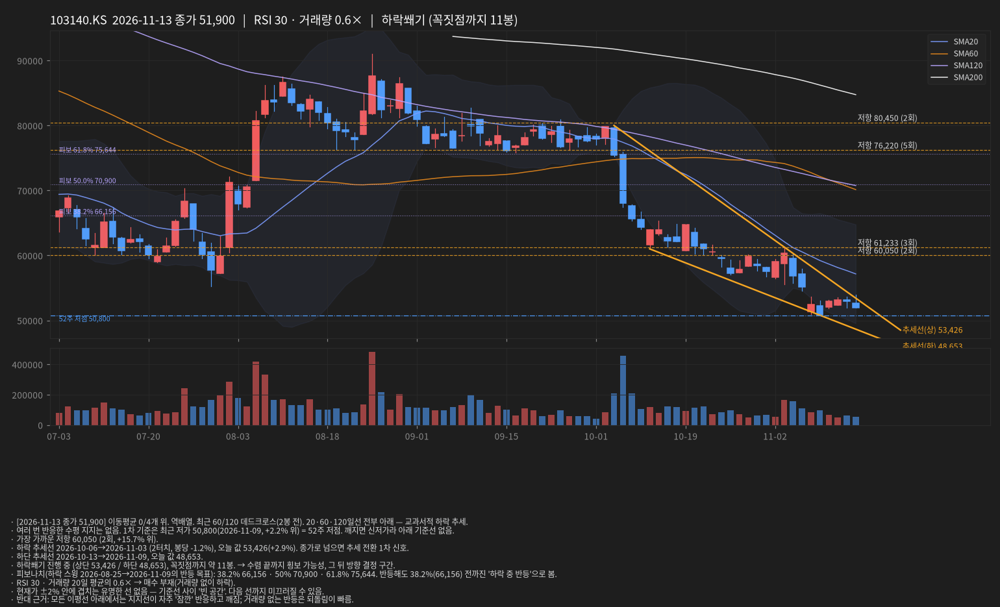
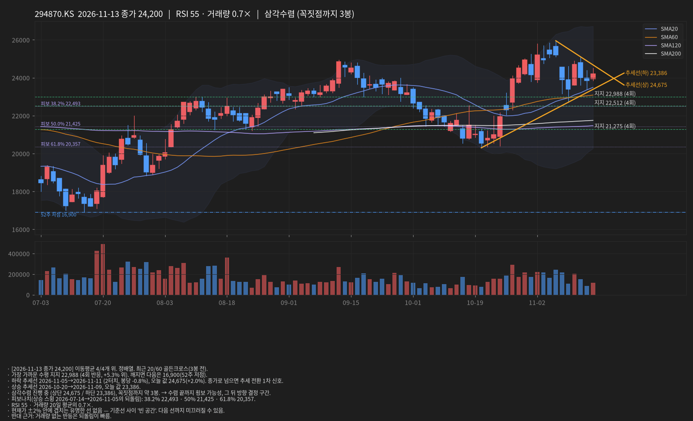
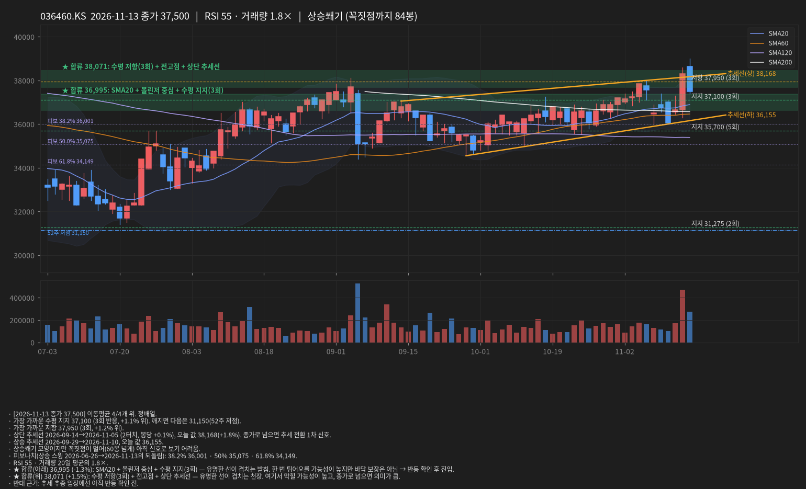
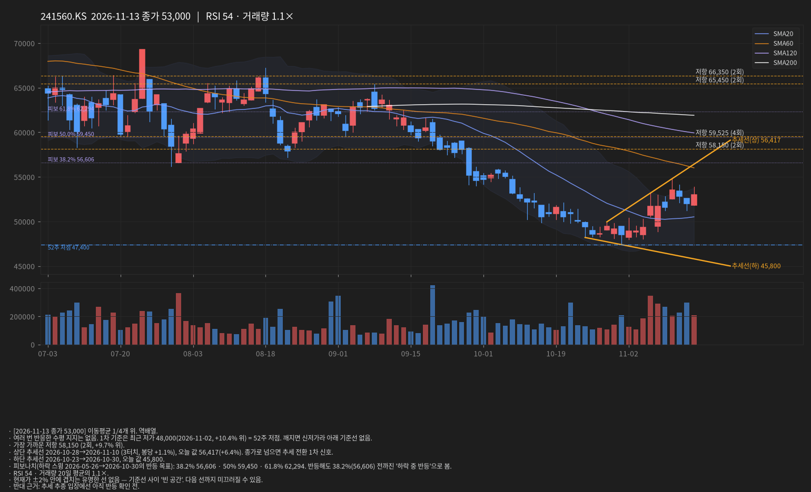
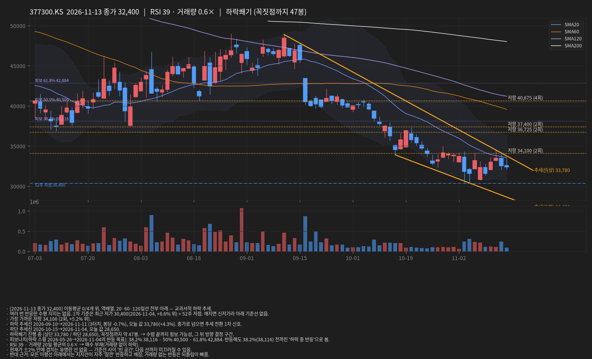

# 선 긋기 리포트 · 2026-11-14 12:55 KST

데이터: 야후 파이낸스 일봉(15분 지연) · 문장은 가능성 표현, 확률 아님

## INFQ · 2026-11-13 종가 8.48

- [2026-11-13 종가 8.48] 이동평균 0/3개 위. 역배열. 20·60·120일선 전부 아래 — 교과서적 하락 추세.
- 가장 가까운 수평 지지 8.41 (2회 반응, +0.8% 위). 깨지면 다음은 7.01(52주 저점).
- 가장 가까운 저항 8.77 (2회, +3.4% 위).
- 하락 추세선 2026-09-23→2026-11-09 (2터치, 봉당 -1.1%), 오늘 값 9.20(+8.4%). 종가로 넘으면 추세 전환 1차 신호.
- 상승 추세선 2026-11-05→2026-11-13, 오늘 값 8.20.
- 삼각수렴 진행 중 (상단 9.20 / 하단 8.20), 꼭짓점까지 약 3봉. → 수렴 끝까지 횡보 가능성, 그 뒤 방향 결정 구간.
- 피보나치(하락 스윙 2026-06-02→2026-11-05의 반등 목표): 38.2% 12.26 · 50% 13.88 · 61.8% 15.50. 반등해도 38.2%(12.26) 전까진 '하락 중 반등'으로 봄.
- RSI 42 · 거래량 20일 평균의 0.6× → 매수 부재(거래량 없이 하락).
- 현재가 ±2% 안에 겹치는 유명한 선 없음 — 기준선 사이 '빈 공간'. 다음 선까지 미끄러질 수 있음.
- 반대 근거: 모든 이평선 아래에서는 지지선이 자주 '잠깐' 반응하고 깨짐; 거래량 없는 반등은 되돌림이 빠름.

## 005930.KS · 2026-11-13 종가 206,000

- [2026-11-13 종가 206,000] 이동평균 0/4개 위. 역배열. 20·60·120일선 전부 아래 — 교과서적 하락 추세.
- 가장 가까운 수평 지지 204,000 (2회 반응, +1.0% 위). 깨지면 다음은 94,500(52주 저점).
- 가장 가까운 저항 245,125 (4회, +19.0% 위).
- 하락 추세선 2026-10-07→2026-10-29 (2터치, 봉당 -0.7%), 오늘 값 226,633(+10.0%). 종가로 넘으면 추세 전환 1차 신호.
- 상승 추세선 2026-11-06→2026-11-13, 오늘 값 205,000.
- 삼각수렴 진행 중 (상단 226,633 / 하단 205,000), 꼭짓점까지 약 3봉. → 수렴 끝까지 횡보 가능성, 그 뒤 방향 결정 구간.
- 피보나치(하락 스윙 2026-06-19→2026-11-06의 반등 목표): 38.2% 253,805 · 50% 276,850 · 61.8% 299,895. 반등해도 38.2%(253,805) 전까진 '하락 중 반등'으로 봄.
- RSI 42 · 거래량 20일 평균의 0.7× → 매수 부재(거래량 없이 하락).
- ★ 합류(아래) 204,500 (-0.7%): 수평 지지(2회) + 상승 추세선 — 유명한 선이 겹치는 받침. 한 번 튀어오를 가능성이 높지만 바닥 보장은 아님 → 반등 확인 후 진입.
- 반대 근거: 모든 이평선 아래에서는 지지선이 자주 '잠깐' 반응하고 깨짐; 거래량 없는 반등은 되돌림이 빠름.

## 000660.KS · 2026-11-13 종가 1,216,000

- [2026-11-13 종가 1,216,000] 이동평균 0/4개 위. 역배열. 20·60·120일선 전부 아래 — 교과서적 하락 추세.
- 여러 번 반응한 수평 지지는 없음. 1차 기준은 최근 저가 1,089,000(2026-11-06, +11.7% 위). 그 아래는 1년 내 기준선이 멀어 올해 상승분 되돌림 구간(피보나치 참고).
- 가장 가까운 저항 1,557,500 (2회, +28.1% 위).
- 하락 추세선 2026-11-05→2026-11-13 (3터치, 봉당 -0.0%), 오늘 값 1,317,000(+8.3%). 종가로 넘으면 추세 전환 1차 신호.
- 하단 추세선 2026-10-20→2026-11-06, 오늘 값 1,052,846.
- 피보나치(하락 스윙 2026-06-25→2026-11-06의 반등 목표): 38.2% 1,814,036 · 50% 2,038,000 · 61.8% 2,261,964. 반등해도 38.2%(1,814,036) 전까진 '하락 중 반등'으로 봄.
- RSI 40 · 거래량 20일 평균의 0.8×.
- 현재가 ±2% 안에 겹치는 유명한 선 없음 — 기준선 사이 '빈 공간'. 다음 선까지 미끄러질 수 있음.
- 반대 근거: 모든 이평선 아래에서는 지지선이 자주 '잠깐' 반응하고 깨짐.

## 277810.KQ · 2026-11-13 종가 363,500

- [2026-11-13 종가 363,500] 이동평균 1/4개 위. 역배열. 
- 가장 가까운 수평 지지 342,000 (2회 반응, +6.3% 위). 깨지면 다음은 300,500(52주 저점).
- 가장 가까운 저항 364,250 (2회, +0.2% 위).
- 하락 추세선 2026-10-07→2026-10-28 (2터치, 봉당 -0.9%), 오늘 값 356,714(-1.9%). 종가로 넘으면 추세 전환 1차 신호.
- 하단 추세선 2026-10-19→2026-11-06, 오늘 값 288,357.
- 하락쐐기 진행 중 (상단 356,714 / 하단 288,357), 꼭짓점까지 약 35봉. → 수렴 끝까지 횡보 가능성, 그 뒤 방향 결정 구간.
- 피보나치(하락 스윙 2026-06-02→2026-11-06의 반등 목표): 38.2% 508,499 · 50% 572,750 · 61.8% 637,001. 반등해도 38.2%(508,499) 전까진 '하락 중 반등'으로 봄.
- RSI 50 · 거래량 20일 평균의 2.6×.
- 현재가 ±2% 안에 겹치는 유명한 선 없음 — 기준선 사이 '빈 공간'. 다음 선까지 미끄러질 수 있음.
- 반대 근거: 추세 추종 입장에선 아직 반등 확인 전.

## 259960.KS · 2026-11-13 종가 199,100

- [2026-11-13 종가 199,100] 이동평균 1/4개 위. 역배열. 
- 여러 번 반응한 수평 지지는 없음. 1차 기준은 최근 저가 179,300(2026-11-03, +11.0% 위) = 52주 저점. 깨지면 신저가라 아래 기준선 없음.
- 가장 가까운 저항 216,167 (3회, +8.6% 위).
- 상단 추세선 2026-09-14→2026-11-09 (2터치, 봉당 +0.2%), 오늘 값 227,833(+14.4%). 종가로 넘으면 추세 전환 1차 신호.
- 상승 추세선 2026-10-30→2026-11-11, 오늘 값 193,000.
- 상승쐐기 진행 중 (상단 227,833 / 하단 193,000), 꼭짓점까지 약 31봉. → 수렴 끝까지 횡보 가능성, 그 뒤 방향 결정 구간.
- 피보나치(하락 스윙 2026-05-20→2026-10-30의 반등 목표): 38.2% 216,318 · 50% 228,000 · 61.8% 239,682. 반등해도 38.2%(216,318) 전까진 '하락 중 반등'으로 봄.
- RSI 49 · 거래량 20일 평균의 0.8×.
- ★ 합류(아래) 196,395 (-1.4%): SMA20 + 볼린저 중심 — 유명한 선이 겹치는 받침. 한 번 튀어오를 가능성이 높지만 바닥 보장은 아님 → 반등 확인 후 진입.
- 반대 근거: 추세 추종 입장에선 아직 반등 확인 전.

## 103140.KS · 2026-11-13 종가 51,900

- [2026-11-13 종가 51,900] 이동평균 0/4개 위. 역배열. 최근 60/120 데드크로스(2봉 전). 20·60·120일선 전부 아래 — 교과서적 하락 추세.
- 여러 번 반응한 수평 지지는 없음. 1차 기준은 최근 저가 50,800(2026-11-09, +2.2% 위) = 52주 저점. 깨지면 신저가라 아래 기준선 없음.
- 가장 가까운 저항 60,050 (2회, +15.7% 위).
- 하락 추세선 2026-10-06→2026-11-03 (2터치, 봉당 -1.2%), 오늘 값 53,426(+2.9%). 종가로 넘으면 추세 전환 1차 신호.
- 하단 추세선 2026-10-13→2026-11-09, 오늘 값 48,653.
- 하락쐐기 진행 중 (상단 53,426 / 하단 48,653), 꼭짓점까지 약 11봉. → 수렴 끝까지 횡보 가능성, 그 뒤 방향 결정 구간.
- 피보나치(하락 스윙 2026-08-25→2026-11-09의 반등 목표): 38.2% 66,156 · 50% 70,900 · 61.8% 75,644. 반등해도 38.2%(66,156) 전까진 '하락 중 반등'으로 봄.
- RSI 30 · 거래량 20일 평균의 0.6× → 매수 부재(거래량 없이 하락).
- 현재가 ±2% 안에 겹치는 유명한 선 없음 — 기준선 사이 '빈 공간'. 다음 선까지 미끄러질 수 있음.
- 반대 근거: 모든 이평선 아래에서는 지지선이 자주 '잠깐' 반응하고 깨짐; 거래량 없는 반등은 되돌림이 빠름.

## 120110.KS · 2026-11-13 종가 36,750

- [2026-11-13 종가 36,750] 이동평균 0/4개 위. 역배열. 20·60·120일선 전부 아래 — 교과서적 하락 추세.
- 여러 번 반응한 수평 지지는 없음. 1차 기준은 최근 저가 34,000(2026-11-12, +8.1% 위) = 52주 저점. 깨지면 신저가라 아래 기준선 없음.
- 가장 가까운 저항 37,700 (2회, +2.6% 위).
- 하락 추세선 2026-11-05→2026-11-11 (2터치, 봉당 -2.3%), 오늘 값 36,825(+0.2%). 종가로 넘으면 추세 전환 1차 신호.
- 하단 추세선 2026-10-30→2026-11-09, 오늘 값 34,617.
- 하락쐐기 진행 중 (상단 36,825 / 하단 34,617), 꼭짓점까지 약 3봉. → 수렴 끝까지 횡보 가능성, 그 뒤 방향 결정 구간.
- 피보나치(하락 스윙 2026-05-26→2026-11-12의 반등 목표): 38.2% 51,725 · 50% 57,200 · 61.8% 62,675. 반등해도 38.2%(51,725) 전까진 '하락 중 반등'으로 봄.
- RSI 34 · 거래량 20일 평균의 1.1×.
- 현재가 ±2% 안에 겹치는 유명한 선 없음 — 기준선 사이 '빈 공간'. 다음 선까지 미끄러질 수 있음.
- 반대 근거: 모든 이평선 아래에서는 지지선이 자주 '잠깐' 반응하고 깨짐.

## 010140.KS · 2026-11-13 종가 16,610

- [2026-11-13 종가 16,610] 이동평균 0/4개 위. 역배열. 20·60·120일선 전부 아래 — 교과서적 하락 추세.
- 가장 가까운 수평 지지 15,290 (2회 반응, +8.6% 위). 깨지면 다음은 15,260(52주 저점).
- 가장 가까운 저항 19,585 (2회, +17.9% 위).
- 하락 추세선 2026-10-06→2026-11-04 (3터치, 봉당 -0.5%), 오늘 값 17,315(+4.2%). 종가로 넘으면 추세 전환 1차 신호.
- 하단 추세선 2026-10-30→2026-11-09, 오늘 값 15,220.
- 하락쐐기 진행 중 (상단 17,315 / 하단 15,220), 꼭짓점까지 약 22봉. → 수렴 끝까지 횡보 가능성, 그 뒤 방향 결정 구간.
- 피보나치(하락 스윙 2026-05-26→2026-11-09의 반등 목표): 38.2% 21,254 · 50% 23,105 · 61.8% 24,956. 반등해도 38.2%(21,254) 전까진 '하락 중 반등'으로 봄.
- RSI 44 · 거래량 20일 평균의 1.5×.
- ★ 합류(위) 16,735 (+0.8%): SMA20 + 볼린저 중심 — 유명한 선이 겹치는 천장. 여기서 막힐 가능성이 높고, 종가로 넘으면 의미가 큼.
- 반대 근거: 모든 이평선 아래에서는 지지선이 자주 '잠깐' 반응하고 깨짐.

## 294870.KS · 2026-11-13 종가 24,200

- [2026-11-13 종가 24,200] 이동평균 4/4개 위. 정배열. 최근 20/60 골든크로스(3봉 전). 
- 가장 가까운 수평 지지 22,988 (4회 반응, +5.3% 위). 깨지면 다음은 16,900(52주 저점).
- 하락 추세선 2026-11-05→2026-11-11 (2터치, 봉당 -0.8%), 오늘 값 24,675(+2.0%). 종가로 넘으면 추세 전환 1차 신호.
- 상승 추세선 2026-10-20→2026-11-09, 오늘 값 23,386.
- 삼각수렴 진행 중 (상단 24,675 / 하단 23,386), 꼭짓점까지 약 3봉. → 수렴 끝까지 횡보 가능성, 그 뒤 방향 결정 구간.
- 피보나치(상승 스윙 2026-07-14→2026-11-05의 되돌림): 38.2% 22,493 · 50% 21,425 · 61.8% 20,357. 
- RSI 55 · 거래량 20일 평균의 0.7×.
- 현재가 ±2% 안에 겹치는 유명한 선 없음 — 기준선 사이 '빈 공간'. 다음 선까지 미끄러질 수 있음.
- 반대 근거: 거래량 없는 반등은 되돌림이 빠름.

## 036460.KS · 2026-11-13 종가 37,500

- [2026-11-13 종가 37,500] 이동평균 4/4개 위. 정배열. 
- 가장 가까운 수평 지지 37,100 (3회 반응, +1.1% 위). 깨지면 다음은 31,150(52주 저점).
- 가장 가까운 저항 37,950 (3회, +1.2% 위).
- 상단 추세선 2026-09-14→2026-11-05 (2터치, 봉당 +0.1%), 오늘 값 38,168(+1.8%). 종가로 넘으면 추세 전환 1차 신호.
- 상승 추세선 2026-09-29→2026-11-10, 오늘 값 36,155.
- 상승쐐기 모양이지만 꼭짓점이 멀어(60봉 넘게) 아직 신호로 보기 어려움.
- 피보나치(상승 스윙 2026-06-26→2026-11-13의 되돌림): 38.2% 36,001 · 50% 35,075 · 61.8% 34,149. 
- RSI 55 · 거래량 20일 평균의 1.8×.
- ★ 합류(아래) 36,995 (-1.3%): SMA20 + 볼린저 중심 + 수평 지지(3회) — 유명한 선이 겹치는 받침. 한 번 튀어오를 가능성이 높지만 바닥 보장은 아님 → 반등 확인 후 진입.
- ★ 합류(위) 38,071 (+1.5%): 수평 저항(3회) + 전고점 + 상단 추세선 — 유명한 선이 겹치는 천장. 여기서 막힐 가능성이 높고, 종가로 넘으면 의미가 큼.
- 반대 근거: 추세 추종 입장에선 아직 반등 확인 전.

## 241560.KS · 2026-11-13 종가 53,000

- [2026-11-13 종가 53,000] 이동평균 1/4개 위. 역배열. 
- 여러 번 반응한 수평 지지는 없음. 1차 기준은 최근 저가 48,000(2026-11-02, +10.4% 위) = 52주 저점. 깨지면 신저가라 아래 기준선 없음.
- 가장 가까운 저항 58,150 (2회, +9.7% 위).
- 상단 추세선 2026-10-28→2026-11-10 (3터치, 봉당 +1.1%), 오늘 값 56,417(+6.4%). 종가로 넘으면 추세 전환 1차 신호.
- 하단 추세선 2026-10-23→2026-10-30, 오늘 값 45,800.
- 피보나치(하락 스윙 2026-05-26→2026-10-30의 반등 목표): 38.2% 56,606 · 50% 59,450 · 61.8% 62,294. 반등해도 38.2%(56,606) 전까진 '하락 중 반등'으로 봄.
- RSI 54 · 거래량 20일 평균의 1.1×.
- 현재가 ±2% 안에 겹치는 유명한 선 없음 — 기준선 사이 '빈 공간'. 다음 선까지 미끄러질 수 있음.
- 반대 근거: 추세 추종 입장에선 아직 반등 확인 전.

## 377300.KS · 2026-11-13 종가 32,400

- [2026-11-13 종가 32,400] 이동평균 0/4개 위. 역배열. 20·60·120일선 전부 아래 — 교과서적 하락 추세.
- 여러 번 반응한 수평 지지는 없음. 1차 기준은 최근 저가 30,400(2026-11-04, +6.6% 위) = 52주 저점. 깨지면 신저가라 아래 기준선 없음.
- 가장 가까운 저항 34,100 (2회, +5.2% 위).
- 하락 추세선 2026-09-10→2026-11-11 (3터치, 봉당 -0.7%), 오늘 값 33,780(+4.3%). 종가로 넘으면 추세 전환 1차 신호.
- 하단 추세선 2026-10-15→2026-11-04, 오늘 값 28,650.
- 하락쐐기 진행 중 (상단 33,780 / 하단 28,650), 꼭짓점까지 약 47봉. → 수렴 끝까지 횡보 가능성, 그 뒤 방향 결정 구간.
- 피보나치(하락 스윙 2026-05-26→2026-11-04의 반등 목표): 38.2% 38,116 · 50% 40,500 · 61.8% 42,884. 반등해도 38.2%(38,116) 전까진 '하락 중 반등'으로 봄.
- RSI 39 · 거래량 20일 평균의 0.6× → 매수 부재(거래량 없이 하락).
- 현재가 ±2% 안에 겹치는 유명한 선 없음 — 기준선 사이 '빈 공간'. 다음 선까지 미끄러질 수 있음.
- 반대 근거: 모든 이평선 아래에서는 지지선이 자주 '잠깐' 반응하고 깨짐; 거래량 없는 반등은 되돌림이 빠름.

## 알림
- [dn] **INFQ** 손절 이탈: 8.48으로 마감해 손절선(8.57) 아래예요. 규칙대로면 단기분 정리 — 다음 장 시작가 확인.
- [ok] **005930.KS** 합류 받침: 204,500까지 −0.7%. 기준 두세 개가 겹친 자리예요 — 반등을 확인하고 판단하세요.
- [up] **277810.KQ** 추세선 돌파: 363,500으로 마감해 흐름선(356,714) 위로 올라섰어요. 내일도 위면 1/3 매수 검토.
- [ok] **259960.KS** 합류 받침: 196,395까지 −1.4%. 기준 두세 개가 겹친 자리예요 — 반등을 확인하고 판단하세요.
- [warn] **010140.KS** 합류 천장: 16,735까지 +0.8%. 넘어서 마감하면 의미가 커요.
- [ok] **036460.KS** 합류 받침: 36,995까지 −1.3%. 기준 두세 개가 겹친 자리예요 — 반등을 확인하고 판단하세요.
- [warn] **036460.KS** 합류 천장: 38,071까지 +1.5%. 넘어서 마감하면 의미가 커요.

## 급락/급등 원인 분해
- [2026-11-13] INFQ -2.9% = 지수 -1.2%(β3.0×^GSPC -0.4%) + 업종 -5.0%(양자 피어 -5.4%) + 종목 고유 +3.3%. 주원인: 업종 · 거래량 0.6× → 매수 부재(거래량 없이 하락). 섹터 FUD 성격 — 펀더멘털 변화 없으면 플레이북 유지.
- [2026-11-13] 005930.KS -1.0% = 지수 -1.3%(β1.3×^KS11 -1.0%) + 업종 -2.4%(반도체 피어 -3.4%) + 종목 고유 +2.7%. 주원인: 종목 고유 · 거래량 0.7× → 매수 부재(거래량 없이 하락).
- [2026-11-13] 000660.KS -3.0% = 지수 -1.6%(β1.7×^KS11 -1.0%) + 업종 -1.3%(반도체 피어 -2.3%) + 종목 고유 -0.1%. 주원인: 지수 · 거래량 0.8× → 보통. 시장 전체 움직임 — 종목 판단과 분리.
- [2026-10-19] 013030.KQ -0.5% = 지수 +0.9%(β0.5×^KQ11 +1.8%) + 업종 +0.0% + 종목 고유 -1.4%. 주원인: 종목 고유 · 거래량 0.5× → 매수 부재(거래량 없이 하락).
- [2026-10-19] 054950.KQ -0.2% = 지수 +0.3%(β0.2×^KQ11 +1.8%) + 업종 +0.0% + 종목 고유 -0.6%. 주원인: 종목 고유 · 거래량 0.9× → 보통.
- [2026-10-19] 236200.KQ +1.2% = 지수 +1.2%(β0.7×^KQ11 +1.8%) + 업종 +0.0% + 종목 고유 +0.0%. 주원인: 지수 · 거래량 0.5× → 보통. 시장 전체 움직임 — 종목 판단과 분리.
- [2026-10-19] 036800.KQ -1.4% = 지수 +0.1%(β0.1×^KQ11 +1.8%) + 업종 +0.0% + 종목 고유 -1.5%. 주원인: 종목 고유 · 거래량 0.3× → 매수 부재(거래량 없이 하락).
- [2026-10-19] 200670.KQ +2.2% = 지수 +1.1%(β0.6×^KQ11 +1.8%) + 업종 +0.0% + 종목 고유 +1.1%. 주원인: 지수 · 거래량 0.4× → 보통. 시장 전체 움직임 — 종목 판단과 분리.
- [2026-10-19] 015230.KS +1.1% = 지수 +0.3%(β0.2×^KS11 +1.8%) + 업종 +0.0% + 종목 고유 +0.8%. 주원인: 종목 고유 · 거래량 1.0× → 보통.
- [2026-10-19] 044960.KQ +0.3% = 지수 +0.3%(β0.2×^KQ11 +1.8%) + 업종 +0.0% + 종목 고유 +0.0%. 주원인: 지수 · 거래량 0.4× → 보통. 시장 전체 움직임 — 종목 판단과 분리.

## 판단 보드
- **INFQ** [exit] 손절선 8.57 아래 마감 — 규칙대로면 단기분 정리
- **005930.KS** [wait] 기다림 — 매수 조건까지 +11.7%
- **000660.KS** [wait] 기다림 — 흐름선까지 +8.3%
- **277810.KQ** [enter] 하락 흐름 끊김 — 종가 363,500 ≥ 흐름선 356,714 · 내일도 위면 1/3 검토
- **259960.KS** [wait] 기다림 — 바닥 후보 196,395 (-1.4%) 위. 반등 확인 전엔 사지 않기
- **103140.KS** [wait] 기다림 — 흐름선까지 +2.9%
- **120110.KS** [wait] 기다림 — 흐름선까지 +0.2%
- **010140.KS** [wait] 기다림 — 막힐 자리 16,735 (+0.8%) 아래. 넘어서 마감하면 다시 판단
- **294870.KS** [wait] 기다림 — 흐름선까지 +2.0%
- **036460.KS** [wait] 기다림 — 바닥 후보 36,995 (-1.3%) 위. 반등 확인 전엔 사지 않기
- **241560.KS** [wait] 기다림 — 흐름선까지 +6.4%
- **377300.KS** [wait] 기다림 — 흐름선까지 +4.3%
