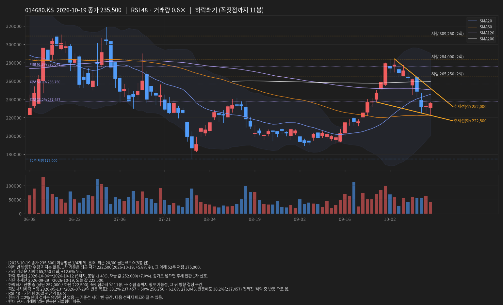
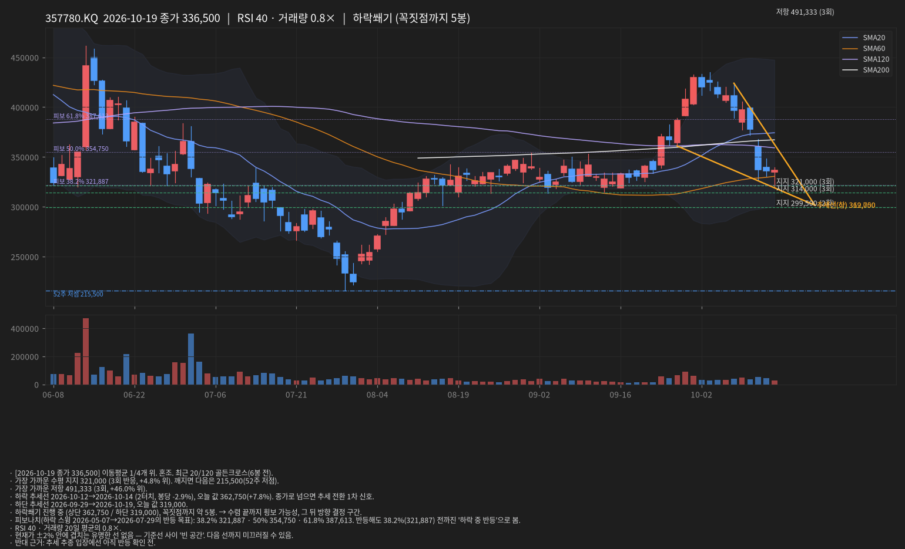

# 선 긋기 리포트 · 2026-10-20 10:18 KST

데이터: 야후 파이낸스 일봉(15분 지연) · 문장은 가능성 표현, 확률 아님

## INFQ · 2026-10-19 종가 8.75

- [2026-10-19 종가 8.75] 이동평균 0/3개 위. 역배열. 최근 20/120 데드크로스(3봉 전). 20·60·120일선 전부 아래 — 교과서적 하락 추세.
- 여러 번 반응한 수평 지지는 없음. 1차 기준은 최근 저가 8.42(2026-10-16, +3.9% 위) = 52주 저점. 깨지면 신저가라 아래 기준선 없음.
- 가장 가까운 저항 8.77 (2회, +0.2% 위).
- 하락 추세선 2026-10-09→2026-10-19 (4터치, 봉당 -3.6%), 오늘 값 8.94(+2.2%). 종가로 넘으면 추세 전환 1차 신호.
- 하단 추세선 2026-09-21→2026-10-15, 오늘 값 8.03.
- 하락쐐기 진행 중 (상단 8.94 / 하단 8.03), 꼭짓점까지 약 7봉. → 수렴 끝까지 횡보 가능성, 그 뒤 방향 결정 구간.
- 피보나치(하락 스윙 2026-06-02→2026-10-16의 반등 목표): 38.2% 13.13 · 50% 14.59 · 61.8% 16.04. 반등해도 38.2%(13.13) 전까진 '하락 중 반등'으로 봄.
- RSI 26 과매도 · 거래량 20일 평균의 0.7×.
- 현재가 ±2% 안에 겹치는 유명한 선 없음 — 기준선 사이 '빈 공간'. 다음 선까지 미끄러질 수 있음.
- 반대 근거: RSI 과매도는 하락 추세에서 며칠씩 유지될 수 있음; 모든 이평선 아래에서는 지지선이 자주 '잠깐' 반응하고 깨짐.

## 005930.KS · 2026-10-19 종가 218,000

- [2026-10-19 종가 218,000] 이동평균 0/4개 위. 혼조. 20·60·120일선 전부 아래 — 교과서적 하락 추세.
- 여러 번 반응한 수평 지지는 없음. 1차 기준은 최근 저가 204,500(2026-10-15, +6.6% 위). 그 아래는 1년 내 기준선이 멀어 올해 상승분 되돌림 구간(피보나치 참고).
- 가장 가까운 저항 245,125 (4회, +12.4% 위).
- 하락 추세선 2026-10-07→2026-10-19 (4터치, 봉당 -3.1%), 오늘 값 219,500(+0.7%). 종가로 넘으면 추세 전환 1차 신호.
- 하단 추세선 2026-08-31→2026-10-15, 오늘 값 201,638.
- 하락쐐기 진행 중 (상단 219,500 / 하단 201,638), 꼭짓점까지 약 3봉. → 수렴 끝까지 횡보 가능성, 그 뒤 방향 결정 구간.
- 피보나치(하락 스윙 2026-06-19→2026-07-29의 반등 목표): 38.2% 259,985 · 50% 281,850 · 61.8% 303,715. 반등해도 38.2%(259,985) 전까진 '하락 중 반등'으로 봄.
- RSI 33 · 거래량 20일 평균의 1.0×.
- 현재가 ±2% 안에 겹치는 유명한 선 없음 — 기준선 사이 '빈 공간'. 다음 선까지 미끄러질 수 있음.
- 반대 근거: 모든 이평선 아래에서는 지지선이 자주 '잠깐' 반응하고 깨짐.

## 000660.KS · 2026-10-19 종가 1,277,000

- [2026-10-19 종가 1,277,000] 이동평균 0/4개 위. 혼조. 20·60·120일선 전부 아래 — 교과서적 하락 추세.
- 여러 번 반응한 수평 지지는 없음. 1차 기준은 최근 저가 1,208,000(2026-10-19, +5.7% 위). 그 아래는 1년 내 기준선이 멀어 올해 상승분 되돌림 구간(피보나치 참고).
- 가장 가까운 저항 1,557,500 (2회, +22.0% 위).
- 하락 추세선 2026-10-12→2026-10-19 (3터치, 봉당 -4.5%), 오늘 값 1,277,000(+0.0%). 종가로 넘으면 추세 전환 1차 신호.
- 하단 추세선 2026-09-17→2026-10-15, 오늘 값 1,175,875.
- 하락쐐기 진행 중 (상단 1,277,000 / 하단 1,175,875), 꼭짓점까지 약 2봉. → 수렴 끝까지 횡보 가능성, 그 뒤 방향 결정 구간.
- 피보나치(상승 스윙 2026-04-23→2026-06-25의 되돌림): 38.2% 2,297,872 · 50% 2,085,000 · 61.8% 1,872,128. 61.8% 아래 — 되돌림이 깊어 상승 추세 자체가 의심되는 구간.
- RSI 26 과매도 · 거래량 20일 평균의 1.1×.
- 현재가 ±2% 안에 겹치는 유명한 선 없음 — 기준선 사이 '빈 공간'. 다음 선까지 미끄러질 수 있음.
- 반대 근거: RSI 과매도는 하락 추세에서 며칠씩 유지될 수 있음; 모든 이평선 아래에서는 지지선이 자주 '잠깐' 반응하고 깨짐.

## 039490.KS · 2026-10-19 종가 228,500

- [2026-10-19 종가 228,500] 이동평균 0/4개 위. 역배열. 20·60·120일선 전부 아래 — 교과서적 하락 추세.
- 여러 번 반응한 수평 지지는 없음. 1차 기준은 최근 저가 205,000(2026-10-15, +11.5% 위) = 52주 저점. 깨지면 신저가라 아래 기준선 없음.
- 가장 가까운 저항 260,250 (2회, +13.9% 위).
- 하락 추세선 2026-09-01→2026-09-22 (4터치, 봉당 -0.3%), 오늘 값 260,500(+14.0%). 종가로 넘으면 추세 전환 1차 신호.
- 하단 추세선 2026-08-31→2026-10-15, 오늘 값 200,586.
- 피보나치(하락 스윙 2026-05-06→2026-10-15의 반등 목표): 38.2% 314,825 · 50% 348,750 · 61.8% 382,675. 반등해도 38.2%(314,825) 전까진 '하락 중 반등'으로 봄.
- RSI 36 · 거래량 20일 평균의 0.6×.
- 현재가 ±2% 안에 겹치는 유명한 선 없음 — 기준선 사이 '빈 공간'. 다음 선까지 미끄러질 수 있음.
- 반대 근거: 모든 이평선 아래에서는 지지선이 자주 '잠깐' 반응하고 깨짐; 거래량 없는 반등은 되돌림이 빠름.

## 214450.KQ · 2026-10-19 종가 277,500

- [2026-10-19 종가 277,500] 이동평균 0/4개 위. 혼조. 최근 20/120 데드크로스(8봉 전). 20·60·120일선 전부 아래 — 교과서적 하락 추세.
- 여러 번 반응한 수평 지지는 없음. 1차 기준은 최근 저가 251,500(2026-10-15, +10.3% 위) = 52주 저점. 깨지면 신저가라 아래 기준선 없음.
- 가장 가까운 저항 284,500 (2회, +2.5% 위).
- 하락 추세선 2026-08-28→2026-10-02 (2터치, 봉당 -1.3%), 오늘 값 270,717(-2.4%). 종가로 넘으면 추세 전환 1차 신호.
- 하단 추세선 2026-08-18→2026-10-15, 오늘 값 244,737.
- 하락쐐기 진행 중 (상단 270,717 / 하단 244,737), 꼭짓점까지 약 10봉. → 수렴 끝까지 횡보 가능성, 그 뒤 방향 결정 구간.
- 피보나치(하락 스윙 2026-08-28→2026-10-15의 반등 목표): 38.2% 333,248 · 50% 358,500 · 61.8% 383,752. 반등해도 38.2%(333,248) 전까진 '하락 중 반등'으로 봄.
- RSI 32 · 거래량 20일 평균의 0.4× → 매수 부재(거래량 없이 하락).
- 현재가 ±2% 안에 겹치는 유명한 선 없음 — 기준선 사이 '빈 공간'. 다음 선까지 미끄러질 수 있음.
- 반대 근거: 모든 이평선 아래에서는 지지선이 자주 '잠깐' 반응하고 깨짐; 거래량 없는 반등은 되돌림이 빠름.

## 001120.KS · 2026-10-19 종가 44,800

- [2026-10-19 종가 44,800] 이동평균 4/4개 위. 혼조. 최근 20/120 골든크로스(7봉 전). 
- 가장 가까운 수평 지지 42,730 (5회 반응, +4.8% 위). 깨지면 다음은 29,000(52주 저점).
- 상단 추세선 2026-08-20→2026-10-14 (4터치, 봉당 +0.5%), 오늘 값 45,831(+2.3%). 종가로 넘으면 추세 전환 1차 신호.
- 상승 추세선 2026-08-24→2026-09-29, 오늘 값 41,000.
- 피보나치(하락 스윙 2026-04-29→2026-06-23의 반등 목표): 38.2% 42,466 · 50% 45,375 · 61.8% 48,284. 반등해도 38.2%(42,466) 전까진 '하락 중 반등'으로 봄.
- RSI 65 · 거래량 20일 평균의 0.5×.
- ★ 합류(위) 45,338 (+1.2%): 전고점 + 피보 50.0% — 유명한 선이 겹치는 천장. 여기서 막힐 가능성이 높고, 종가로 넘으면 의미가 큼.
- 반대 근거: 거래량 없는 반등은 되돌림이 빠름.

## 011200.KS · 2026-10-19 종가 24,000

- [2026-10-19 종가 24,000] 이동평균 4/4개 위. 정배열. 최근 20/60 골든크로스(3봉 전). 
- 가장 가까운 수평 지지 21,990 (5회 반응, +9.1% 위). 깨지면 다음은 17,910(52주 저점).
- 하락 추세선 2026-08-18→2026-10-06 (3터치, 봉당 -0.2%), 오늘 값 21,150(-11.9%). 종가로 넘으면 추세 전환 1차 신호.
- 상승 추세선 2026-09-23→2026-10-12, 오늘 값 20,856.
- 피보나치(상승 스윙 2026-06-26→2026-10-16의 되돌림): 38.2% 21,828 · 50% 21,080 · 61.8% 20,332. 
- RSI 71 과매수 · 거래량 20일 평균의 3.2×.
- 현재가 ±2% 안에 겹치는 유명한 선 없음 — 기준선 사이 '빈 공간'. 다음 선까지 미끄러질 수 있음.
- 반대 근거: 추세 추종 입장에선 아직 반등 확인 전.

## 036460.KS · 2026-10-19 종가 36,800

- [2026-10-19 종가 36,800] 이동평균 4/4개 위. 정배열. 최근 60/120 골든크로스(2봉 전). 
- 가장 가까운 수평 지지 35,700 (3회 반응, +3.1% 위). 깨지면 다음은 31,150(52주 저점).
- 하락 추세선 2026-09-03→2026-10-07 (2터치, 봉당 -0.2%), 오늘 값 35,833(-2.6%). 종가로 넘으면 추세 전환 1차 신호.
- 상승 추세선 2026-09-29→2026-10-13, 오늘 값 35,225.
- 삼각수렴 진행 중 (상단 35,833 / 하단 35,225), 꼭짓점까지 약 4봉. → 수렴 끝까지 횡보 가능성, 그 뒤 방향 결정 구간.
- 피보나치(하락 스윙 2026-04-29→2026-06-26의 반등 목표): 38.2% 34,416 · 50% 35,425 · 61.8% 36,434. 반등해도 38.2%(34,416) 전까진 '하락 중 반등'으로 봄.
- 볼린저 폭이 60일 중 최저 수준(스퀴즈) → 곧 큰 움직임 가능성, 방향은 추세선·패턴 기준.
- RSI 58 · 거래량 20일 평균의 0.6×.
- ★ 합류(아래) 36,417 (-1.0%): 전고점 + 피보 61.8% — 유명한 선이 겹치는 받침. 한 번 튀어오를 가능성이 높지만 바닥 보장은 아님 → 반등 확인 후 진입.
- 반대 근거: 거래량 없는 반등은 되돌림이 빠름.

## 014680.KS · 2026-10-19 종가 235,500

- [2026-10-19 종가 235,500] 이동평균 1/4개 위. 혼조. 최근 20/60 골든크로스(8봉 전). 
- 여러 번 반응한 수평 지지는 없음. 1차 기준은 최근 저가 222,500(2026-10-19, +5.8% 위), 그 아래 52주 저점 175,000.
- 가장 가까운 저항 265,250 (2회, +12.6% 위).
- 하락 추세선 2026-10-06→2026-10-12 (5터치, 봉당 -1.4%), 오늘 값 252,000(+7.0%). 종가로 넘으면 추세 전환 1차 신호.
- 하단 추세선 2026-09-29→2026-10-19, 오늘 값 222,500.
- 하락쐐기 진행 중 (상단 252,000 / 하단 222,500), 꼭짓점까지 약 11봉. → 수렴 끝까지 횡보 가능성, 그 뒤 방향 결정 구간.
- 피보나치(하락 스윙 2026-05-13→2026-07-29의 반등 목표): 38.2% 237,457 · 50% 256,750 · 61.8% 276,043. 반등해도 38.2%(237,457) 전까진 '하락 중 반등'으로 봄.
- RSI 48 · 거래량 20일 평균의 0.6×.
- 현재가 ±2% 안에 겹치는 유명한 선 없음 — 기준선 사이 '빈 공간'. 다음 선까지 미끄러질 수 있음.
- 반대 근거: 거래량 없는 반등은 되돌림이 빠름.

## 357780.KQ · 2026-10-19 종가 336,500

- [2026-10-19 종가 336,500] 이동평균 1/4개 위. 혼조. 최근 20/120 골든크로스(6봉 전). 
- 가장 가까운 수평 지지 321,000 (3회 반응, +4.8% 위). 깨지면 다음은 215,500(52주 저점).
- 가장 가까운 저항 491,333 (3회, +46.0% 위).
- 하락 추세선 2026-10-12→2026-10-14 (2터치, 봉당 -2.9%), 오늘 값 362,750(+7.8%). 종가로 넘으면 추세 전환 1차 신호.
- 하단 추세선 2026-09-29→2026-10-19, 오늘 값 319,000.
- 하락쐐기 진행 중 (상단 362,750 / 하단 319,000), 꼭짓점까지 약 5봉. → 수렴 끝까지 횡보 가능성, 그 뒤 방향 결정 구간.
- 피보나치(하락 스윙 2026-05-07→2026-07-29의 반등 목표): 38.2% 321,887 · 50% 354,750 · 61.8% 387,613. 반등해도 38.2%(321,887) 전까진 '하락 중 반등'으로 봄.
- RSI 40 · 거래량 20일 평균의 0.8×.
- 현재가 ±2% 안에 겹치는 유명한 선 없음 — 기준선 사이 '빈 공간'. 다음 선까지 미끄러질 수 있음.
- 반대 근거: 추세 추종 입장에선 아직 반등 확인 전.

## 알림
- [warn] **001120.KS** 합류 천장: ★45,338 (+1.2%) = 전고점 + 피보 50.0% — 막힐 수 있는 자리. 종가로 넘으면 의미 큼.
- [ok] **036460.KS** 합류 받침: ★36,417 (-1.0%) = 전고점 + 피보 61.8% — 튀어오를 수 있는 자리. 반등 확인 후 판단(바닥 보장 아님).

## 급락/급등 원인 분해
- [2026-10-19] INFQ +2.3% = 지수 +1.2%(β3.0×^GSPC +0.4%) + 업종 -8.3%(양자 피어 -7.8%) + 종목 고유 +9.4%. 주원인: 종목 고유 · 거래량 0.7× → 보통. 종목 고유 뉴스/공시를 먼저 확인.
- [2026-10-19] 005930.KS +1.2% = 지수 +2.9%(β1.4×^KS11 +2.0%) + 업종 -3.9%(반도체 피어 -1.9%) + 종목 고유 +2.2%. 주원인: 업종 · 거래량 1.0× → 보통. 섹터 FUD 성격 — 펀더멘털 변화 없으면 플레이북 유지.
- [2026-10-19] 000660.KS +0.4% = 지수 +3.3%(β1.6×^KS11 +2.0%) + 업종 -3.5%(반도체 피어 -1.5%) + 종목 고유 +0.6%. 주원인: 업종 · 거래량 1.1× → 보통. 섹터 FUD 성격 — 펀더멘털 변화 없으면 플레이북 유지.
- [2026-10-19] 013030.KQ -0.5% = 지수 +2.3%(β0.5×^KQ11 +4.5%) + 업종 +0.0% + 종목 고유 -2.8%. 주원인: 종목 고유 · 거래량 0.5× → 매수 부재(거래량 없이 하락).
- [2026-10-19] 054950.KQ -0.2% = 지수 +0.9%(β0.2×^KQ11 +4.5%) + 업종 +0.0% + 종목 고유 -1.1%. 주원인: 종목 고유 · 거래량 0.9× → 보통.
- [2026-10-19] 236200.KQ +1.2% = 지수 +3.1%(β0.7×^KQ11 +4.5%) + 업종 +0.0% + 종목 고유 -1.9%. 주원인: 지수 · 거래량 0.5× → 보통. 시장 전체 움직임 — 종목 판단과 분리.
- [2026-10-19] 036800.KQ -1.4% = 지수 +0.3%(β0.1×^KQ11 +4.5%) + 업종 +0.0% + 종목 고유 -1.7%. 주원인: 종목 고유 · 거래량 0.3× → 매수 부재(거래량 없이 하락).
- [2026-10-19] 200670.KQ +2.2% = 지수 +2.8%(β0.6×^KQ11 +4.5%) + 업종 +0.0% + 종목 고유 -0.6%. 주원인: 지수 · 거래량 0.4× → 보통. 시장 전체 움직임 — 종목 판단과 분리.
- [2026-10-19] 015230.KS +1.1% = 지수 +0.4%(β0.2×^KS11 +2.0%) + 업종 +0.0% + 종목 고유 +0.7%. 주원인: 종목 고유 · 거래량 1.0× → 보통.
- [2026-10-19] 044960.KQ +0.3% = 지수 +0.8%(β0.2×^KQ11 +4.5%) + 업종 +0.0% + 종목 고유 -0.4%. 주원인: 지수 · 거래량 0.4× → 보통. 시장 전체 움직임 — 종목 판단과 분리.

## 판단 보드
- **INFQ** [hold] 보유 — 손절까지 2.1% 여유
- **005930.KS** [wait] 조건 대기 — 진입선까지 +5.5%
- **000660.KS** [wait] 조건 대기 — 추세선까지 +0.0%
- **039490.KS** [wait] 관망 — 가까운 기준선 없음
- **214450.KQ** [wait] 관망 — 가까운 기준선 없음
- **001120.KS** [wait] 관망 — ★천장 45,338 (+1.2%) 아래. 종가 돌파 시 재검토
- **011200.KS** [wait] 관망 — 가까운 기준선 없음
- **036460.KS** [wait] 관망 — ★받침 36,417 (-1.0%) 위. 반등 확인 전 진입 없음
- **014680.KS** [wait] 관망 — 가까운 기준선 없음
- **357780.KQ** [wait] 관망 — 가까운 기준선 없음
