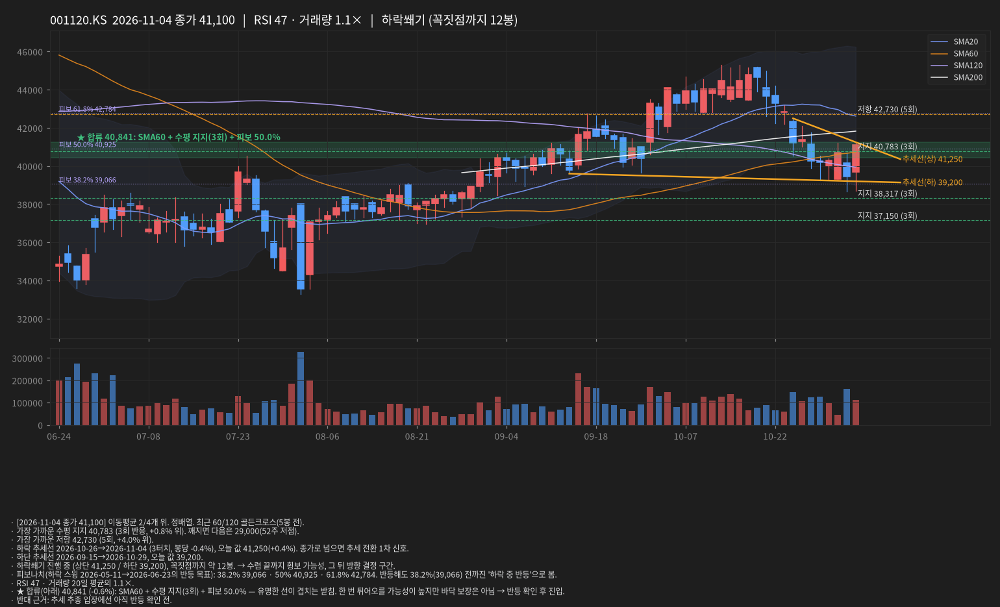
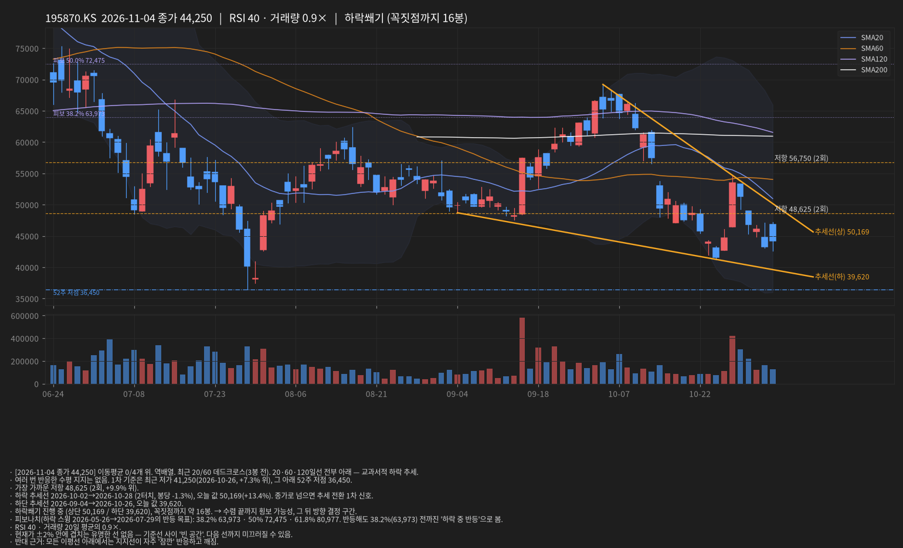
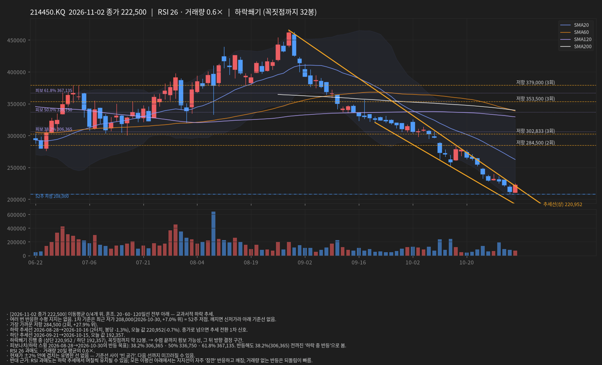

# 선 긋기 리포트 · 2026-11-03 02:01 KST

데이터: 야후 파이낸스 일봉(15분 지연) · 문장은 가능성 표현, 확률 아님

## INFQ · 2026-10-30 종가 8.88

- [2026-10-30 종가 8.88] 이동평균 0/3개 위. 역배열. 20·60·120일선 전부 아래 — 교과서적 하락 추세.
- 가장 가까운 수평 지지 8.77 (2회 반응, +1.3% 위). 깨지면 다음은 8.38(52주 저점).
- 가장 가까운 저항 12.24 (2회, +37.9% 위).
- 하락 추세선 2026-09-23→2026-10-28 (2터치, 봉당 -1.4%), 오늘 값 9.42(+6.1%). 종가로 넘으면 추세 전환 1차 신호.
- 상승 추세선 2026-10-20→2026-10-26, 오늘 값 8.52.
- 삼각수렴 진행 중 (상단 9.42 / 하단 8.52), 꼭짓점까지 약 4봉. → 수렴 끝까지 횡보 가능성, 그 뒤 방향 결정 구간.
- 피보나치(하락 스윙 2026-06-02→2026-10-20의 반등 목표): 38.2% 13.11 · 50% 14.57 · 61.8% 16.02. 반등해도 38.2%(13.11) 전까진 '하락 중 반등'으로 봄.
- RSI 36 · 거래량 20일 평균의 0.8×.
- 현재가 ±2% 안에 겹치는 유명한 선 없음 — 기준선 사이 '빈 공간'. 다음 선까지 미끄러질 수 있음.
- 반대 근거: 모든 이평선 아래에서는 지지선이 자주 '잠깐' 반응하고 깨짐.

## 005930.KS · 2026-11-02 종가 229,000

- [2026-11-02 종가 229,000] 이동평균 0/4개 위. 역배열. 최근 20/60 데드크로스(8봉 전). 20·60·120일선 전부 아래 — 교과서적 하락 추세.
- 가장 가까운 수평 지지 204,000 (2회 반응, +12.3% 위). 깨지면 다음은 94,500(52주 저점).
- 가장 가까운 저항 245,125 (4회, +7.0% 위).
- 상단 추세선 2026-10-22→2026-10-29 (3터치, 봉당 +2.0%), 오늘 값 258,200(+12.8%). 종가로 넘으면 추세 전환 1차 신호.
- 상승 추세선 2026-10-26→2026-11-02, 오늘 값 217,000.
- 피보나치(하락 스윙 2026-06-19→2026-07-29의 반등 목표): 38.2% 259,985 · 50% 281,850 · 61.8% 303,715. 반등해도 38.2%(259,985) 전까진 '하락 중 반등'으로 봄.
- RSI 46 · 거래량 20일 평균의 0.9×.
- ★ 합류(위) 233,225 (+1.8%): SMA20 + 볼린저 중심 — 유명한 선이 겹치는 천장. 여기서 막힐 가능성이 높고, 종가로 넘으면 의미가 큼.
- 반대 근거: 모든 이평선 아래에서는 지지선이 자주 '잠깐' 반응하고 깨짐.

## 000660.KS · 2026-11-02 종가 1,472,000

- [2026-11-02 종가 1,472,000] 이동평균 1/4개 위. 역배열. 
- 여러 번 반응한 수평 지지는 없음. 1차 기준은 최근 저가 1,171,000(2026-10-23, +25.7% 위). 그 아래는 1년 내 기준선이 멀어 올해 상승분 되돌림 구간(피보나치 참고).
- 가장 가까운 저항 1,557,500 (2회, +5.8% 위).
- 하락 추세선 2026-10-02→2026-10-29 (2터치, 봉당 -0.8%), 오늘 값 1,555,471(+5.7%). 종가로 넘으면 추세 전환 1차 신호.
- 상승 추세선 2026-10-23→2026-11-02, 오늘 값 1,389,000.
- 삼각수렴 진행 중 (상단 1,555,471 / 하단 1,389,000), 꼭짓점까지 약 3봉. → 수렴 끝까지 횡보 가능성, 그 뒤 방향 결정 구간.
- 피보나치(하락 스윙 2026-06-25→2026-10-23의 반등 목표): 38.2% 1,864,712 · 50% 2,079,000 · 61.8% 2,293,288. 반등해도 38.2%(1,864,712) 전까진 '하락 중 반등'으로 봄.
- RSI 49 · 거래량 20일 평균의 0.8×.
- 현재가 ±2% 안에 겹치는 유명한 선 없음 — 기준선 사이 '빈 공간'. 다음 선까지 미끄러질 수 있음.
- 반대 근거: 추세 추종 입장에선 아직 반등 확인 전.

## 277810.KQ · 2026-11-02 종가 362,500

- [2026-11-02 종가 362,500] 이동평균 0/4개 위. 역배열. 20·60·120일선 전부 아래 — 교과서적 하락 추세.
- 가장 가까운 수평 지지 342,000 (2회 반응, +6.0% 위). 깨지면 다음은 334,500(52주 저점).
- 가장 가까운 저항 364,250 (2회, +0.5% 위).
- 하락 추세선 2026-10-07→2026-10-28 (2터치, 봉당 -0.9%), 오늘 값 395,929(+9.2%). 종가로 넘으면 추세 전환 1차 신호.
- 상승 추세선 2026-10-19→2026-10-26, 오늘 값 349,500.
- 삼각수렴 진행 중 (상단 395,929 / 하단 349,500), 꼭짓점까지 약 8봉. → 수렴 끝까지 횡보 가능성, 그 뒤 방향 결정 구간.
- 피보나치(하락 스윙 2026-05-12→2026-10-19의 반등 목표): 38.2% 580,699 · 50% 656,750 · 61.8% 732,801. 반등해도 38.2%(580,699) 전까진 '하락 중 반등'으로 봄.
- RSI 43 · 거래량 20일 평균의 0.6× → 매수 부재(거래량 없이 하락).
- 현재가 ±2% 안에 겹치는 유명한 선 없음 — 기준선 사이 '빈 공간'. 다음 선까지 미끄러질 수 있음.
- 반대 근거: 모든 이평선 아래에서는 지지선이 자주 '잠깐' 반응하고 깨짐; 거래량 없는 반등은 되돌림이 빠름.

## 259960.KS · 2026-11-02 종가 181,700

- [2026-11-02 종가 181,700] 이동평균 0/4개 위. 역배열. 20·60·120일선 전부 아래 — 교과서적 하락 추세.
- 여러 번 반응한 수평 지지는 없음. 1차 기준은 최근 저가 178,500(2026-10-30, +1.8% 위) = 52주 저점. 깨지면 신저가라 아래 기준선 없음.
- 가장 가까운 저항 216,167 (3회, +19.0% 위).
- 하락 추세선 2026-09-23→2026-10-20 (3터치, 봉당 -0.0%), 오늘 값 203,200(+11.8%). 종가로 넘으면 추세 전환 1차 신호.
- 하단 추세선 2026-08-28→2026-10-13, 오늘 값 162,400.
- 피보나치(하락 스윙 2026-05-15→2026-10-30의 반등 목표): 38.2% 223,576 · 50% 237,500 · 61.8% 251,424. 반등해도 38.2%(223,576) 전까진 '하락 중 반등'으로 봄.
- RSI 33 · 거래량 20일 평균의 0.6× → 매수 부재(거래량 없이 하락).
- ★ 합류(아래) 178,500 (-1.8%): 52주 저점 + 최근 저가 — 유명한 선이 겹치는 받침. 한 번 튀어오를 가능성이 높지만 바닥 보장은 아님 → 반등 확인 후 진입.
- 반대 근거: 모든 이평선 아래에서는 지지선이 자주 '잠깐' 반응하고 깨짐; 거래량 없는 반등은 되돌림이 빠름.

## 017960.KS · 2026-11-02 종가 15,970

- [2026-11-02 종가 15,970] 이동평균 0/4개 위. 역배열. 20·60·120일선 전부 아래 — 교과서적 하락 추세.
- 여러 번 반응한 수평 지지는 없음. 1차 기준은 최근 저가 14,820(2026-11-02, +7.8% 위) = 52주 저점. 깨지면 신저가라 아래 기준선 없음.
- 가장 가까운 저항 21,150 (2회, +32.4% 위).
- 하락 추세선 2026-10-06→2026-10-14 (2터치, 봉당 -1.7%), 오늘 값 14,728(-7.8%). 종가로 넘으면 추세 전환 1차 신호.
- 하단 추세선 2026-09-03→2026-10-26, 오늘 값 14,530.
- 피보나치(하락 스윙 2026-05-08→2026-11-02의 반등 목표): 38.2% 27,667 · 50% 31,635 · 61.8% 35,603. 반등해도 38.2%(27,667) 전까진 '하락 중 반등'으로 봄.
- RSI 33 · 거래량 20일 평균의 1.4×.
- 현재가 ±2% 안에 겹치는 유명한 선 없음 — 기준선 사이 '빈 공간'. 다음 선까지 미끄러질 수 있음.
- 반대 근거: 모든 이평선 아래에서는 지지선이 자주 '잠깐' 반응하고 깨짐.

## 083650.KQ · 2026-11-02 종가 43,150

- [2026-11-02 종가 43,150] 이동평균 0/4개 위. 역배열. 최근 20/60 데드크로스(8봉 전). 20·60·120일선 전부 아래 — 교과서적 하락 추세.
- 여러 번 반응한 수평 지지는 없음. 1차 기준은 최근 저가 40,000(2026-11-02, +7.9% 위), 그 아래 52주 저점 33,150.
- 가장 가까운 저항 47,725 (2회, +10.6% 위).
- 하락 추세선 2026-10-07→2026-10-27 (2터치, 봉당 -1.9%), 오늘 값 40,815(-5.4%). 종가로 넘으면 추세 전환 1차 신호.
- 하단 추세선 2026-10-15→2026-10-26, 오늘 값 41,179.
- 피보나치(하락 스윙 2026-05-07→2026-07-30의 반등 목표): 38.2% 60,940 · 50% 69,525 · 61.8% 78,110. 반등해도 38.2%(60,940) 전까진 '하락 중 반등'으로 봄.
- RSI 36 · 거래량 20일 평균의 0.7×.
- 현재가 ±2% 안에 겹치는 유명한 선 없음 — 기준선 사이 '빈 공간'. 다음 선까지 미끄러질 수 있음.
- 반대 근거: 모든 이평선 아래에서는 지지선이 자주 '잠깐' 반응하고 깨짐; 거래량 없는 반등은 되돌림이 빠름.

## 120110.KS · 2026-11-02 종가 40,350

- [2026-11-02 종가 40,350] 이동평균 0/4개 위. 역배열. 20·60·120일선 전부 아래 — 교과서적 하락 추세.
- 여러 번 반응한 수평 지지는 없음. 1차 기준은 최근 저가 37,700(2026-10-30, +7.0% 위), 그 아래 52주 저점 33,900.
- 가장 가까운 저항 53,200 (3회, +31.8% 위).
- 하락 추세선 2026-10-23→2026-11-02 (3터치, 봉당 -0.9%), 오늘 값 40,600(+0.6%). 종가로 넘으면 추세 전환 1차 신호.
- 하단 추세선 2026-09-17→2026-10-26, 오늘 값 36,404.
- 피보나치(하락 스윙 2026-05-07→2026-10-30의 반등 목표): 38.2% 60,467 · 50% 67,500 · 61.8% 74,533. 반등해도 38.2%(60,467) 전까진 '하락 중 반등'으로 봄.
- RSI 29 과매도 · 거래량 20일 평균의 0.6×.
- 현재가 ±2% 안에 겹치는 유명한 선 없음 — 기준선 사이 '빈 공간'. 다음 선까지 미끄러질 수 있음.
- 반대 근거: RSI 과매도는 하락 추세에서 며칠씩 유지될 수 있음; 모든 이평선 아래에서는 지지선이 자주 '잠깐' 반응하고 깨짐; 거래량 없는 반등은 되돌림이 빠름.

## 001120.KS · 2026-11-02 종가 40,700

- [2026-11-02 종가 40,700] 이동평균 2/4개 위. 정배열. 최근 60/120 골든크로스(3봉 전). 
- 가장 가까운 수평 지지 38,317 (3회 반응, +6.2% 위). 깨지면 다음은 29,000(52주 저점).
- 가장 가까운 저항 40,783 (3회, +0.2% 위).
- 하락 추세선 2026-10-26→2026-11-02 (4터치, 봉당 -0.6%), 오늘 값 41,200(+1.2%). 종가로 넘으면 추세 전환 1차 신호.
- 하단 추세선 2026-09-15→2026-10-29, 오늘 값 39,225.
- 하락쐐기 진행 중 (상단 41,200 / 하단 39,225), 꼭짓점까지 약 8봉. → 수렴 끝까지 횡보 가능성, 그 뒤 방향 결정 구간.
- 피보나치(하락 스윙 2026-05-07→2026-06-23의 반등 목표): 38.2% 39,353 · 50% 41,300 · 61.8% 43,247. 반등해도 38.2%(39,353) 전까진 '하락 중 반등'으로 봄.
- RSI 42 · 거래량 20일 평균의 0.4×.
- ★ 합류(위) 40,705 (+0.0%): SMA60 + 수평 저항(3회) — 유명한 선이 겹치는 천장. 여기서 막힐 가능성이 높고, 종가로 넘으면 의미가 큼.
- ★ 합류(위) 41,250 (+1.4%): 하락 추세선 + 피보 50.0% — 유명한 선이 겹치는 천장. 여기서 막힐 가능성이 높고, 종가로 넘으면 의미가 큼.
- 반대 근거: 거래량 없는 반등은 되돌림이 빠름.

## 195870.KS · 2026-11-02 종가 46,050

- [2026-11-02 종가 46,050] 이동평균 0/4개 위. 역배열. 최근 20/60 데드크로스(1봉 전). 20·60·120일선 전부 아래 — 교과서적 하락 추세.
- 여러 번 반응한 수평 지지는 없음. 1차 기준은 최근 저가 41,250(2026-10-26, +11.6% 위), 그 아래 52주 저점 36,450.
- 가장 가까운 저항 48,625 (2회, +5.6% 위).
- 하락 추세선 2026-10-12→2026-10-28 (2터치, 봉당 -1.4%), 오늘 값 51,825(+12.5%). 종가로 넘으면 추세 전환 1차 신호.
- 하단 추세선 2026-09-04→2026-10-26, 오늘 값 40,086.
- 하락쐐기 진행 중 (상단 51,825 / 하단 40,086), 꼭짓점까지 약 16봉. → 수렴 끝까지 횡보 가능성, 그 뒤 방향 결정 구간.
- 피보나치(하락 스윙 2026-05-26→2026-07-29의 반등 목표): 38.2% 63,973 · 50% 72,475 · 61.8% 80,977. 반등해도 38.2%(63,973) 전까진 '하락 중 반등'으로 봄.
- RSI 42 · 거래량 20일 평균의 0.8×.
- 현재가 ±2% 안에 겹치는 유명한 선 없음 — 기준선 사이 '빈 공간'. 다음 선까지 미끄러질 수 있음.
- 반대 근거: 모든 이평선 아래에서는 지지선이 자주 '잠깐' 반응하고 깨짐.

## 214450.KQ · 2026-11-02 종가 222,500

- [2026-11-02 종가 222,500] 이동평균 0/4개 위. 혼조. 20·60·120일선 전부 아래 — 교과서적 하락 추세.
- 여러 번 반응한 수평 지지는 없음. 1차 기준은 최근 저가 208,000(2026-10-30, +7.0% 위) = 52주 저점. 깨지면 신저가라 아래 기준선 없음.
- 가장 가까운 저항 284,500 (2회, +27.9% 위).
- 하락 추세선 2026-08-28→2026-10-16 (2터치, 봉당 -1.3%), 오늘 값 220,952(-0.7%). 종가로 넘으면 추세 전환 1차 신호.
- 하단 추세선 2026-09-21→2026-10-15, 오늘 값 192,357.
- 하락쐐기 진행 중 (상단 220,952 / 하단 192,357), 꼭짓점까지 약 32봉. → 수렴 끝까지 횡보 가능성, 그 뒤 방향 결정 구간.
- 피보나치(하락 스윙 2026-08-28→2026-10-30의 반등 목표): 38.2% 306,365 · 50% 336,750 · 61.8% 367,135. 반등해도 38.2%(306,365) 전까진 '하락 중 반등'으로 봄.
- RSI 26 과매도 · 거래량 20일 평균의 0.6×.
- 현재가 ±2% 안에 겹치는 유명한 선 없음 — 기준선 사이 '빈 공간'. 다음 선까지 미끄러질 수 있음.
- 반대 근거: RSI 과매도는 하락 추세에서 며칠씩 유지될 수 있음; 모든 이평선 아래에서는 지지선이 자주 '잠깐' 반응하고 깨짐; 거래량 없는 반등은 되돌림이 빠름.

## 010140.KS · 2026-11-02 종가 17,120

- [2026-11-02 종가 17,120] 이동평균 0/4개 위. 역배열. 20·60·120일선 전부 아래 — 교과서적 하락 추세.
- 여러 번 반응한 수평 지지는 없음. 1차 기준은 최근 저가 15,320(2026-10-30, +11.7% 위) = 52주 저점. 깨지면 신저가라 아래 기준선 없음.
- 가장 가까운 저항 19,585 (2회, +14.4% 위).
- 하락 추세선 2026-09-14→2026-10-14 (2터치, 봉당 -0.7%), 오늘 값 17,454(+2.0%). 종가로 넘으면 추세 전환 1차 신호.
- 하단 추세선 2026-09-03→2026-10-13, 오늘 값 15,641.
- 하락쐐기 진행 중 (상단 17,454 / 하단 15,641), 꼭짓점까지 약 36봉. → 수렴 끝까지 횡보 가능성, 그 뒤 방향 결정 구간.
- 피보나치(하락 스윙 2026-05-11→2026-10-30의 반등 목표): 38.2% 22,971 · 50% 25,335 · 61.8% 27,699. 반등해도 38.2%(22,971) 전까진 '하락 중 반등'으로 봄.
- RSI 42 · 거래량 20일 평균의 1.9×.
- 현재가 ±2% 안에 겹치는 유명한 선 없음 — 기준선 사이 '빈 공간'. 다음 선까지 미끄러질 수 있음.
- 반대 근거: 모든 이평선 아래에서는 지지선이 자주 '잠깐' 반응하고 깨짐.

## 알림
- [warn] **005930.KS** 합류 천장: 233,225까지 +1.8%. 넘어서 마감하면 의미가 커요.
- [ok] **005930.KS** 수급 전환: 최근 5일 외국인·기관 +1.5조 순매수 (20일은 −3.9조). 바닥 후보·흐름선과 같이 확인하세요.
- [ok] **000660.KS** 수급 전환: 최근 5일 외국인·기관 +3,116억 순매수 (20일은 −9.5조). 바닥 후보·흐름선과 같이 확인하세요.
- [ok] **259960.KS** 합류 받침: 178,500까지 −1.8%. 기준 두세 개가 겹친 자리예요 — 반등을 확인하고 판단하세요.
- [up] **083650.KQ** 추세선 돌파: 43,150으로 마감해 흐름선(40,815) 위로 올라섰어요. 내일도 위면 1/3 매수 검토.
- [warn] **001120.KS** 합류 천장: 40,705까지 0.0%. 넘어서 마감하면 의미가 커요.
- [warn] **001120.KS** 합류 천장: 41,250까지 +1.4%. 넘어서 마감하면 의미가 커요.
- [up] **214450.KQ** 추세선 돌파: 222,500으로 마감해 흐름선(220,952) 위로 올라섰어요. 내일도 위면 1/3 매수 검토.

## 급락/급등 원인 분해
- [2026-10-30] INFQ -5.8% = 지수 -5.5%(β3.0×^GSPC -1.8%) + 업종 -4.8%(양자 피어 -6.6%) + 종목 고유 +4.4%. 주원인: 지수 · 거래량 0.8× → 보통. 시장 전체 움직임 — 종목 판단과 분리.
- [2026-11-02] 005930.KS +1.8% = 지수 +3.1%(β1.4×^KS11 +2.2%) + 업종 -4.5%(반도체 피어 -2.2%) + 종목 고유 +3.2%. 주원인: 업종 · 거래량 0.9× → 보통. 섹터 FUD 성격 — 펀더멘털 변화 없으면 플레이북 유지.
- [2026-11-02] 000660.KS +3.8% = 지수 +3.7%(β1.7×^KS11 +2.2%) + 업종 -5.5%(반도체 피어 -3.2%) + 종목 고유 +5.6%. 주원인: 종목 고유 · 거래량 0.8× → 보통. 종목 고유 뉴스/공시를 먼저 확인.
- [2026-10-19] 013030.KQ -0.5% = 지수 +0.9%(β0.5×^KQ11 +1.8%) + 업종 +0.0% + 종목 고유 -1.4%. 주원인: 종목 고유 · 거래량 0.5× → 매수 부재(거래량 없이 하락).
- [2026-10-19] 054950.KQ -0.2% = 지수 +0.3%(β0.2×^KQ11 +1.8%) + 업종 +0.0% + 종목 고유 -0.6%. 주원인: 종목 고유 · 거래량 0.9× → 보통.
- [2026-10-19] 236200.KQ +1.2% = 지수 +1.2%(β0.7×^KQ11 +1.8%) + 업종 +0.0% + 종목 고유 +0.0%. 주원인: 지수 · 거래량 0.5× → 보통. 시장 전체 움직임 — 종목 판단과 분리.
- [2026-10-19] 036800.KQ -1.4% = 지수 +0.1%(β0.1×^KQ11 +1.8%) + 업종 +0.0% + 종목 고유 -1.5%. 주원인: 종목 고유 · 거래량 0.3× → 매수 부재(거래량 없이 하락).
- [2026-10-19] 200670.KQ +2.2% = 지수 +1.1%(β0.6×^KQ11 +1.8%) + 업종 +0.0% + 종목 고유 +1.1%. 주원인: 지수 · 거래량 0.4× → 보통. 시장 전체 움직임 — 종목 판단과 분리.
- [2026-10-19] 015230.KS +1.1% = 지수 +0.3%(β0.2×^KS11 +1.8%) + 업종 +0.0% + 종목 고유 +0.8%. 주원인: 종목 고유 · 거래량 1.0× → 보통.
- [2026-10-19] 044960.KQ +0.3% = 지수 +0.3%(β0.2×^KQ11 +1.8%) + 업종 +0.0% + 종목 고유 +0.0%. 주원인: 지수 · 거래량 0.4× → 보통. 시장 전체 움직임 — 종목 판단과 분리.

## 판단 보드
- **INFQ** [hold] 보유 유지 — 손절까지 현재가에서 -3.5%
- **005930.KS** [wait] 기다림 — 매수 조건까지 +0.4%
- **000660.KS** [wait] 기다림 — 흐름선까지 +5.7%
- **277810.KQ** [wait] 기다림 — 흐름선까지 +9.2%
- **259960.KS** [wait] 기다림 — 바닥 후보 178,500 (-1.8%) 위. 반등 확인 전엔 사지 않기
- **017960.KS** [enter] 하락 흐름 끊김 — 종가 15,970 ≥ 흐름선 14,728 · 4일째
- **083650.KQ** [enter] 하락 흐름 끊김 — 종가 43,150 ≥ 흐름선 40,815 · 내일도 위면 1/3 검토
- **120110.KS** [wait] 기다림 — 많이 팔린 상태(RSI 29), 바닥 후보는 없음. 거래량 늘며 오르는지 보기
- **001120.KS** [wait] 기다림 — 막힐 자리 40,705 (+0.0%) 아래. 넘어서 마감하면 다시 판단
- **195870.KS** [wait] 기다림 — 흐름선까지 +12.5%
- **214450.KQ** [enter] 하락 흐름 끊김 — 종가 222,500 ≥ 흐름선 220,952 · 내일도 위면 1/3 검토
- **010140.KS** [wait] 기다림 — 흐름선까지 +2.0%
