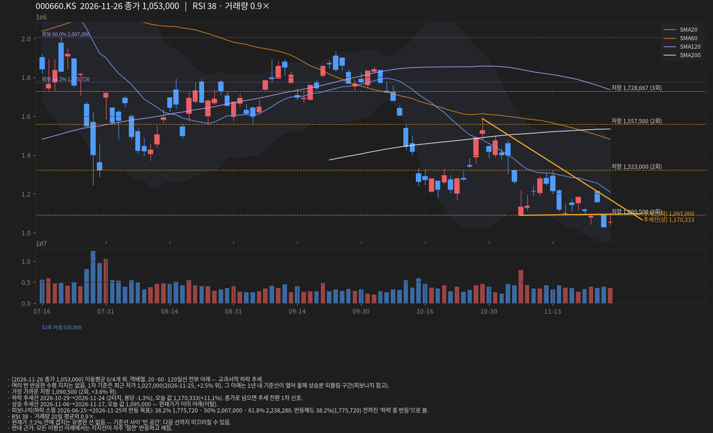
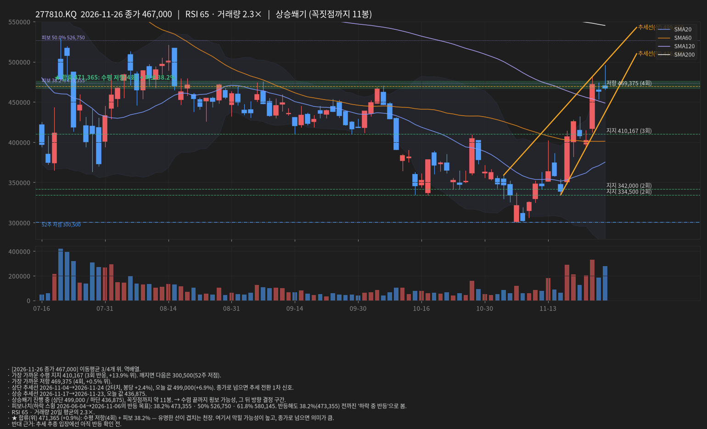
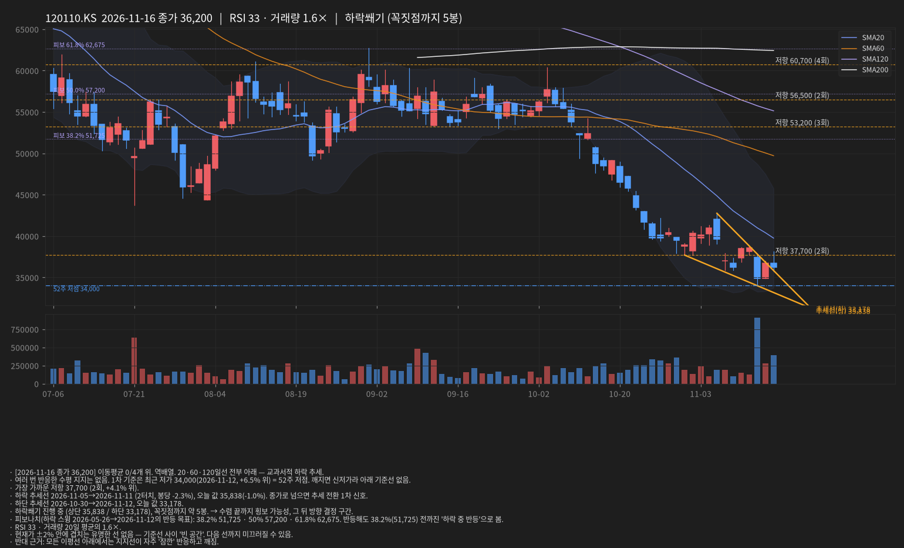

# 선 긋기 리포트 · 2026-11-19 13:33 KST

데이터: 야후 파이낸스 일봉(15분 지연) · 문장은 가능성 표현, 확률 아님

## INFQ · 2026-11-18 종가 7.61

- [2026-11-18 종가 7.61] 이동평균 0/3개 위. 역배열. 20·60·120일선 전부 아래 — 교과서적 하락 추세.
- 여러 번 반응한 수평 지지는 없음. 1차 기준은 최근 저가 7.01(2026-11-05, +8.6% 위) = 52주 저점. 깨지면 신저가라 아래 기준선 없음.
- 가장 가까운 저항 8.41 (2회, +10.6% 위).
- 하락 추세선 2026-09-23→2026-11-09 (2터치, 봉당 -1.1%), 오늘 값 8.72(+14.6%). 종가로 넘으면 추세 전환 1차 신호.
- 상승 추세선 2026-11-05→2026-11-18, 오늘 값 7.38.
- 삼각수렴 진행 중 (상단 8.72 / 하단 7.38), 꼭짓점까지 약 7봉. → 수렴 끝까지 횡보 가능성, 그 뒤 방향 결정 구간.
- 피보나치(하락 스윙 2026-06-02→2026-11-05의 반등 목표): 38.2% 12.26 · 50% 13.88 · 61.8% 15.50. 반등해도 38.2%(12.26) 전까진 '하락 중 반등'으로 봄.
- RSI 37 · 거래량 20일 평균의 0.8×.
- 현재가 ±2% 안에 겹치는 유명한 선 없음 — 기준선 사이 '빈 공간'. 다음 선까지 미끄러질 수 있음.
- 반대 근거: 모든 이평선 아래에서는 지지선이 자주 '잠깐' 반응하고 깨짐.

## 005930.KS · 2026-11-18 종가 194,700

- [2026-11-18 종가 194,700] 이동평균 0/4개 위. 역배열. 20·60·120일선 전부 아래 — 교과서적 하락 추세.
- 여러 번 반응한 수평 지지는 없음. 1차 기준은 최근 저가 179,200(2026-11-06, +8.6% 위). 그 아래는 1년 내 기준선이 멀어 올해 상승분 되돌림 구간(피보나치 참고).
- 가장 가까운 저항 204,000 (2회, +4.8% 위).
- 하락 추세선 2026-10-29→2026-11-13 (2터치, 봉당 -1.2%), 오늘 값 207,000(+6.3%). 종가로 넘으면 추세 전환 1차 신호.
- 하단 추세선 2026-10-15→2026-11-06, 오늘 값 166,550.
- 하락쐐기 진행 중 (상단 207,000 / 하단 166,550), 꼭짓점까지 약 29봉. → 수렴 끝까지 횡보 가능성, 그 뒤 방향 결정 구간.
- 피보나치(하락 스윙 2026-06-19→2026-11-06의 반등 목표): 38.2% 253,805 · 50% 276,850 · 61.8% 299,895. 반등해도 38.2%(253,805) 전까진 '하락 중 반등'으로 봄.
- RSI 39 · 거래량 20일 평균의 1.0×.
- 현재가 ±2% 안에 겹치는 유명한 선 없음 — 기준선 사이 '빈 공간'. 다음 선까지 미끄러질 수 있음.
- 반대 근거: 모든 이평선 아래에서는 지지선이 자주 '잠깐' 반응하고 깨짐.

## 000660.KS · 2026-11-18 종가 1,144,000

- [2026-11-18 종가 1,144,000] 이동평균 0/4개 위. 역배열. 20·60·120일선 전부 아래 — 교과서적 하락 추세.
- 여러 번 반응한 수평 지지는 없음. 1차 기준은 최근 저가 1,089,000(2026-11-06, +5.1% 위). 그 아래는 1년 내 기준선이 멀어 올해 상승분 되돌림 구간(피보나치 참고).
- 가장 가까운 저항 1,323,000 (2회, +15.6% 위).
- 하락 추세선 2026-10-29→2026-11-13 (2터치, 봉당 -1.5%), 오늘 값 1,243,364(+8.7%). 종가로 넘으면 추세 전환 1차 신호.
- 하단 추세선 2026-10-20→2026-11-06, 오늘 값 1,031,154.
- 하락쐐기 진행 중 (상단 1,243,364 / 하단 1,031,154), 꼭짓점까지 약 12봉. → 수렴 끝까지 횡보 가능성, 그 뒤 방향 결정 구간.
- 피보나치(하락 스윙 2026-06-25→2026-11-06의 반등 목표): 38.2% 1,814,036 · 50% 2,038,000 · 61.8% 2,261,964. 반등해도 38.2%(1,814,036) 전까진 '하락 중 반등'으로 봄.
- RSI 38 · 거래량 20일 평균의 0.9×.
- 현재가 ±2% 안에 겹치는 유명한 선 없음 — 기준선 사이 '빈 공간'. 다음 선까지 미끄러질 수 있음.
- 반대 근거: 모든 이평선 아래에서는 지지선이 자주 '잠깐' 반응하고 깨짐.

## 277810.KQ · 2026-11-18 종가 407,000

- [2026-11-18 종가 407,000] 이동평균 2/4개 위. 역배열. 
- 가장 가까운 수평 지지 364,250 (2회 반응, +11.7% 위). 깨지면 다음은 300,500(52주 저점).
- 가장 가까운 저항 410,167 (3회, +0.8% 위).
- 하락 추세선 2026-10-07→2026-11-13 (2터치, 봉당 -0.6%), 오늘 값 394,154(-3.2%). 종가로 넘으면 추세 전환 1차 신호.
- 하단 추세선 2026-10-19→2026-11-06, 오늘 값 281,071.
- 피보나치(하락 스윙 2026-06-02→2026-11-06의 반등 목표): 38.2% 508,499 · 50% 572,750 · 61.8% 637,001. 반등해도 38.2%(508,499) 전까진 '하락 중 반등'으로 봄.
- RSI 59 · 거래량 20일 평균의 3.8×.
- ★ 합류(위) 409,583 (+0.6%): 전고점 + 수평 저항(3회) — 유명한 선이 겹치는 천장. 여기서 막힐 가능성이 높고, 종가로 넘으면 의미가 큼.
- 반대 근거: 추세 추종 입장에선 아직 반등 확인 전.

## 259960.KS · 2026-11-18 종가 196,700

- [2026-11-18 종가 196,700] 이동평균 1/4개 위. 역배열. 
- 여러 번 반응한 수평 지지는 없음. 1차 기준은 최근 저가 190,100(2026-11-11, +3.5% 위), 그 아래 52주 저점 178,500.
- 가장 가까운 저항 216,167 (3회, +9.9% 위).
- 하락 추세선 2026-09-01→2026-11-09 (2터치, 봉당 -0.1%), 오늘 값 225,567(+14.7%). 종가로 넘으면 추세 전환 1차 신호.
- 상승 추세선 2026-10-30→2026-11-11, 오늘 값 197,350.
- 삼각수렴 진행 중 (상단 225,567 / 하단 197,350), 꼭짓점까지 약 18봉. → 수렴 끝까지 횡보 가능성, 그 뒤 방향 결정 구간.
- 피보나치(하락 스윙 2026-05-26→2026-10-30의 반등 목표): 38.2% 215,363 · 50% 226,750 · 61.8% 238,137. 반등해도 38.2%(215,363) 전까진 '하락 중 반등'으로 봄.
- RSI 48 · 거래량 20일 평균의 1.0×.
- ★ 합류(위) 196,742 (+0.0%): SMA20 + 볼린저 중심 + 상승 추세선 — 유명한 선이 겹치는 천장. 여기서 막힐 가능성이 높고, 종가로 넘으면 의미가 큼.
- 반대 근거: 추세 추종 입장에선 아직 반등 확인 전.

## 103140.KS · 2026-11-18 종가 50,500

- [2026-11-18 종가 50,500] 이동평균 0/4개 위. 역배열. 최근 60/120 데드크로스(5봉 전). 20·60·120일선 전부 아래 — 교과서적 하락 추세.
- 여러 번 반응한 수평 지지는 없음. 1차 기준은 최근 저가 49,900(2026-11-18, +1.2% 위) = 52주 저점. 깨지면 신저가라 아래 기준선 없음.
- 가장 가까운 저항 60,050 (2회, +18.9% 위).
- 하락 추세선 2026-10-06→2026-11-13 (3터치, 봉당 -1.2%), 오늘 값 51,000(+1.0%). 종가로 넘으면 추세 전환 1차 신호.
- 하단 추세선 2026-10-13→2026-11-09, 오늘 값 47,042.
- 하락쐐기 진행 중 (상단 51,000 / 하단 47,042), 꼭짓점까지 약 9봉. → 수렴 끝까지 횡보 가능성, 그 뒤 방향 결정 구간.
- 피보나치(하락 스윙 2026-08-25→2026-11-18의 반등 목표): 38.2% 65,600 · 50% 70,450 · 61.8% 75,300. 반등해도 38.2%(65,600) 전까진 '하락 중 반등'으로 봄.
- RSI 29 과매도 · 거래량 20일 평균의 0.8×.
- ★ 합류(아래) 49,900 (-1.2%): 52주 저점 + 최근 저가 — 유명한 선이 겹치는 받침. 한 번 튀어오를 가능성이 높지만 바닥 보장은 아님 → 반등 확인 후 진입.
- ★ 합류(위) 50,900 (+0.8%): 전저점 + 하락 추세선 — 유명한 선이 겹치는 천장. 여기서 막힐 가능성이 높고, 종가로 넘으면 의미가 큼.
- 반대 근거: RSI 과매도는 하락 추세에서 며칠씩 유지될 수 있음; 모든 이평선 아래에서는 지지선이 자주 '잠깐' 반응하고 깨짐.

## 120110.KS · 2026-11-18 종가 36,550

- [2026-11-18 종가 36,550] 이동평균 0/4개 위. 역배열. 20·60·120일선 전부 아래 — 교과서적 하락 추세.
- 여러 번 반응한 수평 지지는 없음. 1차 기준은 최근 저가 34,000(2026-11-12, +7.5% 위) = 52주 저점. 깨지면 신저가라 아래 기준선 없음.
- 가장 가까운 저항 37,700 (2회, +3.1% 위).
- 하락 추세선 2026-10-06→2026-11-16 (2터치, 봉당 -1.3%), 오늘 값 36,561(+0.0%). 종가로 넘으면 추세 전환 1차 신호.
- 하단 추세선 2026-10-30→2026-11-12, 오늘 값 32,356.
- 하락쐐기 진행 중 (상단 36,561 / 하단 32,356), 꼭짓점까지 약 11봉. → 수렴 끝까지 횡보 가능성, 그 뒤 방향 결정 구간.
- 피보나치(하락 스윙 2026-05-26→2026-11-12의 반등 목표): 38.2% 51,725 · 50% 57,200 · 61.8% 62,675. 반등해도 38.2%(51,725) 전까진 '하락 중 반등'으로 봄.
- RSI 35 · 거래량 20일 평균의 0.7×.
- 현재가 ±2% 안에 겹치는 유명한 선 없음 — 기준선 사이 '빈 공간'. 다음 선까지 미끄러질 수 있음.
- 반대 근거: 모든 이평선 아래에서는 지지선이 자주 '잠깐' 반응하고 깨짐; 거래량 없는 반등은 되돌림이 빠름.

## 010140.KS · 2026-11-18 종가 15,760

- [2026-11-18 종가 15,760] 이동평균 0/4개 위. 역배열. 20·60·120일선 전부 아래 — 교과서적 하락 추세.
- 가장 가까운 수평 지지 15,290 (2회 반응, +3.1% 위). 깨지면 다음은 15,260(52주 저점).
- 가장 가까운 저항 17,245 (2회, +9.4% 위).
- 하락 추세선 2026-10-06→2026-11-13 (4터치, 봉당 -0.5%), 오늘 값 16,961(+7.6%). 종가로 넘으면 추세 전환 1차 신호.
- 하단 추세선 2026-10-30→2026-11-09, 오늘 값 15,190.
- 하락쐐기 진행 중 (상단 16,961 / 하단 15,190), 꼭짓점까지 약 18봉. → 수렴 끝까지 횡보 가능성, 그 뒤 방향 결정 구간.
- 피보나치(하락 스윙 2026-05-26→2026-11-09의 반등 목표): 38.2% 21,254 · 50% 23,105 · 61.8% 24,956. 반등해도 38.2%(21,254) 전까진 '하락 중 반등'으로 봄.
- RSI 38 · 거래량 20일 평균의 0.7× → 매수 부재(거래량 없이 하락).
- 현재가 ±2% 안에 겹치는 유명한 선 없음 — 기준선 사이 '빈 공간'. 다음 선까지 미끄러질 수 있음.
- 반대 근거: 모든 이평선 아래에서는 지지선이 자주 '잠깐' 반응하고 깨짐; 거래량 없는 반등은 되돌림이 빠름.

## 294870.KS · 2026-11-18 종가 24,600

- [2026-11-18 종가 24,600] 이동평균 4/4개 위. 정배열. 최근 20/60 골든크로스(6봉 전). 
- 가장 가까운 수평 지지 22,988 (4회 반응, +7.0% 위). 깨지면 다음은 16,900(52주 저점).
- 가장 가까운 저항 25,025 (2회, +1.7% 위).
- 하락 추세선 2026-11-05→2026-11-11 (2터치, 봉당 -0.8%), 오늘 값 24,038(-2.3%). 종가로 넘으면 추세 전환 1차 신호.
- 상승 추세선 2026-10-20→2026-11-09, 오늘 값 23,900.
- 삼각수렴 진행 중 (상단 24,038 / 하단 23,900), 꼭짓점까지 약 0봉. → 수렴 끝까지 횡보 가능성, 그 뒤 방향 결정 구간.
- 피보나치(상승 스윙 2026-07-14→2026-11-05의 되돌림): 38.2% 22,493 · 50% 21,425 · 61.8% 20,357. 
- RSI 57 · 거래량 20일 평균의 1.0×.
- 현재가 ±2% 안에 겹치는 유명한 선 없음 — 기준선 사이 '빈 공간'. 다음 선까지 미끄러질 수 있음.
- 반대 근거: 추세 추종 입장에선 아직 반등 확인 전.

## 036460.KS · 2026-11-18 종가 38,400

- [2026-11-18 종가 38,400] 이동평균 4/4개 위. 정배열. 
- 가장 가까운 수평 지지 37,950 (3회 반응, +1.2% 위). 깨지면 다음은 31,150(52주 저점).
- 상단 추세선 2026-10-22→2026-11-13 (3터치, 봉당 +0.4%), 오늘 값 39,394(+2.6%). 종가로 넘으면 추세 전환 1차 신호.
- 상승 추세선 2026-09-29→2026-11-10, 오늘 값 36,311.
- 피보나치(상승 스윙 2026-06-26→2026-11-13의 되돌림): 38.2% 36,001 · 50% 35,075 · 61.8% 34,149. 
- RSI 61 · 거래량 20일 평균의 0.8×.
- 현재가 ±2% 안에 겹치는 유명한 선 없음 — 기준선 사이 '빈 공간'. 다음 선까지 미끄러질 수 있음.
- 반대 근거: 추세 추종 입장에선 아직 반등 확인 전.

## 241560.KS · 2026-11-18 종가 52,000

- [2026-11-18 종가 52,000] 이동평균 1/4개 위. 역배열. 
- 여러 번 반응한 수평 지지는 없음. 1차 기준은 최근 저가 48,850(2026-11-06, +6.4% 위), 그 아래 52주 저점 47,400.
- 가장 가까운 저항 58,150 (2회, +11.8% 위).
- 상단 추세선 2026-10-28→2026-11-10 (3터치, 봉당 +1.1%), 오늘 값 58,033(+11.6%). 종가로 넘으면 추세 전환 1차 신호.
- 상승 추세선 2026-10-30→2026-11-12, 오늘 값 52,889 — 현재가가 이미 아래(이탈).
- 피보나치(하락 스윙 2026-05-26→2026-10-30의 반등 목표): 38.2% 56,606 · 50% 59,450 · 61.8% 62,294. 반등해도 38.2%(56,606) 전까진 '하락 중 반등'으로 봄.
- RSI 50 · 거래량 20일 평균의 1.3×.
- 현재가 ±2% 안에 겹치는 유명한 선 없음 — 기준선 사이 '빈 공간'. 다음 선까지 미끄러질 수 있음.
- 반대 근거: 추세 추종 입장에선 아직 반등 확인 전.

## 377300.KS · 2026-11-18 종가 33,100

- [2026-11-18 종가 33,100] 이동평균 1/4개 위. 역배열. 
- 여러 번 반응한 수평 지지는 없음. 1차 기준은 최근 저가 30,750(2026-11-06, +7.6% 위) = 52주 저점. 깨지면 신저가라 아래 기준선 없음.
- 가장 가까운 저항 34,233 (3회, +3.4% 위).
- 하락 추세선 2026-09-15→2026-11-11 (2터치, 봉당 -0.7%), 오늘 값 32,709(-1.2%). 종가로 넘으면 추세 전환 1차 신호.
- 상승 추세선 2026-11-04→2026-11-12, 오늘 값 33,150.
- 피보나치(하락 스윙 2026-05-26→2026-11-04의 반등 목표): 38.2% 38,116 · 50% 40,500 · 61.8% 42,884. 반등해도 38.2%(38,116) 전까진 '하락 중 반등'으로 봄.
- 볼린저 폭이 60일 중 최저 수준(스퀴즈) → 곧 큰 움직임 가능성, 방향은 추세선·패턴 기준.
- RSI 44 · 거래량 20일 평균의 0.8×.
- ★ 합류(아래) 33,051 (-0.1%): 하락 추세선 + SMA20 + 볼린저 중심 + 상승 추세선 — 유명한 선이 겹치는 받침. 한 번 튀어오를 가능성이 높지만 바닥 보장은 아님 → 반등 확인 후 진입.
- 반대 근거: 추세 추종 입장에선 아직 반등 확인 전.

## 알림
- [dn] **INFQ** 손절 이탈: 7.61으로 마감해 손절선(8.57) 아래예요. 규칙대로면 단기분 정리 — 다음 장 시작가 확인.
- [up] **277810.KQ** 추세선 돌파: 407,000으로 마감해 흐름선(394,154) 위로 올라섰어요. 내일도 위면 1/3 매수 검토.
- [warn] **277810.KQ** 합류 천장: 409,583까지 +0.6%. 넘어서 마감하면 의미가 커요.
- [warn] **259960.KS** 합류 천장: 196,742까지 0.0%. 넘어서 마감하면 의미가 커요.
- [ok] **103140.KS** 합류 받침: 49,900까지 −1.2%. 기준 두세 개가 겹친 자리예요 — 반등을 확인하고 판단하세요.
- [warn] **103140.KS** 합류 천장: 50,900까지 +0.8%. 넘어서 마감하면 의미가 커요.
- [up] **294870.KS** 추세선 돌파: 24,600으로 마감해 흐름선(24,038) 위로 올라섰어요. 내일도 위면 1/3 매수 검토.
- [up] **377300.KS** 추세선 돌파: 33,100으로 마감해 흐름선(32,709) 위로 올라섰어요. 내일도 위면 1/3 매수 검토.
- [ok] **377300.KS** 합류 받침: 33,051까지 −0.1%. 여러 기준이 겹친 자리예요 — 반등을 확인하고 판단하세요.

## 급락/급등 원인 분해
- [2026-11-18] INFQ +0.9% = 지수 -0.7%(β3.0×^GSPC -0.2%) + 업종 -3.7%(양자 피어 -3.9%) + 종목 고유 +5.3%. 주원인: 종목 고유 · 거래량 0.8× → 보통. 종목 고유 뉴스/공시를 먼저 확인.
- [2026-11-18] 005930.KS +2.3% = 지수 +2.6%(β1.3×^KS11 +2.0%) + 업종 +0.2%(반도체 피어 +2.2%) + 종목 고유 -0.5%. 주원인: 지수 · 거래량 1.0× → 보통. 시장 전체 움직임 — 종목 판단과 분리.
- [2026-11-18] 000660.KS +4.2% = 지수 +3.2%(β1.6×^KS11 +2.0%) + 업종 -0.7%(반도체 피어 +1.3%) + 종목 고유 +1.6%. 주원인: 지수 · 거래량 0.9× → 보통. 시장 전체 움직임 — 종목 판단과 분리.
- [2026-10-19] 013030.KQ -0.5% = 지수 +0.9%(β0.5×^KQ11 +1.8%) + 업종 +0.0% + 종목 고유 -1.4%. 주원인: 종목 고유 · 거래량 0.5× → 매수 부재(거래량 없이 하락).
- [2026-10-19] 054950.KQ -0.2% = 지수 +0.3%(β0.2×^KQ11 +1.8%) + 업종 +0.0% + 종목 고유 -0.6%. 주원인: 종목 고유 · 거래량 0.9× → 보통.
- [2026-10-19] 236200.KQ +1.2% = 지수 +1.2%(β0.7×^KQ11 +1.8%) + 업종 +0.0% + 종목 고유 +0.0%. 주원인: 지수 · 거래량 0.5× → 보통. 시장 전체 움직임 — 종목 판단과 분리.
- [2026-10-19] 036800.KQ -1.4% = 지수 +0.1%(β0.1×^KQ11 +1.8%) + 업종 +0.0% + 종목 고유 -1.5%. 주원인: 종목 고유 · 거래량 0.3× → 매수 부재(거래량 없이 하락).
- [2026-10-19] 200670.KQ +2.2% = 지수 +1.1%(β0.6×^KQ11 +1.8%) + 업종 +0.0% + 종목 고유 +1.1%. 주원인: 지수 · 거래량 0.4× → 보통. 시장 전체 움직임 — 종목 판단과 분리.
- [2026-10-19] 015230.KS +1.1% = 지수 +0.3%(β0.2×^KS11 +1.8%) + 업종 +0.0% + 종목 고유 +0.8%. 주원인: 종목 고유 · 거래량 1.0× → 보통.
- [2026-10-19] 044960.KQ +0.3% = 지수 +0.3%(β0.2×^KQ11 +1.8%) + 업종 +0.0% + 종목 고유 +0.0%. 주원인: 지수 · 거래량 0.4× → 보통. 시장 전체 움직임 — 종목 판단과 분리.

## 판단 보드
- **INFQ** [exit] 손절선 8.57 아래 마감 — 규칙대로면 단기분 정리
- **005930.KS** [exit] 무효선 204,500 아래 — 관심 해제 검토
- **000660.KS** [wait] 기다림 — 흐름선까지 +8.7%
- **277810.KQ** [enter] 하락 흐름 끊김 — 종가 407,000 ≥ 흐름선 394,154 · 내일도 위면 1/3 검토 · 바로 위 막힐 자리 409,583 (+0.6%)
- **259960.KS** [wait] 기다림 — 막힐 자리 196,742 (+0.0%) 아래. 넘어서 마감하면 다시 판단
- **103140.KS** [wait] 기다림 — 막힐 자리 50,900 (+0.8%) 아래. 넘어서 마감하면 다시 판단
- **120110.KS** [wait] 기다림 — 흐름선까지 +0.0%
- **010140.KS** [wait] 기다림 — 흐름선까지 +7.6%
- **294870.KS** [enter] 하락 흐름 끊김 — 종가 24,600 ≥ 흐름선 24,038 · 내일도 위면 1/3 검토
- **036460.KS** [wait] 기다림 — 흐름선까지 +2.6%
- **241560.KS** [wait] 기다림 — 흐름선까지 +11.6%
- **377300.KS** [enter] 하락 흐름 끊김 — 종가 33,100 ≥ 흐름선 32,709 · 내일도 위면 1/3 검토
