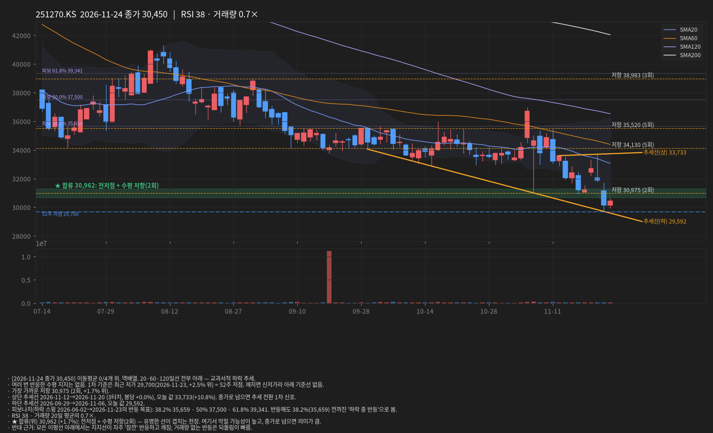
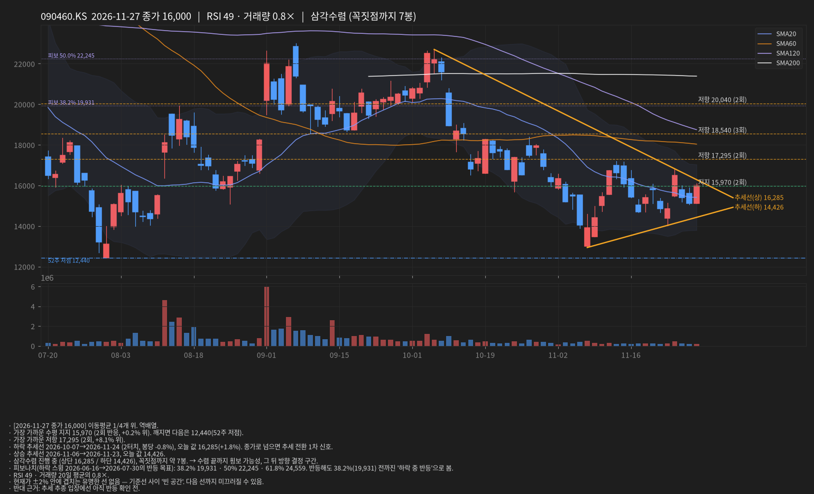
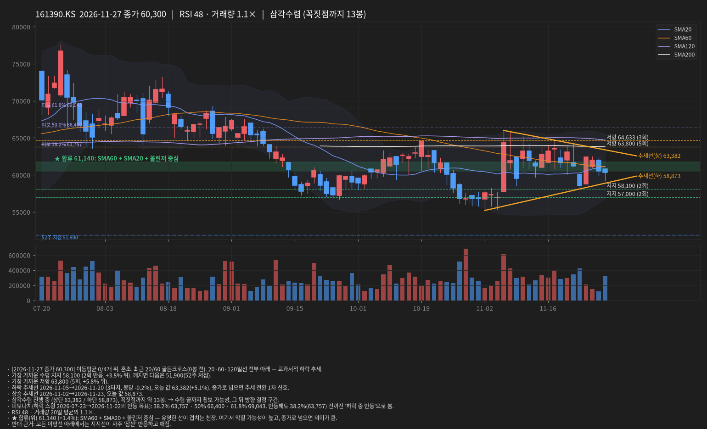
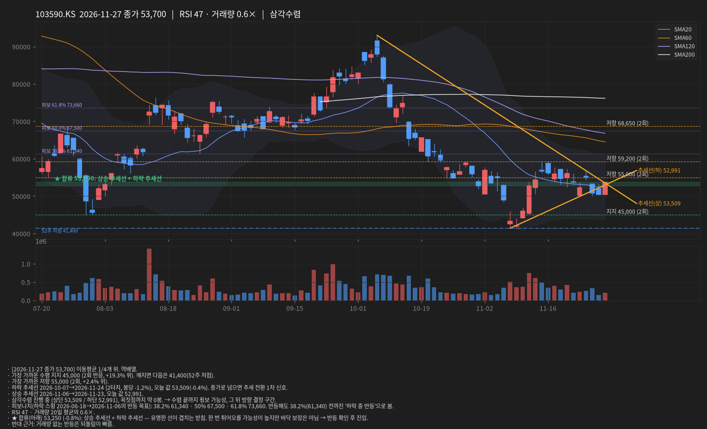

# 선 긋기 리포트 · 2026-11-28 14:21 KST

데이터: 야후 파이낸스 일봉(15분 지연) · 문장은 가능성 표현, 확률 아님

## INFQ · 2026-11-27 종가 7.05

- [2026-11-27 종가 7.05] 이동평균 0/3개 위. 역배열. 20·60·120일선 전부 아래 — 교과서적 하락 추세.
- 여러 번 반응한 수평 지지는 없음. 1차 기준은 최근 저가 5.77(2026-11-25, +22.2% 위) = 52주 저점. 깨지면 신저가라 아래 기준선 없음.
- 가장 가까운 저항 8.41 (2회, +19.4% 위).
- 하락 추세선 2026-11-09→2026-11-19 (2터치, 봉당 -2.0%), 오늘 값 7.21(+2.3%). 종가로 넘으면 추세 전환 1차 신호.
- 하단 추세선 2026-10-20→2026-11-05, 오늘 값 5.30.
- 하락쐐기 진행 중 (상단 7.21 / 하단 5.30), 꼭짓점까지 약 22봉. → 수렴 끝까지 횡보 가능성, 그 뒤 방향 결정 구간.
- 피보나치(하락 스윙 2026-06-23→2026-11-25의 반등 목표): 38.2% 9.90 · 50% 11.18 · 61.8% 12.46. 반등해도 38.2%(9.90) 전까진 '하락 중 반등'으로 봄.
- RSI 40 · 거래량 20일 평균의 0.8×.
- 현재가 ±2% 안에 겹치는 유명한 선 없음 — 기준선 사이 '빈 공간'. 다음 선까지 미끄러질 수 있음.
- 반대 근거: 모든 이평선 아래에서는 지지선이 자주 '잠깐' 반응하고 깨짐.

## 005930.KS · 2026-11-27 종가 179,100

- [2026-11-27 종가 179,100] 이동평균 0/4개 위. 역배열. 20·60·120일선 전부 아래 — 교과서적 하락 추세.
- 여러 번 반응한 수평 지지는 없음. 1차 기준은 최근 저가 169,000(2026-11-27, +6.0% 위). 그 아래는 1년 내 기준선이 멀어 올해 상승분 되돌림 구간(피보나치 참고).
- 가장 가까운 저항 204,000 (2회, +13.9% 위).
- 하락 추세선 2026-10-29→2026-11-24 (3터치, 봉당 -1.2%), 오늘 값 184,483(+3.0%). 종가로 넘으면 추세 전환 1차 신호.
- 하단 추세선 2026-10-15→2026-11-06, 오늘 값 155,481.
- 하락쐐기 진행 중 (상단 184,483 / 하단 155,481), 꼭짓점까지 약 19봉. → 수렴 끝까지 횡보 가능성, 그 뒤 방향 결정 구간.
- 피보나치(하락 스윙 2026-06-19→2026-11-27의 반등 목표): 38.2% 247,501 · 50% 271,750 · 61.8% 295,999. 반등해도 38.2%(247,501) 전까진 '하락 중 반등'으로 봄.
- RSI 39 · 거래량 20일 평균의 0.8×.
- 현재가 ±2% 안에 겹치는 유명한 선 없음 — 기준선 사이 '빈 공간'. 다음 선까지 미끄러질 수 있음.
- 반대 근거: 모든 이평선 아래에서는 지지선이 자주 '잠깐' 반응하고 깨짐.

## 000660.KS · 2026-11-27 종가 1,110,000

- [2026-11-27 종가 1,110,000] 이동평균 0/4개 위. 역배열. 20·60·120일선 전부 아래 — 교과서적 하락 추세.
- 가장 가까운 수평 지지 1,090,500 (2회 반응, +1.8% 위). 깨지면 다음은 525,000(52주 저점).
- 가장 가까운 저항 1,323,000 (2회, +19.2% 위).
- 하락 추세선 2026-10-29→2026-11-24 (2터치, 봉당 -1.3%), 오늘 값 1,149,500(+3.6%). 종가로 넘으면 추세 전환 1차 신호.
- 상승 추세선 2026-11-06→2026-11-17, 오늘 값 1,095,429.
- 삼각수렴 진행 중 (상단 1,149,500 / 하단 1,095,429), 꼭짓점까지 약 3봉. → 수렴 끝까지 횡보 가능성, 그 뒤 방향 결정 구간.
- 피보나치(하락 스윙 2026-06-25→2026-11-27의 반등 목표): 38.2% 1,772,630 · 50% 2,004,500 · 61.8% 2,236,370. 반등해도 38.2%(1,772,630) 전까진 '하락 중 반등'으로 봄.
- RSI 42 · 거래량 20일 평균의 0.8×.
- ★ 합류(아래) 1,093,339 (-1.5%): 수평 지지(2회) + 전저점 + 상승 추세선 — 유명한 선이 겹치는 받침. 한 번 튀어오를 가능성이 높지만 바닥 보장은 아님 → 반등 확인 후 진입.
- 반대 근거: 모든 이평선 아래에서는 지지선이 자주 '잠깐' 반응하고 깨짐.

## 277810.KQ · 2026-11-27 종가 531,000

- [2026-11-27 종가 531,000] 이동평균 3/4개 위. 역배열. 
- 가장 가까운 수평 지지 469,375 (4회 반응, +13.1% 위). 깨지면 다음은 300,500(52주 저점).
- 상단 추세선 2026-11-06→2026-11-27 (3터치, 봉당 +3.9%), 오늘 값 534,000(+0.6%). 종가로 넘으면 추세 전환 1차 신호.
- 상승 추세선 2026-11-17→2026-11-23, 오늘 값 451,500.
- 상승쐐기 진행 중 (상단 534,000 / 하단 451,500), 꼭짓점까지 약 55봉. → 수렴 끝까지 횡보 가능성, 그 뒤 방향 결정 구간.
- 피보나치(하락 스윙 2026-06-05→2026-11-06의 반등 목표): 38.2% 451,963 · 50% 498,750 · 61.8% 545,537. 반등해도 38.2%(451,963) 전까진 '하락 중 반등'으로 봄.
- RSI 72 과매수 · 거래량 20일 평균의 3.3×.
- 현재가 ±2% 안에 겹치는 유명한 선 없음 — 기준선 사이 '빈 공간'. 다음 선까지 미끄러질 수 있음.
- 반대 근거: 추세 추종 입장에선 아직 반등 확인 전.

## 259960.KS · 2026-11-27 종가 210,500

- [2026-11-27 종가 210,500] 이동평균 2/4개 위. 혼조. 최근 20/60 골든크로스(0봉 전). 
- 가장 가까운 수평 지지 189,833 (3회 반응, +10.9% 위). 깨지면 다음은 178,500(52주 저점).
- 가장 가까운 저항 216,167 (3회, +2.7% 위).
- 하락 추세선 2026-11-09→2026-11-20 (2터치, 봉당 -0.9%), 오늘 값 197,722(-6.1%). 종가로 넘으면 추세 전환 1차 신호.
- 상승 추세선 2026-10-30→2026-11-23, 오늘 값 190,875.
- 피보나치(하락 스윙 2026-07-30→2026-10-30의 반등 목표): 38.2% 211,543 · 50% 221,750 · 61.8% 231,957. 반등해도 38.2%(211,543) 전까진 '하락 중 반등'으로 봄.
- RSI 58 · 거래량 20일 평균의 0.6×.
- 현재가 ±2% 안에 겹치는 유명한 선 없음 — 기준선 사이 '빈 공간'. 다음 선까지 미끄러질 수 있음.
- 반대 근거: 거래량 없는 반등은 되돌림이 빠름.

## 010140.KS · 2026-11-27 종가 14,650

- [2026-11-27 종가 14,650] 이동평균 0/4개 위. 역배열. 20·60·120일선 전부 아래 — 교과서적 하락 추세.
- 여러 번 반응한 수평 지지는 없음. 1차 기준은 최근 저가 13,530(2026-11-25, +8.3% 위) = 52주 저점. 깨지면 신저가라 아래 기준선 없음.
- 가장 가까운 저항 15,290 (2회, +4.4% 위).
- 하락 추세선 2026-10-06→2026-11-13 (4터치, 봉당 -0.5%), 오늘 값 16,217(+10.7%). 종가로 넘으면 추세 전환 1차 신호.
- 하단 추세선 2026-10-30→2026-11-25, 오늘 값 13,331.
- 하락쐐기 모양이지만 꼭짓점이 멀어(60봉 넘게) 아직 신호로 보기 어려움.
- 피보나치(하락 스윙 2026-06-17→2026-11-25의 반등 목표): 38.2% 19,745 · 50% 21,665 · 61.8% 23,585. 반등해도 38.2%(19,745) 전까진 '하락 중 반등'으로 봄.
- RSI 39 · 거래량 20일 평균의 0.9×.
- 현재가 ±2% 안에 겹치는 유명한 선 없음 — 기준선 사이 '빈 공간'. 다음 선까지 미끄러질 수 있음.
- 반대 근거: 모든 이평선 아래에서는 지지선이 자주 '잠깐' 반응하고 깨짐.

## 294870.KS · 2026-11-27 종가 23,150

- [2026-11-27 종가 23,150] 이동평균 2/4개 위. 정배열. 
- 가장 가까운 수평 지지 22,970 (5회 반응, +0.8% 위). 깨지면 다음은 16,900(52주 저점).
- 가장 가까운 저항 25,025 (2회, +8.1% 위).
- 하락 추세선 2026-11-05→2026-11-18 (2터치, 봉당 -0.1%), 오늘 값 25,328(+9.4%). 종가로 넘으면 추세 전환 1차 신호.
- 상승 추세선 2026-10-20→2026-11-23, 오늘 값 23,333 — 현재가가 이미 아래(이탈).
- 삼각수렴 진행 중 (상단 25,328 / 하단 23,333), 꼭짓점까지 약 14봉. → 수렴 끝까지 횡보 가능성, 그 뒤 방향 결정 구간.
- 피보나치(상승 스윙 2026-07-14→2026-11-05의 되돌림): 38.2% 22,493 · 50% 21,425 · 61.8% 20,357. 
- RSI 46 · 거래량 20일 평균의 1.3×.
- ★ 합류(아래) 22,903 (-1.1%): 볼린저 하단 + 전저점 + 수평 지지(5회) — 유명한 선이 겹치는 받침. 한 번 튀어오를 가능성이 높지만 바닥 보장은 아님 → 반등 확인 후 진입.
- ★ 합류(위) 23,324 (+0.8%): SMA60 + 상승 추세선 — 유명한 선이 겹치는 천장. 여기서 막힐 가능성이 높고, 종가로 넘으면 의미가 큼.
- 반대 근거: 추세 추종 입장에선 아직 반등 확인 전.

## 251270.KS · 2026-11-27 종가 32,250

- [2026-11-27 종가 32,250] 이동평균 0/4개 위. 역배열. 20·60·120일선 전부 아래 — 교과서적 하락 추세.
- 가장 가까운 수평 지지 30,975 (2회 반응, +4.1% 위). 깨지면 다음은 29,700(52주 저점).
- 가장 가까운 저항 33,980 (5회, +5.4% 위).
- 상단 추세선 2026-11-12→2026-11-20 (3터치, 봉당 +0.0%), 오늘 값 33,783(+4.8%). 종가로 넘으면 추세 전환 1차 신호.
- 하단 추세선 2026-09-29→2026-11-23, 오늘 값 29,230.
- 피보나치(하락 스윙 2026-06-05→2026-11-23의 반등 목표): 38.2% 35,239 · 50% 36,950 · 61.8% 38,661. 반등해도 38.2%(35,239) 전까진 '하락 중 반등'으로 봄.
- RSI 47 · 거래량 20일 평균의 0.7×.
- ★ 합류(위) 32,842 (+1.8%): SMA20 + 볼린저 중심 — 유명한 선이 겹치는 천장. 여기서 막힐 가능성이 높고, 종가로 넘으면 의미가 큼.
- 반대 근거: 모든 이평선 아래에서는 지지선이 자주 '잠깐' 반응하고 깨짐; 거래량 없는 반등은 되돌림이 빠름.

## 090460.KS · 2026-11-27 종가 16,000

- [2026-11-27 종가 16,000] 이동평균 1/4개 위. 역배열. 
- 가장 가까운 수평 지지 15,970 (2회 반응, +0.2% 위). 깨지면 다음은 12,440(52주 저점).
- 가장 가까운 저항 17,295 (2회, +8.1% 위).
- 하락 추세선 2026-10-07→2026-11-24 (2터치, 봉당 -0.8%), 오늘 값 16,285(+1.8%). 종가로 넘으면 추세 전환 1차 신호.
- 상승 추세선 2026-11-06→2026-11-23, 오늘 값 14,426.
- 삼각수렴 진행 중 (상단 16,285 / 하단 14,426), 꼭짓점까지 약 7봉. → 수렴 끝까지 횡보 가능성, 그 뒤 방향 결정 구간.
- 피보나치(하락 스윙 2026-06-16→2026-07-30의 반등 목표): 38.2% 19,931 · 50% 22,245 · 61.8% 24,559. 반등해도 38.2%(19,931) 전까진 '하락 중 반등'으로 봄.
- RSI 49 · 거래량 20일 평균의 0.8×.
- 현재가 ±2% 안에 겹치는 유명한 선 없음 — 기준선 사이 '빈 공간'. 다음 선까지 미끄러질 수 있음.
- 반대 근거: 추세 추종 입장에선 아직 반등 확인 전.

## 036460.KS · 2026-11-27 종가 35,550

- [2026-11-27 종가 35,550] 이동평균 1/4개 위. 정배열. 
- 가장 가까운 수평 지지 34,533 (3회 반응, +2.9% 위). 깨지면 다음은 31,150(52주 저점).
- 가장 가까운 저항 35,700 (5회, +0.4% 위).
- 상단 추세선 2026-10-22→2026-11-13 (3터치, 봉당 +0.4%), 오늘 값 40,312(+13.4%). 종가로 넘으면 추세 전환 1차 신호.
- 하단 추세선 2026-10-22→2026-11-24, 오늘 값 34,533.
- 피보나치(상승 스윙 2026-06-26→2026-11-13의 되돌림): 38.2% 36,001 · 50% 35,075 · 61.8% 34,149. 
- RSI 42 · 거래량 20일 평균의 1.1×.
- ★ 합류(아래) 35,038 (-1.4%): 볼린저 하단 + 피보 50.0% — 유명한 선이 겹치는 받침. 한 번 튀어오를 가능성이 높지만 바닥 보장은 아님 → 반등 확인 후 진입.
- ★ 합류(위) 35,583 (+0.1%): SMA120 + 수평 저항(5회) — 유명한 선이 겹치는 천장. 여기서 막힐 가능성이 높고, 종가로 넘으면 의미가 큼.
- 반대 근거: 추세 추종 입장에선 아직 반등 확인 전.

## 196170.KQ · 2026-11-27 종가 186,300

- [2026-11-27 종가 186,300] 이동평균 1/4개 위. 역배열. 
- 여러 번 반응한 수평 지지는 없음. 1차 기준은 최근 저가 158,400(2026-11-24, +17.6% 위), 그 아래 52주 저점 152,500.
- 가장 가까운 저항 243,750 (2회, +30.8% 위).
- 하락 추세선 2026-11-05→2026-11-20 (2터치, 봉당 -1.7%), 오늘 값 162,473(-12.8%). 종가로 넘으면 추세 전환 1차 신호.
- 상승 추세선 2026-11-09→2026-11-25, 오늘 값 159,383.
- 피보나치(하락 스윙 2026-08-10→2026-11-09의 반등 목표): 38.2% 230,237 · 50% 254,250 · 61.8% 278,263. 반등해도 38.2%(230,237) 전까진 '하락 중 반등'으로 봄.
- RSI 47 · 거래량 20일 평균의 1.2×.
- 현재가 ±2% 안에 겹치는 유명한 선 없음 — 기준선 사이 '빈 공간'. 다음 선까지 미끄러질 수 있음.
- 반대 근거: 모든 이평선 아래에서는 지지선이 자주 '잠깐' 반응하고 깨짐.

## 161390.KS · 2026-11-27 종가 60,300

- [2026-11-27 종가 60,300] 이동평균 0/4개 위. 혼조. 최근 20/60 골든크로스(0봉 전). 20·60·120일선 전부 아래 — 교과서적 하락 추세.
- 가장 가까운 수평 지지 58,100 (2회 반응, +3.8% 위). 깨지면 다음은 51,900(52주 저점).
- 가장 가까운 저항 63,800 (5회, +5.8% 위).
- 하락 추세선 2026-11-05→2026-11-20 (3터치, 봉당 -0.2%), 오늘 값 63,382(+5.1%). 종가로 넘으면 추세 전환 1차 신호.
- 상승 추세선 2026-11-02→2026-11-23, 오늘 값 58,873.
- 삼각수렴 진행 중 (상단 63,382 / 하단 58,873), 꼭짓점까지 약 13봉. → 수렴 끝까지 횡보 가능성, 그 뒤 방향 결정 구간.
- 피보나치(하락 스윙 2026-07-23→2026-11-02의 반등 목표): 38.2% 63,757 · 50% 66,400 · 61.8% 69,043. 반등해도 38.2%(63,757) 전까진 '하락 중 반등'으로 봄.
- RSI 48 · 거래량 20일 평균의 1.1×.
- ★ 합류(위) 61,140 (+1.4%): SMA60 + SMA20 + 볼린저 중심 — 유명한 선이 겹치는 천장. 여기서 막힐 가능성이 높고, 종가로 넘으면 의미가 큼.
- 반대 근거: 모든 이평선 아래에서는 지지선이 자주 '잠깐' 반응하고 깨짐.

## 064350.KS · 2026-11-27 종가 62,700

- [2026-11-27 종가 62,700] 이동평균 0/4개 위. 역배열. 20·60·120일선 전부 아래 — 교과서적 하락 추세.
- 여러 번 반응한 수평 지지는 없음. 1차 기준은 최근 저가 56,700(2026-11-23, +10.6% 위) = 52주 저점. 깨지면 신저가라 아래 기준선 없음.
- 가장 가까운 저항 117,550 (2회, +87.5% 위).
- 하락 추세선 2026-10-06→2026-11-12 (2터치, 봉당 -1.4%), 오늘 값 57,558(-8.2%). 종가로 넘으면 추세 전환 1차 신호.
- 하단 추세선 2026-11-06→2026-11-23, 오늘 값 52,627.
- 피보나치(하락 스윙 2026-06-16→2026-11-23의 반등 목표): 38.2% 126,721 · 50% 148,350 · 61.8% 169,979. 반등해도 38.2%(126,721) 전까진 '하락 중 반등'으로 봄.
- RSI 35 · 거래량 20일 평균의 1.4×.
- 현재가 ±2% 안에 겹치는 유명한 선 없음 — 기준선 사이 '빈 공간'. 다음 선까지 미끄러질 수 있음.
- 반대 근거: 모든 이평선 아래에서는 지지선이 자주 '잠깐' 반응하고 깨짐.

## 103590.KS · 2026-11-27 종가 53,700

- [2026-11-27 종가 53,700] 이동평균 1/4개 위. 역배열. 
- 가장 가까운 수평 지지 45,000 (2회 반응, +19.3% 위). 깨지면 다음은 41,400(52주 저점).
- 가장 가까운 저항 55,000 (2회, +2.4% 위).
- 하락 추세선 2026-10-07→2026-11-24 (2터치, 봉당 -1.2%), 오늘 값 53,509(-0.4%). 종가로 넘으면 추세 전환 1차 신호.
- 상승 추세선 2026-11-06→2026-11-23, 오늘 값 52,991.
- 삼각수렴 진행 중 (상단 53,509 / 하단 52,991), 꼭짓점까지 약 0봉. → 수렴 끝까지 횡보 가능성, 그 뒤 방향 결정 구간.
- 피보나치(하락 스윙 2026-06-18→2026-11-06의 반등 목표): 38.2% 61,340 · 50% 67,500 · 61.8% 73,660. 반등해도 38.2%(61,340) 전까진 '하락 중 반등'으로 봄.
- RSI 47 · 거래량 20일 평균의 0.6×.
- ★ 합류(아래) 53,250 (-0.8%): 상승 추세선 + 하락 추세선 — 유명한 선이 겹치는 받침. 한 번 튀어오를 가능성이 높지만 바닥 보장은 아님 → 반등 확인 후 진입.
- 반대 근거: 거래량 없는 반등은 되돌림이 빠름.

## 알림
- [dn] **INFQ** 손절 이탈: 7.05으로 마감해 손절선(8.57) 아래예요. 규칙대로면 단기분 정리 — 다음 장 시작가 확인.
- [ok] **005930.KS** 수급 전환: 최근 5일 외국인·기관 +4,105억 순매수 (20일은 −2.0조). 바닥 후보·흐름선과 같이 확인하세요.
- [ok] **000660.KS** 합류 받침: 1,093,339까지 −1.5%. 기준 두세 개가 겹친 자리예요 — 반등을 확인하고 판단하세요.
- [up] **006280.KS** 추세선 돌파: 131,400으로 마감해 흐름선(130,273) 위로 올라섰어요. 내일도 위면 1/3 매수 검토.
- [ok] **006280.KS** 합류 받침: 130,717까지 −0.5%. 여러 기준이 겹친 자리예요 — 반등을 확인하고 판단하세요.
- [warn] **006280.KS** 합류 천장: 133,640까지 +1.7%. 넘어서 마감하면 의미가 커요.
- [warn] **251270.KS** 합류 천장: 32,842까지 +1.8%. 넘어서 마감하면 의미가 커요.
- [warn] **161390.KS** 합류 천장: 61,140까지 +1.4%. 넘어서 마감하면 의미가 커요.
- [up] **064350.KS** 추세선 돌파: 62,700으로 마감해 흐름선(57,558) 위로 올라섰어요. 내일도 위면 1/3 매수 검토.
- [up] **103590.KS** 추세선 돌파: 53,700으로 마감해 흐름선(53,509) 위로 올라섰어요. 내일도 위면 1/3 매수 검토.
- [ok] **103590.KS** 합류 받침: 53,250까지 −0.8%. 기준 두세 개가 겹친 자리예요 — 반등을 확인하고 판단하세요.

## 급락/급등 원인 분해
- [2026-11-27] INFQ +8.6% = 지수 +4.8%(β3.0×^GSPC +1.6%) + 업종 +6.1%(양자 피어 +7.7%) + 종목 고유 -2.2%. 주원인: 업종 · 거래량 0.8× → 보통. 섹터 FUD 성격 — 펀더멘털 변화 없으면 플레이북 유지.
- [2026-11-27] 005930.KS +4.6% = 지수 +5.5%(β1.3×^KS11 +4.3%) + 업종 +0.7%(반도체 피어 +5.1%) + 종목 고유 -1.7%. 주원인: 지수 · 거래량 0.8× → 보통. 시장 전체 움직임 — 종목 판단과 분리.
- [2026-11-27] 000660.KS +5.4% = 지수 +6.8%(β1.6×^KS11 +4.3%) + 업종 +0.3%(반도체 피어 +4.7%) + 종목 고유 -1.7%. 주원인: 지수 · 거래량 0.8× → 보통. 시장 전체 움직임 — 종목 판단과 분리.
- [2026-10-19] 013030.KQ -0.5% = 지수 +0.9%(β0.5×^KQ11 +1.8%) + 업종 +0.0% + 종목 고유 -1.4%. 주원인: 종목 고유 · 거래량 0.5× → 매수 부재(거래량 없이 하락).
- [2026-10-19] 054950.KQ -0.2% = 지수 +0.3%(β0.2×^KQ11 +1.8%) + 업종 +0.0% + 종목 고유 -0.6%. 주원인: 종목 고유 · 거래량 0.9× → 보통.
- [2026-10-19] 236200.KQ +1.2% = 지수 +1.2%(β0.7×^KQ11 +1.8%) + 업종 +0.0% + 종목 고유 +0.0%. 주원인: 지수 · 거래량 0.5× → 보통. 시장 전체 움직임 — 종목 판단과 분리.
- [2026-10-19] 036800.KQ -1.4% = 지수 +0.1%(β0.1×^KQ11 +1.8%) + 업종 +0.0% + 종목 고유 -1.5%. 주원인: 종목 고유 · 거래량 0.3× → 매수 부재(거래량 없이 하락).
- [2026-10-19] 200670.KQ +2.2% = 지수 +1.1%(β0.6×^KQ11 +1.8%) + 업종 +0.0% + 종목 고유 +1.1%. 주원인: 지수 · 거래량 0.4× → 보통. 시장 전체 움직임 — 종목 판단과 분리.
- [2026-10-19] 015230.KS +1.1% = 지수 +0.3%(β0.2×^KS11 +1.8%) + 업종 +0.0% + 종목 고유 +0.8%. 주원인: 종목 고유 · 거래량 1.0× → 보통.
- [2026-10-19] 044960.KQ +0.3% = 지수 +0.3%(β0.2×^KQ11 +1.8%) + 업종 +0.0% + 종목 고유 +0.0%. 주원인: 지수 · 거래량 0.4× → 보통. 시장 전체 움직임 — 종목 판단과 분리.

## 판단 보드
- **INFQ** [exit] 손절선 8.57 아래 마감 — 규칙대로면 단기분 정리
- **005930.KS** [exit] 무효선 204,500 아래 — 관심 해제 검토
- **000660.KS** [wait] 기다림 — 흐름선까지 +3.6%
- **277810.KQ** [wait] 기다림 — 흐름선까지 +0.6%
- **259960.KS** [enter] 하락 흐름 끊김 — 종가 210,500 ≥ 흐름선 197,722 · 3일째
- **006280.KS** [enter] 하락 흐름 끊김 — 종가 131,400 ≥ 흐름선 130,273 · 내일도 위면 1/3 검토 · 바로 위 막힐 자리 133,640 (+1.7%)
- **251270.KS** [wait] 기다림 — 막힐 자리 32,842 (+1.8%) 아래. 넘어서 마감하면 다시 판단
- **090460.KS** [wait] 기다림 — 흐름선까지 +1.8%
- **010140.KS** [wait] 기다림 — 흐름선까지 +10.7%
- **161390.KS** [wait] 기다림 — 막힐 자리 61,140 (+1.4%) 아래. 넘어서 마감하면 다시 판단
- **064350.KS** [enter] 하락 흐름 끊김 — 종가 62,700 ≥ 흐름선 57,558 · 내일도 위면 1/3 검토
- **103590.KS** [enter] 하락 흐름 끊김 — 종가 53,700 ≥ 흐름선 53,509 · 내일도 위면 1/3 검토
