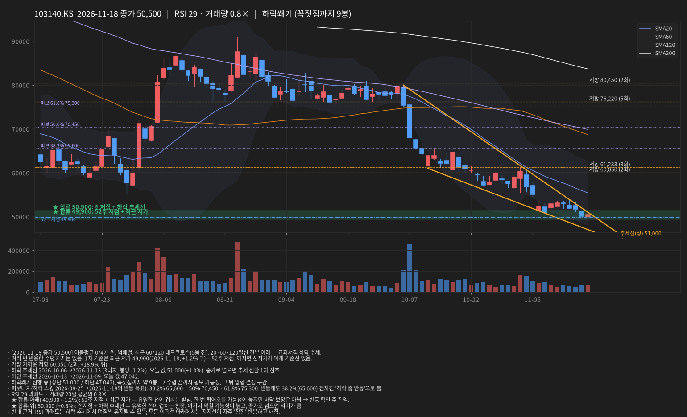

# 선 긋기 리포트 · 2026-11-18 01:52 KST

데이터: 야후 파이낸스 일봉(15분 지연) · 문장은 가능성 표현, 확률 아님

## INFQ · 2026-11-16 종가 7.90

- [2026-11-16 종가 7.90] 이동평균 0/3개 위. 역배열. 20·60·120일선 전부 아래 — 교과서적 하락 추세.
- 여러 번 반응한 수평 지지는 없음. 1차 기준은 최근 저가 7.01(2026-11-05, +12.7% 위) = 52주 저점. 깨지면 신저가라 아래 기준선 없음.
- 가장 가까운 저항 8.41 (2회, +6.5% 위).
- 하락 추세선 2026-09-23→2026-11-09 (2터치, 봉당 -1.1%), 오늘 값 9.04(+14.4%). 종가로 넘으면 추세 전환 1차 신호.
- 상승 추세선 2026-11-05→2026-11-16, 오늘 값 7.87.
- 삼각수렴 진행 중 (상단 9.04 / 하단 7.87), 꼭짓점까지 약 4봉. → 수렴 끝까지 횡보 가능성, 그 뒤 방향 결정 구간.
- 피보나치(하락 스윙 2026-06-02→2026-11-05의 반등 목표): 38.2% 12.26 · 50% 13.88 · 61.8% 15.50. 반등해도 38.2%(12.26) 전까진 '하락 중 반등'으로 봄.
- RSI 38 · 거래량 20일 평균의 1.2×.
- 현재가 ±2% 안에 겹치는 유명한 선 없음 — 기준선 사이 '빈 공간'. 다음 선까지 미끄러질 수 있음.
- 반대 근거: 모든 이평선 아래에서는 지지선이 자주 '잠깐' 반응하고 깨짐.

## 005930.KS · 2026-11-17 종가 190,300

- [2026-11-17 종가 190,300] 이동평균 0/4개 위. 역배열. 20·60·120일선 전부 아래 — 교과서적 하락 추세.
- 여러 번 반응한 수평 지지는 없음. 1차 기준은 최근 저가 179,200(2026-11-06, +6.2% 위). 그 아래는 1년 내 기준선이 멀어 올해 상승분 되돌림 구간(피보나치 참고).
- 가장 가까운 저항 204,000 (2회, +7.2% 위).
- 하락 추세선 2026-10-29→2026-11-13 (2터치, 봉당 -1.2%), 오늘 값 210,000(+10.4%). 종가로 넘으면 추세 전환 1차 신호.
- 하단 추세선 2026-10-15→2026-11-06, 오늘 값 168,131.
- 하락쐐기 진행 중 (상단 210,000 / 하단 168,131), 꼭짓점까지 약 30봉. → 수렴 끝까지 횡보 가능성, 그 뒤 방향 결정 구간.
- 피보나치(하락 스윙 2026-06-19→2026-11-06의 반등 목표): 38.2% 253,805 · 50% 276,850 · 61.8% 299,895. 반등해도 38.2%(253,805) 전까진 '하락 중 반등'으로 봄.
- RSI 36 · 거래량 20일 평균의 1.0×.
- 현재가 ±2% 안에 겹치는 유명한 선 없음 — 기준선 사이 '빈 공간'. 다음 선까지 미끄러질 수 있음.
- 반대 근거: 모든 이평선 아래에서는 지지선이 자주 '잠깐' 반응하고 깨짐.

## 000660.KS · 2026-11-17 종가 1,098,000

- [2026-11-17 종가 1,098,000] 이동평균 0/4개 위. 역배열. 20·60·120일선 전부 아래 — 교과서적 하락 추세.
- 여러 번 반응한 수평 지지는 없음. 1차 기준은 최근 저가 1,089,000(2026-11-06, +0.8% 위). 그 아래는 1년 내 기준선이 멀어 올해 상승분 되돌림 구간(피보나치 참고).
- 가장 가까운 저항 1,557,500 (2회, +41.8% 위).
- 하락 추세선 2026-10-29→2026-11-13 (2터치, 봉당 -1.5%), 오늘 값 1,267,909(+15.5%). 종가로 넘으면 추세 전환 1차 신호.
- 하단 추세선 2026-10-20→2026-11-06, 오늘 값 1,038,385.
- 하락쐐기 진행 중 (상단 1,267,909 / 하단 1,038,385), 꼭짓점까지 약 13봉. → 수렴 끝까지 횡보 가능성, 그 뒤 방향 결정 구간.
- 피보나치(하락 스윙 2026-06-25→2026-11-06의 반등 목표): 38.2% 1,814,036 · 50% 2,038,000 · 61.8% 2,261,964. 반등해도 38.2%(1,814,036) 전까진 '하락 중 반등'으로 봄.
- RSI 35 · 거래량 20일 평균의 1.0×.
- ★ 합류(아래) 1,089,000 (-0.8%): 전저점 + 최근 저가 — 유명한 선이 겹치는 받침. 한 번 튀어오를 가능성이 높지만 바닥 보장은 아님 → 반등 확인 후 진입.
- 반대 근거: 모든 이평선 아래에서는 지지선이 자주 '잠깐' 반응하고 깨짐.

## 277810.KQ · 2026-11-17 종가 339,000

- [2026-11-17 종가 339,000] 이동평균 0/4개 위. 역배열. 20·60·120일선 전부 아래 — 교과서적 하락 추세.
- 여러 번 반응한 수평 지지는 없음. 1차 기준은 최근 저가 300,500(2026-11-06, +12.8% 위) = 52주 저점. 깨지면 신저가라 아래 기준선 없음.
- 가장 가까운 저항 342,000 (2회, +0.9% 위).
- 하락 추세선 2026-10-07→2026-11-13 (2터치, 봉당 -0.6%), 오늘 값 396,769(+17.0%). 종가로 넘으면 추세 전환 1차 신호.
- 상승 추세선 2026-11-09→2026-11-17, 오늘 값 334,500.
- 삼각수렴 진행 중 (상단 396,769 / 하단 334,500), 꼭짓점까지 약 8봉. → 수렴 끝까지 횡보 가능성, 그 뒤 방향 결정 구간.
- 피보나치(하락 스윙 2026-06-02→2026-11-06의 반등 목표): 38.2% 508,499 · 50% 572,750 · 61.8% 637,001. 반등해도 38.2%(508,499) 전까진 '하락 중 반등'으로 봄.
- RSI 44 · 거래량 20일 평균의 0.8×.
- 현재가 ±2% 안에 겹치는 유명한 선 없음 — 기준선 사이 '빈 공간'. 다음 선까지 미끄러질 수 있음.
- 반대 근거: 모든 이평선 아래에서는 지지선이 자주 '잠깐' 반응하고 깨짐.

## 259960.KS · 2026-11-17 종가 191,200

- [2026-11-17 종가 191,200] 이동평균 0/4개 위. 역배열. 20·60·120일선 전부 아래 — 교과서적 하락 추세.
- 여러 번 반응한 수평 지지는 없음. 1차 기준은 최근 저가 190,100(2026-11-11, +0.6% 위), 그 아래 52주 저점 178,500.
- 가장 가까운 저항 216,167 (3회, +13.1% 위).
- 하락 추세선 2026-11-09→2026-11-17 (3터치, 봉당 -2.0%), 오늘 값 199,600(+4.4%). 종가로 넘으면 추세 전환 1차 신호.
- 상승 추세선 2026-10-30→2026-11-11, 오늘 값 195,900 — 현재가가 이미 아래(이탈).
- 삼각수렴 진행 중 (상단 199,600 / 하단 195,900), 꼭짓점까지 약 1봉. → 수렴 끝까지 횡보 가능성, 그 뒤 방향 결정 구간.
- 피보나치(하락 스윙 2026-05-26→2026-10-30의 반등 목표): 38.2% 215,363 · 50% 226,750 · 61.8% 238,137. 반등해도 38.2%(215,363) 전까진 '하락 중 반등'으로 봄.
- RSI 44 · 거래량 20일 평균의 1.1×.
- ★ 합류(아래) 190,100 (-0.6%): 전저점 + 최근 저가 — 유명한 선이 겹치는 받침. 한 번 튀어오를 가능성이 높지만 바닥 보장은 아님 → 반등 확인 후 진입.
- 반대 근거: 모든 이평선 아래에서는 지지선이 자주 '잠깐' 반응하고 깨짐.

## 103140.KS · 2026-11-17 종가 50,100

- [2026-11-17 종가 50,100] 이동평균 0/4개 위. 역배열. 최근 60/120 데드크로스(4봉 전). 20·60·120일선 전부 아래 — 교과서적 하락 추세.
- 여러 번 반응한 수평 지지는 없음. 1차 기준은 최근 저가 50,000(2026-11-17, +0.2% 위) = 52주 저점. 깨지면 신저가라 아래 기준선 없음.
- 가장 가까운 저항 60,050 (2회, +19.9% 위).
- 하락 추세선 2026-10-06→2026-11-13 (3터치, 봉당 -1.2%), 오늘 값 51,967(+3.7%). 종가로 넘으면 추세 전환 1차 신호.
- 하단 추세선 2026-10-13→2026-11-09, 오늘 값 47,579.
- 하락쐐기 진행 중 (상단 51,967 / 하단 47,579), 꼭짓점까지 약 10봉. → 수렴 끝까지 횡보 가능성, 그 뒤 방향 결정 구간.
- 피보나치(하락 스윙 2026-08-25→2026-11-17의 반등 목표): 38.2% 65,662 · 50% 70,500 · 61.8% 75,338. 반등해도 38.2%(65,662) 전까진 '하락 중 반등'으로 봄.
- RSI 28 과매도 · 거래량 20일 평균의 0.8×.
- ★ 합류(아래) 50,000 (-0.2%): 52주 저점 + 최근 저가 — 유명한 선이 겹치는 받침. 한 번 튀어오를 가능성이 높지만 바닥 보장은 아님 → 반등 확인 후 진입.
- 반대 근거: RSI 과매도는 하락 추세에서 며칠씩 유지될 수 있음; 모든 이평선 아래에서는 지지선이 자주 '잠깐' 반응하고 깨짐.

## 120110.KS · 2026-11-17 종가 36,300

- [2026-11-17 종가 36,300] 이동평균 0/4개 위. 역배열. 20·60·120일선 전부 아래 — 교과서적 하락 추세.
- 여러 번 반응한 수평 지지는 없음. 1차 기준은 최근 저가 34,000(2026-11-12, +6.8% 위) = 52주 저점. 깨지면 신저가라 아래 기준선 없음.
- 가장 가까운 저항 37,700 (2회, +3.9% 위).
- 하락 추세선 2026-11-05→2026-11-11 (2터치, 봉당 -2.3%), 오늘 값 34,850(-4.0%). 종가로 넘으면 추세 전환 1차 신호.
- 하단 추세선 2026-10-30→2026-11-12, 오늘 값 32,767.
- 피보나치(하락 스윙 2026-05-26→2026-11-12의 반등 목표): 38.2% 51,725 · 50% 57,200 · 61.8% 62,675. 반등해도 38.2%(51,725) 전까진 '하락 중 반등'으로 봄.
- RSI 34 · 거래량 20일 평균의 0.6×.
- 현재가 ±2% 안에 겹치는 유명한 선 없음 — 기준선 사이 '빈 공간'. 다음 선까지 미끄러질 수 있음.
- 반대 근거: 모든 이평선 아래에서는 지지선이 자주 '잠깐' 반응하고 깨짐; 거래량 없는 반등은 되돌림이 빠름.

## 010140.KS · 2026-11-17 종가 16,000

- [2026-11-17 종가 16,000] 이동평균 0/4개 위. 역배열. 20·60·120일선 전부 아래 — 교과서적 하락 추세.
- 가장 가까운 수평 지지 15,290 (2회 반응, +4.6% 위). 깨지면 다음은 15,260(52주 저점).
- 가장 가까운 저항 19,585 (2회, +22.4% 위).
- 하락 추세선 2026-10-06→2026-11-13 (4터치, 봉당 -0.5%), 오늘 값 17,067(+6.7%). 종가로 넘으면 추세 전환 1차 신호.
- 하단 추세선 2026-10-30→2026-11-09, 오늘 값 15,200.
- 하락쐐기 진행 중 (상단 17,067 / 하단 15,200), 꼭짓점까지 약 19봉. → 수렴 끝까지 횡보 가능성, 그 뒤 방향 결정 구간.
- 피보나치(하락 스윙 2026-05-26→2026-11-09의 반등 목표): 38.2% 21,254 · 50% 23,105 · 61.8% 24,956. 반등해도 38.2%(21,254) 전까진 '하락 중 반등'으로 봄.
- RSI 39 · 거래량 20일 평균의 0.6× → 매수 부재(거래량 없이 하락).
- 현재가 ±2% 안에 겹치는 유명한 선 없음 — 기준선 사이 '빈 공간'. 다음 선까지 미끄러질 수 있음.
- 반대 근거: 모든 이평선 아래에서는 지지선이 자주 '잠깐' 반응하고 깨짐; 거래량 없는 반등은 되돌림이 빠름.

## 294870.KS · 2026-11-17 종가 23,900

- [2026-11-17 종가 23,900] 이동평균 4/4개 위. 정배열. 최근 20/60 골든크로스(5봉 전). 
- 가장 가까운 수평 지지 22,988 (4회 반응, +4.0% 위). 깨지면 다음은 16,900(52주 저점).
- 가장 가까운 저항 25,025 (2회, +4.7% 위).
- 하락 추세선 2026-11-05→2026-11-11 (2터치, 봉당 -0.8%), 오늘 값 24,250(+1.5%). 종가로 넘으면 추세 전환 1차 신호.
- 상승 추세선 2026-10-20→2026-11-09, 오늘 값 23,729.
- 삼각수렴 진행 중 (상단 24,250 / 하단 23,729), 꼭짓점까지 약 1봉. → 수렴 끝까지 횡보 가능성, 그 뒤 방향 결정 구간.
- 피보나치(상승 스윙 2026-07-14→2026-11-05의 되돌림): 38.2% 22,493 · 50% 21,425 · 61.8% 20,357. 
- RSI 52 · 거래량 20일 평균의 0.7× → 매수 부재(거래량 없이 하락).
- ★ 합류(아래) 23,799 (-0.4%): 상승 추세선 + SMA20 + 볼린저 중심 — 유명한 선이 겹치는 받침. 한 번 튀어오를 가능성이 높지만 바닥 보장은 아님 → 반등 확인 후 진입.
- 반대 근거: 거래량 없는 반등은 되돌림이 빠름.

## 036460.KS · 2026-11-17 종가 38,150

- [2026-11-17 종가 38,150] 이동평균 4/4개 위. 정배열. 
- 가장 가까운 수평 지지 37,950 (3회 반응, +0.5% 위). 깨지면 다음은 31,150(52주 저점).
- 상단 추세선 2026-10-22→2026-11-13 (3터치, 봉당 +0.4%), 오늘 값 39,262(+2.9%). 종가로 넘으면 추세 전환 1차 신호.
- 상승 추세선 2026-09-29→2026-11-10, 오늘 값 36,259.
- 피보나치(상승 스윙 2026-06-26→2026-11-13의 되돌림): 38.2% 36,001 · 50% 35,075 · 61.8% 34,149. 
- RSI 59 · 거래량 20일 평균의 0.7×.
- ★ 합류(아래) 37,975 (-0.5%): 수평 지지(3회) + 전고점 — 유명한 선이 겹치는 받침. 한 번 튀어오를 가능성이 높지만 바닥 보장은 아님 → 반등 확인 후 진입.
- 반대 근거: 거래량 없는 반등은 되돌림이 빠름.

## 241560.KS · 2026-11-17 종가 51,100

- [2026-11-17 종가 51,100] 이동평균 1/4개 위. 역배열. 
- 여러 번 반응한 수평 지지는 없음. 1차 기준은 최근 저가 48,050(2026-11-04, +6.3% 위) = 52주 저점. 깨지면 신저가라 아래 기준선 없음.
- 가장 가까운 저항 58,150 (2회, +13.8% 위).
- 상단 추세선 2026-10-28→2026-11-10 (3터치, 봉당 +1.1%), 오늘 값 57,494(+12.5%). 종가로 넘으면 추세 전환 1차 신호.
- 상승 추세선 2026-10-30→2026-11-12, 오늘 값 52,467 — 현재가가 이미 아래(이탈).
- 피보나치(하락 스윙 2026-05-26→2026-10-30의 반등 목표): 38.2% 56,606 · 50% 59,450 · 61.8% 62,294. 반등해도 38.2%(56,606) 전까진 '하락 중 반등'으로 봄.
- RSI 45 · 거래량 20일 평균의 1.2×.
- ★ 합류(아래) 50,558 (-1.1%): SMA20 + 볼린저 중심 — 유명한 선이 겹치는 받침. 한 번 튀어오를 가능성이 높지만 바닥 보장은 아님 → 반등 확인 후 진입.
- 반대 근거: 추세 추종 입장에선 아직 반등 확인 전.

## 377300.KS · 2026-11-17 종가 32,200

- [2026-11-17 종가 32,200] 이동평균 0/4개 위. 역배열. 20·60·120일선 전부 아래 — 교과서적 하락 추세.
- 여러 번 반응한 수평 지지는 없음. 1차 기준은 최근 저가 30,400(2026-11-04, +5.9% 위) = 52주 저점. 깨지면 신저가라 아래 기준선 없음.
- 가장 가까운 저항 34,233 (3회, +6.3% 위).
- 하락 추세선 2026-09-15→2026-11-11 (2터치, 봉당 -0.7%), 오늘 값 33,068(+2.7%). 종가로 넘으면 추세 전환 1차 신호.
- 상승 추세선 2026-11-04→2026-11-12, 오늘 값 32,875 — 현재가가 이미 아래(이탈).
- 삼각수렴 진행 중 (상단 33,068 / 하단 32,875), 꼭짓점까지 약 0봉. → 수렴 끝까지 횡보 가능성, 그 뒤 방향 결정 구간.
- 피보나치(하락 스윙 2026-05-26→2026-11-04의 반등 목표): 38.2% 38,116 · 50% 40,500 · 61.8% 42,884. 반등해도 38.2%(38,116) 전까진 '하락 중 반등'으로 봄.
- 볼린저 폭이 60일 중 최저 수준(스퀴즈) → 곧 큰 움직임 가능성, 방향은 추세선·패턴 기준.
- RSI 38 · 거래량 20일 평균의 0.5× → 매수 부재(거래량 없이 하락).
- 현재가 ±2% 안에 겹치는 유명한 선 없음 — 기준선 사이 '빈 공간'. 다음 선까지 미끄러질 수 있음.
- 반대 근거: 모든 이평선 아래에서는 지지선이 자주 '잠깐' 반응하고 깨짐; 거래량 없는 반등은 되돌림이 빠름.

## 알림
- [dn] **INFQ** 손절 이탈: 7.90으로 마감해 손절선(8.57) 아래예요. 규칙대로면 단기분 정리 — 다음 장 시작가 확인.
- [ok] **005930.KS** 수급 전환: 최근 5일 외국인·기관 +890억 순매수 (20일은 −1,272억). 바닥 후보·흐름선과 같이 확인하세요.
- [ok] **000660.KS** 합류 받침: 1,089,000까지 −0.8%. 기준 두세 개가 겹친 자리예요 — 반등을 확인하고 판단하세요.
- [dn] **259960.KS** 하단선 이탈: 191,200으로 마감해 아래 흐름선(195,900) 밑으로 내려갔어요. 다음 바닥까지 밀릴 수 있어요.
- [ok] **259960.KS** 합류 받침: 190,100까지 −0.6%. 기준 두세 개가 겹친 자리예요 — 반등을 확인하고 판단하세요.
- [ok] **103140.KS** 합류 받침: 50,000까지 −0.2%. 기준 두세 개가 겹친 자리예요 — 반등을 확인하고 판단하세요.
- [ok] **103140.KS** RSI 과매도: RSI 28 · 거래량 평소의 0.8배. 거래량이 늘며 오르면 바닥 신호로 올라가요.
- [ok] **294870.KS** 합류 받침: 23,799까지 −0.4%. 기준 두세 개가 겹친 자리예요 — 반등을 확인하고 판단하세요.
- [ok] **036460.KS** 합류 받침: 37,975까지 −0.5%. 기준 두세 개가 겹친 자리예요 — 반등을 확인하고 판단하세요.
- [ok] **241560.KS** 합류 받침: 50,558까지 −1.1%. 기준 두세 개가 겹친 자리예요 — 반등을 확인하고 판단하세요.
- [dn] **377300.KS** 하단선 이탈: 32,200으로 마감해 아래 흐름선(32,875) 밑으로 내려갔어요. 다음 바닥까지 밀릴 수 있어요.

## 급락/급등 원인 분해
- [2026-11-16] INFQ -6.8% = 지수 -5.8%(β3.0×^GSPC -1.9%) + 업종 -5.9%(양자 피어 -7.8%) + 종목 고유 +4.8%. 주원인: 업종 · 거래량 1.2× → 보통. 섹터 FUD 성격 — 펀더멘털 변화 없으면 플레이북 유지.
- [2026-11-17] 005930.KS -3.3% = 지수 -3.4%(β1.3×^KS11 -2.6%) + 업종 -1.1%(반도체 피어 -3.7%) + 종목 고유 +1.2%. 주원인: 지수 · 거래량 1.0× → 보통. 시장 전체 움직임 — 종목 판단과 분리.
- [2026-11-17] 000660.KS -2.0% = 지수 -4.2%(β1.6×^KS11 -2.6%) + 업종 -1.8%(반도체 피어 -4.4%) + 종목 고유 +4.0%. 주원인: 지수 · 거래량 1.0× → 보통. 시장 전체 움직임 — 종목 판단과 분리.
- [2026-10-19] 013030.KQ -0.5% = 지수 +0.9%(β0.5×^KQ11 +1.8%) + 업종 +0.0% + 종목 고유 -1.4%. 주원인: 종목 고유 · 거래량 0.5× → 매수 부재(거래량 없이 하락).
- [2026-10-19] 054950.KQ -0.2% = 지수 +0.3%(β0.2×^KQ11 +1.8%) + 업종 +0.0% + 종목 고유 -0.6%. 주원인: 종목 고유 · 거래량 0.9× → 보통.
- [2026-10-19] 236200.KQ +1.2% = 지수 +1.2%(β0.7×^KQ11 +1.8%) + 업종 +0.0% + 종목 고유 +0.0%. 주원인: 지수 · 거래량 0.5× → 보통. 시장 전체 움직임 — 종목 판단과 분리.
- [2026-10-19] 036800.KQ -1.4% = 지수 +0.1%(β0.1×^KQ11 +1.8%) + 업종 +0.0% + 종목 고유 -1.5%. 주원인: 종목 고유 · 거래량 0.3× → 매수 부재(거래량 없이 하락).
- [2026-10-19] 200670.KQ +2.2% = 지수 +1.1%(β0.6×^KQ11 +1.8%) + 업종 +0.0% + 종목 고유 +1.1%. 주원인: 지수 · 거래량 0.4× → 보통. 시장 전체 움직임 — 종목 판단과 분리.
- [2026-10-19] 015230.KS +1.1% = 지수 +0.3%(β0.2×^KS11 +1.8%) + 업종 +0.0% + 종목 고유 +0.8%. 주원인: 종목 고유 · 거래량 1.0× → 보통.
- [2026-10-19] 044960.KQ +0.3% = 지수 +0.3%(β0.2×^KQ11 +1.8%) + 업종 +0.0% + 종목 고유 +0.0%. 주원인: 지수 · 거래량 0.4× → 보통. 시장 전체 움직임 — 종목 판단과 분리.

## 판단 보드
- **INFQ** [exit] 손절선 8.57 아래 마감 — 규칙대로면 단기분 정리
- **005930.KS** [exit] 무효선 204,500 아래 — 관심 해제 검토
- **000660.KS** [wait] 기다림 — 흐름선까지 +15.5%
- **277810.KQ** [wait] 기다림 — 흐름선까지 +17.0%
- **259960.KS** [wait] 기다림 — 바닥 후보 190,100 (-0.6%) 위. 반등 확인 전엔 사지 않기
- **103140.KS** [wait] 기다림 — 바닥 후보 50,000 (-0.2%) 위. 반등 확인 전엔 사지 않기
- **120110.KS** [enter] 하락 흐름 끊김 — 종가 36,300 ≥ 흐름선 34,850 · 2일째
- **010140.KS** [wait] 기다림 — 흐름선까지 +6.7%
- **294870.KS** [wait] 기다림 — 바닥 후보 23,799 (-0.4%) 위. 반등 확인 전엔 사지 않기
- **036460.KS** [wait] 기다림 — 바닥 후보 37,975 (-0.5%) 위. 반등 확인 전엔 사지 않기
- **241560.KS** [wait] 기다림 — 바닥 후보 50,558 (-1.1%) 위. 반등 확인 전엔 사지 않기
- **377300.KS** [wait] 기다림 — 흐름선까지 +2.7%
