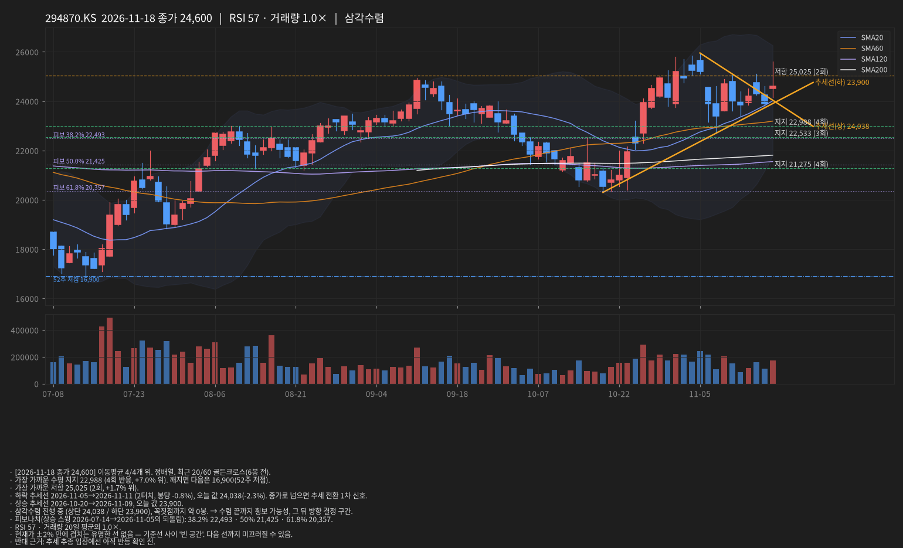
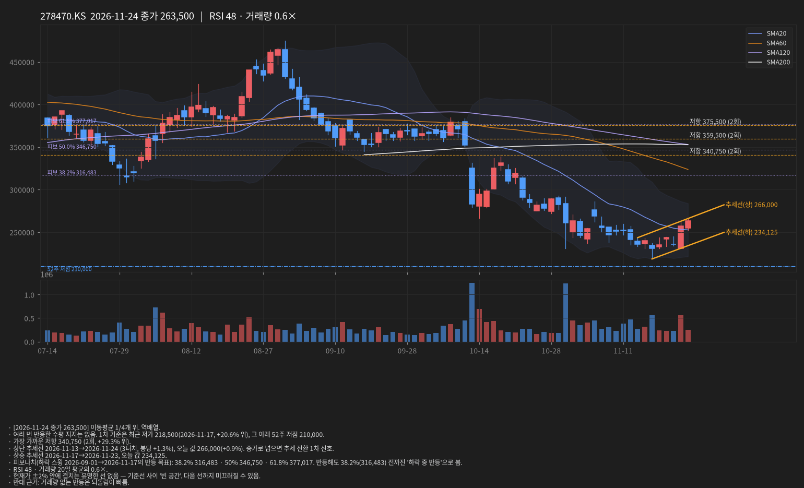

# 선 긋기 리포트 · 2026-11-27 14:24 KST

데이터: 야후 파이낸스 일봉(15분 지연) · 문장은 가능성 표현, 확률 아님

## INFQ · 2026-11-25 종가 6.49

- [2026-11-25 종가 6.49] 이동평균 0/3개 위. 역배열. 20·60·120일선 전부 아래 — 교과서적 하락 추세.
- 여러 번 반응한 수평 지지는 없음. 1차 기준은 최근 저가 5.77(2026-11-25, +12.5% 위) = 52주 저점. 깨지면 신저가라 아래 기준선 없음.
- 가장 가까운 저항 8.41 (2회, +29.7% 위).
- 하락 추세선 2026-11-09→2026-11-19 (2터치, 봉당 -2.0%), 오늘 값 7.42(+14.3%). 종가로 넘으면 추세 전환 1차 신호.
- 하단 추세선 2026-11-05→2026-11-25, 오늘 값 5.77.
- 하락쐐기 진행 중 (상단 7.42 / 하단 5.77), 꼭짓점까지 약 15봉. → 수렴 끝까지 횡보 가능성, 그 뒤 방향 결정 구간.
- 피보나치(하락 스윙 2026-06-23→2026-11-25의 반등 목표): 38.2% 9.90 · 50% 11.18 · 61.8% 12.46. 반등해도 38.2%(9.90) 전까진 '하락 중 반등'으로 봄.
- RSI 34 · 거래량 20일 평균의 1.2×.
- 현재가 ±2% 안에 겹치는 유명한 선 없음 — 기준선 사이 '빈 공간'. 다음 선까지 미끄러질 수 있음.
- 반대 근거: 모든 이평선 아래에서는 지지선이 자주 '잠깐' 반응하고 깨짐.

## 005930.KS · 2026-11-26 종가 171,300

- [2026-11-26 종가 171,300] 이동평균 0/4개 위. 역배열. 20·60·120일선 전부 아래 — 교과서적 하락 추세.
- 여러 번 반응한 수평 지지는 없음. 1차 기준은 최근 저가 170,000(2026-11-25, +0.8% 위). 그 아래는 1년 내 기준선이 멀어 올해 상승분 되돌림 구간(피보나치 참고).
- 가장 가까운 저항 204,000 (2회, +19.1% 위).
- 하락 추세선 2026-10-29→2026-11-24 (3터치, 봉당 -1.2%), 오늘 값 187,556(+9.5%). 종가로 넘으면 추세 전환 1차 신호.
- 하단 추세선 2026-10-15→2026-11-06, 오늘 값 157,062.
- 하락쐐기 진행 중 (상단 187,556 / 하단 157,062), 꼭짓점까지 약 20봉. → 수렴 끝까지 횡보 가능성, 그 뒤 방향 결정 구간.
- 피보나치(하락 스윙 2026-06-19→2026-11-25의 반등 목표): 38.2% 248,119 · 50% 272,250 · 61.8% 296,381. 반등해도 38.2%(248,119) 전까진 '하락 중 반등'으로 봄.
- RSI 34 · 거래량 20일 평균의 0.7×.
- 현재가 ±2% 안에 겹치는 유명한 선 없음 — 기준선 사이 '빈 공간'. 다음 선까지 미끄러질 수 있음.
- 반대 근거: 모든 이평선 아래에서는 지지선이 자주 '잠깐' 반응하고 깨짐.

## 000660.KS · 2026-11-26 종가 1,053,000

- [2026-11-26 종가 1,053,000] 이동평균 0/4개 위. 역배열. 20·60·120일선 전부 아래 — 교과서적 하락 추세.
- 여러 번 반응한 수평 지지는 없음. 1차 기준은 최근 저가 1,027,000(2026-11-25, +2.5% 위). 그 아래는 1년 내 기준선이 멀어 올해 상승분 되돌림 구간(피보나치 참고).
- 가장 가까운 저항 1,090,500 (2회, +3.6% 위).
- 하락 추세선 2026-10-29→2026-11-24 (2터치, 봉당 -1.3%), 오늘 값 1,170,333(+11.1%). 종가로 넘으면 추세 전환 1차 신호.
- 상승 추세선 2026-11-06→2026-11-17, 오늘 값 1,095,000 — 현재가가 이미 아래(이탈).
- 피보나치(하락 스윙 2026-06-25→2026-11-25의 반등 목표): 38.2% 1,775,720 · 50% 2,007,000 · 61.8% 2,238,280. 반등해도 38.2%(1,775,720) 전까진 '하락 중 반등'으로 봄.
- RSI 38 · 거래량 20일 평균의 0.9×.
- 현재가 ±2% 안에 겹치는 유명한 선 없음 — 기준선 사이 '빈 공간'. 다음 선까지 미끄러질 수 있음.
- 반대 근거: 모든 이평선 아래에서는 지지선이 자주 '잠깐' 반응하고 깨짐.

## 277810.KQ · 2026-11-26 종가 467,000

- [2026-11-26 종가 467,000] 이동평균 3/4개 위. 역배열. 
- 가장 가까운 수평 지지 410,167 (3회 반응, +13.9% 위). 깨지면 다음은 300,500(52주 저점).
- 가장 가까운 저항 469,375 (4회, +0.5% 위).
- 상단 추세선 2026-11-04→2026-11-24 (2터치, 봉당 +2.4%), 오늘 값 499,000(+6.9%). 종가로 넘으면 추세 전환 1차 신호.
- 상승 추세선 2026-11-17→2026-11-23, 오늘 값 436,875.
- 상승쐐기 진행 중 (상단 499,000 / 하단 436,875), 꼭짓점까지 약 11봉. → 수렴 끝까지 횡보 가능성, 그 뒤 방향 결정 구간.
- 피보나치(하락 스윙 2026-06-04→2026-11-06의 반등 목표): 38.2% 473,355 · 50% 526,750 · 61.8% 580,145. 반등해도 38.2%(473,355) 전까진 '하락 중 반등'으로 봄.
- RSI 65 · 거래량 20일 평균의 1.8×.
- ★ 합류(위) 471,365 (+0.9%): 수평 저항(4회) + 피보 38.2% — 유명한 선이 겹치는 천장. 여기서 막힐 가능성이 높고, 종가로 넘으면 의미가 큼.
- 반대 근거: 추세 추종 입장에선 아직 반등 확인 전.

## 259960.KS · 2026-11-26 종가 210,000

- [2026-11-26 종가 210,000] 이동평균 2/4개 위. 역배열. 
- 가장 가까운 수평 지지 189,833 (3회 반응, +10.6% 위). 깨지면 다음은 178,500(52주 저점).
- 가장 가까운 저항 216,167 (3회, +2.9% 위).
- 하락 추세선 2026-11-09→2026-11-20 (2터치, 봉당 -0.9%), 오늘 값 199,778(-4.9%). 종가로 넘으면 추세 전환 1차 신호.
- 상승 추세선 2026-10-30→2026-11-23, 오늘 값 190,256.
- 피보나치(하락 스윙 2026-06-04→2026-10-30의 반등 목표): 38.2% 212,689 · 50% 223,250 · 61.8% 233,811. 반등해도 38.2%(212,689) 전까진 '하락 중 반등'으로 봄.
- RSI 57 · 거래량 20일 평균의 0.8×.
- 현재가 ±2% 안에 겹치는 유명한 선 없음 — 기준선 사이 '빈 공간'. 다음 선까지 미끄러질 수 있음.
- 반대 근거: 추세 추종 입장에선 아직 반등 확인 전.

## 010140.KS · 2026-11-26 종가 13,900

- [2026-11-26 종가 13,900] 이동평균 0/4개 위. 역배열. 20·60·120일선 전부 아래 — 교과서적 하락 추세.
- 여러 번 반응한 수평 지지는 없음. 1차 기준은 최근 저가 13,530(2026-11-25, +2.7% 위) = 52주 저점. 깨지면 신저가라 아래 기준선 없음.
- 가장 가까운 저항 15,290 (2회, +10.0% 위).
- 하락 추세선 2026-11-13→2026-11-19 (4터치, 봉당 -1.6%), 오늘 값 14,738(+6.0%). 종가로 넘으면 추세 전환 1차 신호.
- 하단 추세선 2026-10-30→2026-11-09, 오늘 값 15,130 — 현재가가 이미 아래(이탈).
- 피보나치(하락 스윙 2026-06-04→2026-11-25의 반등 목표): 38.2% 19,879 · 50% 21,840 · 61.8% 23,801. 반등해도 38.2%(19,879) 전까진 '하락 중 반등'으로 봄.
- RSI 32 · 거래량 20일 평균의 0.7× → 매수 부재(거래량 없이 하락).
- 현재가 ±2% 안에 겹치는 유명한 선 없음 — 기준선 사이 '빈 공간'. 다음 선까지 미끄러질 수 있음.
- 반대 근거: 모든 이평선 아래에서는 지지선이 자주 '잠깐' 반응하고 깨짐; 거래량 없는 반등은 되돌림이 빠름.

## 294870.KS · 2026-11-26 종가 23,400

- [2026-11-26 종가 23,400] 이동평균 3/4개 위. 정배열. 
- 가장 가까운 수평 지지 22,970 (5회 반응, +1.9% 위). 깨지면 다음은 16,900(52주 저점).
- 가장 가까운 저항 25,025 (2회, +6.9% 위).
- 하락 추세선 2026-11-05→2026-11-18 (2터치, 봉당 -0.1%), 오늘 값 25,367(+8.4%). 종가로 넘으면 추세 전환 1차 신호.
- 상승 추세선 2026-10-20→2026-11-23, 오늘 값 23,225.
- 삼각수렴 진행 중 (상단 25,367 / 하단 23,225), 꼭짓점까지 약 15봉. → 수렴 끝까지 횡보 가능성, 그 뒤 방향 결정 구간.
- 피보나치(상승 스윙 2026-07-14→2026-11-05의 되돌림): 38.2% 22,493 · 50% 21,425 · 61.8% 20,357. 
- RSI 48 · 거래량 20일 평균의 0.4× → 매수 부재(거래량 없이 하락).
- ★ 합류(아래) 23,272 (-0.5%): 상승 추세선 + SMA60 — 유명한 선이 겹치는 받침. 한 번 튀어오를 가능성이 높지만 바닥 보장은 아님 → 반등 확인 후 진입.
- 반대 근거: 거래량 없는 반등은 되돌림이 빠름.

## 251270.KS · 2026-11-26 종가 32,000

- [2026-11-26 종가 32,000] 이동평균 0/4개 위. 역배열. 20·60·120일선 전부 아래 — 교과서적 하락 추세.
- 가장 가까운 수평 지지 30,975 (2회 반응, +3.3% 위). 깨지면 다음은 29,700(52주 저점).
- 가장 가까운 저항 33,980 (5회, +6.2% 위).
- 하락 추세선 2026-11-11→2026-11-26 (3터치, 봉당 -0.7%), 오늘 값 32,900(+2.8%). 종가로 넘으면 추세 전환 1차 신호.
- 하단 추세선 2026-09-29→2026-11-23, 오늘 값 29,347.
- 하락쐐기 진행 중 (상단 32,900 / 하단 29,347), 꼭짓점까지 약 31봉. → 수렴 끝까지 횡보 가능성, 그 뒤 방향 결정 구간.
- 피보나치(하락 스윙 2026-06-04→2026-11-23의 반등 목표): 38.2% 35,468 · 50% 37,250 · 61.8% 39,032. 반등해도 38.2%(35,468) 전까진 '하락 중 반등'으로 봄.
- RSI 46 · 거래량 20일 평균의 0.6× → 매수 부재(거래량 없이 하락).
- 현재가 ±2% 안에 겹치는 유명한 선 없음 — 기준선 사이 '빈 공간'. 다음 선까지 미끄러질 수 있음.
- 반대 근거: 모든 이평선 아래에서는 지지선이 자주 '잠깐' 반응하고 깨짐; 거래량 없는 반등은 되돌림이 빠름.

## 278470.KS · 2026-11-26 종가 298,500

- [2026-11-26 종가 298,500] 이동평균 1/4개 위. 역배열. 
- 가장 가까운 수평 지지 231,000 (2회 반응, +29.2% 위). 깨지면 다음은 210,000(52주 저점).
- 가장 가까운 저항 340,750 (2회, +14.2% 위).
- 상단 추세선 2026-11-06→2026-11-26 (2터치, 봉당 +1.1%), 오늘 값 309,500(+3.7%). 종가로 넘으면 추세 전환 1차 신호.
- 상승 추세선 2026-11-17→2026-11-23, 오늘 값 240,375.
- 상승쐐기 모양이지만 꼭짓점이 멀어(60봉 넘게) 아직 신호로 보기 어려움.
- 피보나치(하락 스윙 2026-09-01→2026-11-17의 반등 목표): 38.2% 316,483 · 50% 346,750 · 61.8% 377,017. 반등해도 38.2%(316,483) 전까진 '하락 중 반등'으로 봄.
- RSI 60 · 거래량 20일 평균의 1.4×.
- 현재가 ±2% 안에 겹치는 유명한 선 없음 — 기준선 사이 '빈 공간'. 다음 선까지 미끄러질 수 있음.
- 반대 근거: 추세 추종 입장에선 아직 반등 확인 전.

## 036460.KS · 2026-11-26 종가 35,650

- [2026-11-26 종가 35,650] 이동평균 1/4개 위. 정배열. 
- 가장 가까운 수평 지지 31,275 (2회 반응, +14.0% 위). 깨지면 다음은 31,150(52주 저점).
- 가장 가까운 저항 35,700 (5회, +0.1% 위).
- 상단 추세선 2026-10-22→2026-11-13 (3터치, 봉당 +0.4%), 오늘 값 40,181(+12.7%). 종가로 넘으면 추세 전환 1차 신호.
- 하단 추세선 2026-10-22→2026-11-24, 오늘 값 34,572.
- 피보나치(상승 스윙 2026-06-26→2026-11-13의 되돌림): 38.2% 36,001 · 50% 35,075 · 61.8% 34,149. 
- RSI 42 · 거래량 20일 평균의 0.5× → 매수 부재(거래량 없이 하락).
- ★ 합류(아래) 35,299 (-1.0%): 피보 50.0% + 볼린저 하단 + SMA120 — 유명한 선이 겹치는 받침. 한 번 튀어오를 가능성이 높지만 바닥 보장은 아님 → 반등 확인 후 진입.
- ★ 합류(위) 35,926 (+0.8%): 수평 저항(5회) + 전저점 + 피보 38.2% — 유명한 선이 겹치는 천장. 여기서 막힐 가능성이 높고, 종가로 넘으면 의미가 큼.
- 반대 근거: 거래량 없는 반등은 되돌림이 빠름.

## 196170.KQ · 2026-11-26 종가 170,300

- [2026-11-26 종가 170,300] 이동평균 0/4개 위. 역배열. 20·60·120일선 전부 아래 — 교과서적 하락 추세.
- 여러 번 반응한 수평 지지는 없음. 1차 기준은 최근 저가 158,400(2026-11-24, +7.5% 위), 그 아래 52주 저점 152,500.
- 가장 가까운 저항 243,750 (2회, +43.1% 위).
- 하락 추세선 2026-11-05→2026-11-20 (2터치, 봉당 -1.7%), 오늘 값 166,318(-2.3%). 종가로 넘으면 추세 전환 1차 신호.
- 상승 추세선 2026-11-09→2026-11-24, 오늘 값 159,473.
- 삼각수렴 진행 중 (상단 166,318 / 하단 159,473), 꼭짓점까지 약 2봉. → 수렴 끝까지 횡보 가능성, 그 뒤 방향 결정 구간.
- 피보나치(하락 스윙 2026-08-10→2026-11-09의 반등 목표): 38.2% 230,237 · 50% 254,250 · 61.8% 278,263. 반등해도 38.2%(230,237) 전까진 '하락 중 반등'으로 봄.
- RSI 36 · 거래량 20일 평균의 0.8×.
- 현재가 ±2% 안에 겹치는 유명한 선 없음 — 기준선 사이 '빈 공간'. 다음 선까지 미끄러질 수 있음.
- 반대 근거: 모든 이평선 아래에서는 지지선이 자주 '잠깐' 반응하고 깨짐.

## 064350.KS · 2026-11-26 종가 58,100

- [2026-11-26 종가 58,100] 이동평균 0/4개 위. 역배열. 20·60·120일선 전부 아래 — 교과서적 하락 추세.
- 여러 번 반응한 수평 지지는 없음. 1차 기준은 최근 저가 56,700(2026-11-23, +2.5% 위) = 52주 저점. 깨지면 신저가라 아래 기준선 없음.
- 가장 가까운 저항 117,550 (2회, +102.3% 위).
- 하락 추세선 2026-10-06→2026-11-12 (2터치, 봉당 -1.4%), 오늘 값 59,162(+1.8%). 종가로 넘으면 추세 전환 1차 신호.
- 하단 추세선 2026-11-06→2026-11-23, 오늘 값 53,645.
- 하락쐐기 진행 중 (상단 59,162 / 하단 53,645), 꼭짓점까지 약 9봉. → 수렴 끝까지 횡보 가능성, 그 뒤 방향 결정 구간.
- 피보나치(하락 스윙 2026-06-16→2026-11-23의 반등 목표): 38.2% 126,721 · 50% 148,350 · 61.8% 169,979. 반등해도 38.2%(126,721) 전까진 '하락 중 반등'으로 봄.
- RSI 26 과매도 · 거래량 20일 평균의 0.9×.
- 현재가 ±2% 안에 겹치는 유명한 선 없음 — 기준선 사이 '빈 공간'. 다음 선까지 미끄러질 수 있음.
- 반대 근거: RSI 과매도는 하락 추세에서 며칠씩 유지될 수 있음; 모든 이평선 아래에서는 지지선이 자주 '잠깐' 반응하고 깨짐.

## 알림
- [dn] **INFQ** 손절 이탈: 6.49으로 마감해 손절선(8.57) 아래예요. 규칙대로면 단기분 정리 — 다음 장 시작가 확인.
- [warn] **277810.KQ** 합류 천장: 471,365까지 +0.9%. 넘어서 마감하면 의미가 커요.
- [ok] **294870.KS** 합류 받침: 23,272까지 −0.5%. 기준 두세 개가 겹친 자리예요 — 반등을 확인하고 판단하세요.
- [ok] **036460.KS** 합류 받침: 35,299까지 −1.0%. 기준 두세 개가 겹친 자리예요 — 반등을 확인하고 판단하세요.
- [warn] **036460.KS** 합류 천장: 35,926까지 +0.8%. 넘어서 마감하면 의미가 커요.
- [up] **196170.KQ** 추세선 돌파: 170,300으로 마감해 흐름선(166,318) 위로 올라섰어요. 내일도 위면 1/3 매수 검토.

## 급락/급등 원인 분해
- [2026-11-25] INFQ +2.4% = 지수 -0.8%(β3.0×^GSPC -0.3%) + 업종 +4.4%(양자 피어 +4.1%) + 종목 고유 -1.3%. 주원인: 업종 · 거래량 1.2× → 보통. 섹터 FUD 성격 — 펀더멘털 변화 없으면 플레이북 유지.
- [2026-11-26] 005930.KS +0.4% = 지수 +0.4%(β1.3×^KS11 +0.3%) + 업종 +0.6%(반도체 피어 +0.9%) + 종목 고유 -0.6%. 주원인: 종목 고유 · 거래량 0.7× → 보통.
- [2026-11-26] 000660.KS +2.2% = 지수 +0.5%(β1.6×^KS11 +0.3%) + 업종 -0.4%(반도체 피어 -0.1%) + 종목 고유 +2.1%. 주원인: 종목 고유 · 거래량 0.9× → 보통.
- [2026-10-19] 013030.KQ -0.5% = 지수 +0.9%(β0.5×^KQ11 +1.8%) + 업종 +0.0% + 종목 고유 -1.4%. 주원인: 종목 고유 · 거래량 0.5× → 매수 부재(거래량 없이 하락).
- [2026-10-19] 054950.KQ -0.2% = 지수 +0.3%(β0.2×^KQ11 +1.8%) + 업종 +0.0% + 종목 고유 -0.6%. 주원인: 종목 고유 · 거래량 0.9× → 보통.
- [2026-10-19] 236200.KQ +1.2% = 지수 +1.2%(β0.7×^KQ11 +1.8%) + 업종 +0.0% + 종목 고유 +0.0%. 주원인: 지수 · 거래량 0.5× → 보통. 시장 전체 움직임 — 종목 판단과 분리.
- [2026-10-19] 036800.KQ -1.4% = 지수 +0.1%(β0.1×^KQ11 +1.8%) + 업종 +0.0% + 종목 고유 -1.5%. 주원인: 종목 고유 · 거래량 0.3× → 매수 부재(거래량 없이 하락).
- [2026-10-19] 200670.KQ +2.2% = 지수 +1.1%(β0.6×^KQ11 +1.8%) + 업종 +0.0% + 종목 고유 +1.1%. 주원인: 지수 · 거래량 0.4× → 보통. 시장 전체 움직임 — 종목 판단과 분리.
- [2026-10-19] 015230.KS +1.1% = 지수 +0.3%(β0.2×^KS11 +1.8%) + 업종 +0.0% + 종목 고유 +0.8%. 주원인: 종목 고유 · 거래량 1.0× → 보통.
- [2026-10-19] 044960.KQ +0.3% = 지수 +0.3%(β0.2×^KQ11 +1.8%) + 업종 +0.0% + 종목 고유 +0.0%. 주원인: 지수 · 거래량 0.4× → 보통. 시장 전체 움직임 — 종목 판단과 분리.

## 판단 보드
- **INFQ** [exit] 손절선 8.57 아래 마감 — 규칙대로면 단기분 정리
- **005930.KS** [exit] 무효선 204,500 아래 — 관심 해제 검토
- **000660.KS** [wait] 기다림 — 흐름선까지 +11.1%
- **277810.KQ** [wait] 기다림 — 막힐 자리 471,365 (+0.9%) 아래. 넘어서 마감하면 다시 판단
- **259960.KS** [enter] 하락 흐름 끊김 — 종가 210,000 ≥ 흐름선 199,778 · 2일째
- **010140.KS** [wait] 기다림 — 흐름선까지 +6.0%
- **294870.KS** [wait] 기다림 — 바닥 후보 23,272 (-0.5%) 위. 반등 확인 전엔 사지 않기
- **251270.KS** [wait] 기다림 — 흐름선까지 +2.8%
- **278470.KS** [wait] 기다림 — 흐름선까지 +3.7%
- **036460.KS** [wait] 기다림 — 막힐 자리 35,926 (+0.8%) 아래. 넘어서 마감하면 다시 판단
- **196170.KQ** [enter] 하락 흐름 끊김 — 종가 170,300 ≥ 흐름선 166,318 · 내일도 위면 1/3 검토
- **064350.KS** [wait] 기다림 — 많이 팔린 상태(RSI 26), 바닥 후보는 없음. 거래량 늘며 오르는지 보기
