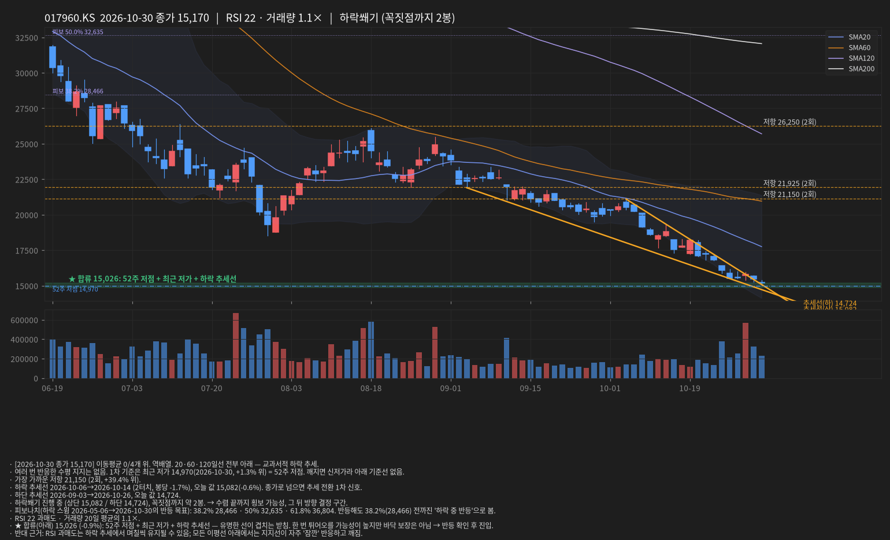
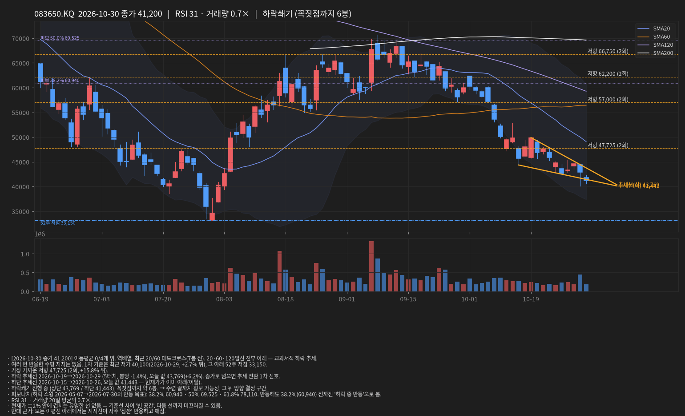
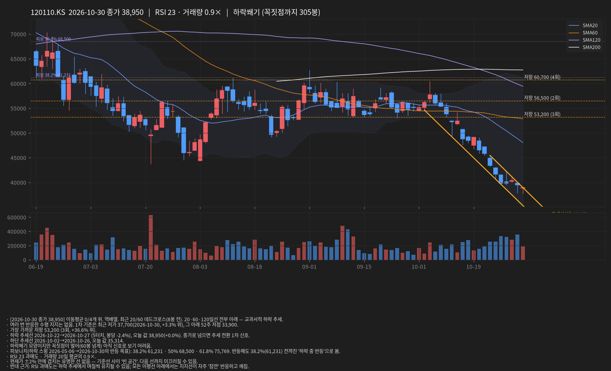

# 선 긋기 리포트 · 2026-10-31 12:04 KST

데이터: 야후 파이낸스 일봉(15분 지연) · 문장은 가능성 표현, 확률 아님

## INFQ · 2026-10-30 종가 8.88

- [2026-10-30 종가 8.88] 이동평균 0/3개 위. 역배열. 20·60·120일선 전부 아래 — 교과서적 하락 추세.
- 가장 가까운 수평 지지 8.77 (2회 반응, +1.3% 위). 깨지면 다음은 8.38(52주 저점).
- 가장 가까운 저항 12.24 (2회, +37.9% 위).
- 하락 추세선 2026-09-23→2026-10-28 (2터치, 봉당 -1.4%), 오늘 값 9.42(+6.1%). 종가로 넘으면 추세 전환 1차 신호.
- 상승 추세선 2026-10-20→2026-10-26, 오늘 값 8.52.
- 삼각수렴 진행 중 (상단 9.42 / 하단 8.52), 꼭짓점까지 약 4봉. → 수렴 끝까지 횡보 가능성, 그 뒤 방향 결정 구간.
- 피보나치(하락 스윙 2026-06-02→2026-10-20의 반등 목표): 38.2% 13.11 · 50% 14.57 · 61.8% 16.02. 반등해도 38.2%(13.11) 전까진 '하락 중 반등'으로 봄.
- RSI 36 · 거래량 20일 평균의 0.8×.
- 현재가 ±2% 안에 겹치는 유명한 선 없음 — 기준선 사이 '빈 공간'. 다음 선까지 미끄러질 수 있음.
- 반대 근거: 모든 이평선 아래에서는 지지선이 자주 '잠깐' 반응하고 깨짐.

## 005930.KS · 2026-10-30 종가 225,000

- [2026-10-30 종가 225,000] 이동평균 0/4개 위. 역배열. 최근 20/60 데드크로스(7봉 전). 20·60·120일선 전부 아래 — 교과서적 하락 추세.
- 가장 가까운 수평 지지 204,000 (2회 반응, +10.3% 위). 깨지면 다음은 94,500(52주 저점).
- 가장 가까운 저항 245,125 (4회, +8.9% 위).
- 상단 추세선 2026-10-22→2026-10-29 (3터치, 봉당 +2.0%), 오늘 값 253,600(+12.7%). 종가로 넘으면 추세 전환 1차 신호.
- 하단 추세선 2026-10-15→2026-10-23, 오늘 값 202,667.
- 피보나치(하락 스윙 2026-06-19→2026-07-29의 반등 목표): 38.2% 259,985 · 50% 281,850 · 61.8% 303,715. 반등해도 38.2%(259,985) 전까진 '하락 중 반등'으로 봄.
- RSI 44 · 거래량 20일 평균의 1.1×.
- 현재가 ±2% 안에 겹치는 유명한 선 없음 — 기준선 사이 '빈 공간'. 다음 선까지 미끄러질 수 있음.
- 반대 근거: 모든 이평선 아래에서는 지지선이 자주 '잠깐' 반응하고 깨짐.

## 000660.KS · 2026-10-30 종가 1,418,000

- [2026-10-30 종가 1,418,000] 이동평균 0/4개 위. 역배열. 최근 20/60 데드크로스(8봉 전). 20·60·120일선 전부 아래 — 교과서적 하락 추세.
- 여러 번 반응한 수평 지지는 없음. 1차 기준은 최근 저가 1,171,000(2026-10-23, +21.1% 위). 그 아래는 1년 내 기준선이 멀어 올해 상승분 되돌림 구간(피보나치 참고).
- 가장 가까운 저항 1,557,500 (2회, +9.8% 위).
- 상단 추세선 2026-10-14→2026-10-29 (2터치, 봉당 +0.5%), 오늘 값 1,595,182(+12.5%). 종가로 넘으면 추세 전환 1차 신호.
- 상승 추세선 2026-10-23→2026-10-30, 오늘 값 1,381,000.
- 상승쐐기 진행 중 (상단 1,595,182 / 하단 1,381,000), 꼭짓점까지 약 6봉. → 수렴 끝까지 횡보 가능성, 그 뒤 방향 결정 구간.
- 피보나치(하락 스윙 2026-06-25→2026-10-23의 반등 목표): 38.2% 1,864,712 · 50% 2,079,000 · 61.8% 2,293,288. 반등해도 38.2%(1,864,712) 전까진 '하락 중 반등'으로 봄.
- RSI 45 · 거래량 20일 평균의 1.1×.
- 현재가 ±2% 안에 겹치는 유명한 선 없음 — 기준선 사이 '빈 공간'. 다음 선까지 미끄러질 수 있음.
- 반대 근거: 모든 이평선 아래에서는 지지선이 자주 '잠깐' 반응하고 깨짐.

## 277810.KQ · 2026-10-30 종가 363,000

- [2026-10-30 종가 363,000] 이동평균 0/4개 위. 역배열. 20·60·120일선 전부 아래 — 교과서적 하락 추세.
- 가장 가까운 수평 지지 342,000 (2회 반응, +6.1% 위). 깨지면 다음은 334,500(52주 저점).
- 가장 가까운 저항 364,250 (2회, +0.3% 위).
- 하락 추세선 2026-10-08→2026-10-28 (2터치, 봉당 -0.7%), 오늘 값 402,769(+11.0%). 종가로 넘으면 추세 전환 1차 신호.
- 상승 추세선 2026-10-19→2026-10-26, 오늘 값 348,000.
- 삼각수렴 진행 중 (상단 402,769 / 하단 348,000), 꼭짓점까지 약 12봉. → 수렴 끝까지 횡보 가능성, 그 뒤 방향 결정 구간.
- 피보나치(하락 스윙 2026-05-12→2026-10-19의 반등 목표): 38.2% 580,699 · 50% 656,750 · 61.8% 732,801. 반등해도 38.2%(580,699) 전까진 '하락 중 반등'으로 봄.
- RSI 43 · 거래량 20일 평균의 0.7×.
- 현재가 ±2% 안에 겹치는 유명한 선 없음 — 기준선 사이 '빈 공간'. 다음 선까지 미끄러질 수 있음.
- 반대 근거: 모든 이평선 아래에서는 지지선이 자주 '잠깐' 반응하고 깨짐.

## 259960.KS · 2026-10-30 종가 182,100

- [2026-10-30 종가 182,100] 이동평균 0/4개 위. 역배열. 20·60·120일선 전부 아래 — 교과서적 하락 추세.
- 여러 번 반응한 수평 지지는 없음. 1차 기준은 최근 저가 178,500(2026-10-30, +2.0% 위) = 52주 저점. 깨지면 신저가라 아래 기준선 없음.
- 가장 가까운 저항 216,167 (3회, +18.7% 위).
- 하락 추세선 2026-09-23→2026-10-20 (3터치, 봉당 -0.0%), 오늘 값 203,233(+11.6%). 종가로 넘으면 추세 전환 1차 신호.
- 하단 추세선 2026-08-28→2026-10-13, 오늘 값 163,700.
- 피보나치(하락 스윙 2026-05-15→2026-10-30의 반등 목표): 38.2% 223,576 · 50% 237,500 · 61.8% 251,424. 반등해도 38.2%(223,576) 전까진 '하락 중 반등'으로 봄.
- RSI 34 · 거래량 20일 평균의 0.9×.
- ★ 합류(아래) 178,500 (-2.0%): 52주 저점 + 최근 저가 — 유명한 선이 겹치는 받침. 한 번 튀어오를 가능성이 높지만 바닥 보장은 아님 → 반등 확인 후 진입.
- 반대 근거: 모든 이평선 아래에서는 지지선이 자주 '잠깐' 반응하고 깨짐.

## 017960.KS · 2026-10-30 종가 15,170

- [2026-10-30 종가 15,170] 이동평균 0/4개 위. 역배열. 20·60·120일선 전부 아래 — 교과서적 하락 추세.
- 여러 번 반응한 수평 지지는 없음. 1차 기준은 최근 저가 14,970(2026-10-30, +1.3% 위) = 52주 저점. 깨지면 신저가라 아래 기준선 없음.
- 가장 가까운 저항 21,150 (2회, +39.4% 위).
- 하락 추세선 2026-10-06→2026-10-14 (2터치, 봉당 -1.7%), 오늘 값 15,082(-0.6%). 종가로 넘으면 추세 전환 1차 신호.
- 하단 추세선 2026-09-03→2026-10-26, 오늘 값 14,724.
- 하락쐐기 진행 중 (상단 15,082 / 하단 14,724), 꼭짓점까지 약 2봉. → 수렴 끝까지 횡보 가능성, 그 뒤 방향 결정 구간.
- 피보나치(하락 스윙 2026-05-06→2026-10-30의 반등 목표): 38.2% 28,466 · 50% 32,635 · 61.8% 36,804. 반등해도 38.2%(28,466) 전까진 '하락 중 반등'으로 봄.
- RSI 22 과매도 · 거래량 20일 평균의 1.1×.
- ★ 합류(아래) 15,026 (-0.9%): 52주 저점 + 최근 저가 + 하락 추세선 — 유명한 선이 겹치는 받침. 한 번 튀어오를 가능성이 높지만 바닥 보장은 아님 → 반등 확인 후 진입.
- 반대 근거: RSI 과매도는 하락 추세에서 며칠씩 유지될 수 있음; 모든 이평선 아래에서는 지지선이 자주 '잠깐' 반응하고 깨짐.

## 083650.KQ · 2026-10-30 종가 41,200

- [2026-10-30 종가 41,200] 이동평균 0/4개 위. 역배열. 최근 20/60 데드크로스(7봉 전). 20·60·120일선 전부 아래 — 교과서적 하락 추세.
- 여러 번 반응한 수평 지지는 없음. 1차 기준은 최근 저가 40,100(2026-10-29, +2.7% 위), 그 아래 52주 저점 33,150.
- 가장 가까운 저항 47,725 (2회, +15.8% 위).
- 하락 추세선 2026-10-19→2026-10-29 (5터치, 봉당 -1.4%), 오늘 값 43,769(+6.2%). 종가로 넘으면 추세 전환 1차 신호.
- 하단 추세선 2026-10-15→2026-10-26, 오늘 값 41,443 — 현재가가 이미 아래(이탈).
- 하락쐐기 진행 중 (상단 43,769 / 하단 41,443), 꼭짓점까지 약 6봉. → 수렴 끝까지 횡보 가능성, 그 뒤 방향 결정 구간.
- 피보나치(하락 스윙 2026-05-07→2026-07-30의 반등 목표): 38.2% 60,940 · 50% 69,525 · 61.8% 78,110. 반등해도 38.2%(60,940) 전까진 '하락 중 반등'으로 봄.
- RSI 31 · 거래량 20일 평균의 0.7×.
- 현재가 ±2% 안에 겹치는 유명한 선 없음 — 기준선 사이 '빈 공간'. 다음 선까지 미끄러질 수 있음.
- 반대 근거: 모든 이평선 아래에서는 지지선이 자주 '잠깐' 반응하고 깨짐.

## 120110.KS · 2026-10-30 종가 38,950

- [2026-10-30 종가 38,950] 이동평균 0/4개 위. 역배열. 최근 20/60 데드크로스(8봉 전). 20·60·120일선 전부 아래 — 교과서적 하락 추세.
- 여러 번 반응한 수평 지지는 없음. 1차 기준은 최근 저가 37,700(2026-10-30, +3.3% 위), 그 아래 52주 저점 33,900.
- 가장 가까운 저항 53,200 (3회, +36.6% 위).
- 하락 추세선 2026-10-22→2026-10-27 (5터치, 봉당 -2.4%), 오늘 값 38,950(+0.0%). 종가로 넘으면 추세 전환 1차 신호.
- 하단 추세선 2026-10-02→2026-10-26, 오늘 값 35,314.
- 하락쐐기 모양이지만 꼭짓점이 멀어(60봉 넘게) 아직 신호로 보기 어려움.
- 피보나치(하락 스윙 2026-05-06→2026-10-30의 반등 목표): 38.2% 61,231 · 50% 68,500 · 61.8% 75,769. 반등해도 38.2%(61,231) 전까진 '하락 중 반등'으로 봄.
- RSI 23 과매도 · 거래량 20일 평균의 0.9×.
- 현재가 ±2% 안에 겹치는 유명한 선 없음 — 기준선 사이 '빈 공간'. 다음 선까지 미끄러질 수 있음.
- 반대 근거: RSI 과매도는 하락 추세에서 며칠씩 유지될 수 있음; 모든 이평선 아래에서는 지지선이 자주 '잠깐' 반응하고 깨짐.

## 001120.KS · 2026-10-30 종가 40,300

- [2026-10-30 종가 40,300] 이동평균 1/4개 위. 정배열. 최근 60/120 골든크로스(2봉 전). 
- 가장 가까운 수평 지지 38,317 (3회 반응, +5.2% 위). 깨지면 다음은 29,000(52주 저점).
- 가장 가까운 저항 40,783 (3회, +1.2% 위).
- 하락 추세선 2026-10-16→2026-10-21 (4터치, 봉당 -0.2%), 오늘 값 44,300(+9.9%). 종가로 넘으면 추세 전환 1차 신호.
- 하단 추세선 2026-10-01→2026-10-29, 오늘 값 39,117.
- 피보나치(하락 스윙 2026-05-06→2026-06-23의 반등 목표): 38.2% 40,556 · 50% 42,875 · 61.8% 45,194. 반등해도 38.2%(40,556) 전까진 '하락 중 반등'으로 봄.
- RSI 39 · 거래량 20일 평균의 0.9×.
- ★ 합류(아래) 40,051 (-0.6%): 볼린저 하단 + SMA120 — 유명한 선이 겹치는 받침. 한 번 튀어오를 가능성이 높지만 바닥 보장은 아님 → 반등 확인 후 진입.
- ★ 합류(위) 40,657 (+0.9%): SMA60 + 피보 38.2% + 수평 저항(3회) — 유명한 선이 겹치는 천장. 여기서 막힐 가능성이 높고, 종가로 넘으면 의미가 큼.
- 반대 근거: 추세 추종 입장에선 아직 반등 확인 전.

## 011200.KS · 2026-10-30 종가 23,350

- [2026-10-30 종가 23,350] 이동평균 4/4개 위. 정배열. 
- 가장 가까운 수평 지지 22,117 (3회 반응, +5.6% 위). 깨지면 다음은 17,910(52주 저점).
- 상단 추세선 2026-09-14→2026-10-16 (3터치, 봉당 +0.7%), 오늘 값 25,700(+10.1%). 종가로 넘으면 추세 전환 1차 신호.
- 상승 추세선 2026-09-23→2026-10-12, 오늘 값 20,956.
- 피보나치(상승 스윙 2026-06-26→2026-10-16의 되돌림): 38.2% 21,828 · 50% 21,080 · 61.8% 20,332. 
- RSI 61 · 거래량 20일 평균의 1.1×.
- 현재가 ±2% 안에 겹치는 유명한 선 없음 — 기준선 사이 '빈 공간'. 다음 선까지 미끄러질 수 있음.
- 반대 근거: 추세 추종 입장에선 아직 반등 확인 전.

## 251270.KS · 2026-10-30 종가 33,750

- [2026-10-30 종가 33,750] 이동평균 0/4개 위. 역배열. 20·60·120일선 전부 아래 — 교과서적 하락 추세.
- 가장 가까운 수평 지지 32,950 (2회 반응, +2.4% 위). 깨지면 다음은 32,950(52주 저점).
- 가장 가까운 저항 34,130 (5회, +1.1% 위).
- 상단 추세선 2026-09-14→2026-10-16 (4터치, 봉당 +0.1%), 오늘 값 36,175(+7.2%). 종가로 넘으면 추세 전환 1차 신호.
- 하단 추세선 2026-09-09→2026-10-15, 오늘 값 32,350.
- 피보나치(하락 스윙 2026-05-06→2026-10-15의 반등 목표): 38.2% 39,253 · 50% 41,200 · 61.8% 43,147. 반등해도 38.2%(39,253) 전까진 '하락 중 반등'으로 봄.
- RSI 42 · 거래량 20일 평균의 0.6×.
- ★ 합류(위) 34,181 (+1.3%): 수평 저항(5회) + SMA20 + 볼린저 중심 — 유명한 선이 겹치는 천장. 여기서 막힐 가능성이 높고, 종가로 넘으면 의미가 큼.
- 반대 근거: 모든 이평선 아래에서는 지지선이 자주 '잠깐' 반응하고 깨짐; 거래량 없는 반등은 되돌림이 빠름.

## 377300.KS · 2026-10-30 종가 33,850

- [2026-10-30 종가 33,850] 이동평균 0/4개 위. 역배열. 20·60·120일선 전부 아래 — 교과서적 하락 추세.
- 여러 번 반응한 수평 지지는 없음. 1차 기준은 최근 저가 32,400(2026-10-27, +4.5% 위) = 52주 저점. 깨지면 신저가라 아래 기준선 없음.
- 가장 가까운 저항 36,725 (2회, +8.5% 위).
- 하락 추세선 2026-10-06→2026-10-28 (3터치, 봉당 -1.0%), 오늘 값 34,170(+0.9%). 종가로 넘으면 추세 전환 1차 신호.
- 하단 추세선 2026-09-03→2026-10-15, 오늘 값 29,733.
- 하락쐐기 모양이지만 꼭짓점이 멀어(60봉 넘게) 아직 신호로 보기 어려움.
- 피보나치(하락 스윙 2026-05-06→2026-10-27의 반등 목표): 38.2% 44,548 · 50% 48,300 · 61.8% 52,052. 반등해도 38.2%(44,548) 전까진 '하락 중 반등'으로 봄.
- RSI 34 · 거래량 20일 평균의 0.8×.
- 현재가 ±2% 안에 겹치는 유명한 선 없음 — 기준선 사이 '빈 공간'. 다음 선까지 미끄러질 수 있음.
- 반대 근거: 모든 이평선 아래에서는 지지선이 자주 '잠깐' 반응하고 깨짐.

## 012330.KS · 2026-10-30 종가 334,000

- [2026-10-30 종가 334,000] 이동평균 0/4개 위. 역배열. 20·60·120일선 전부 아래 — 교과서적 하락 추세.
- 여러 번 반응한 수평 지지는 없음. 1차 기준은 최근 저가 317,500(2026-10-26, +5.2% 위), 그 아래 52주 저점 283,000.
- 가장 가까운 저항 454,000 (2회, +35.9% 위).
- 하락 추세선 2026-09-01→2026-10-20 (2터치, 봉당 -0.6%), 오늘 값 346,145(+3.6%). 종가로 넘으면 추세 전환 1차 신호.
- 하단 추세선 2026-09-02→2026-10-15, 오늘 값 298,500.
- 피보나치(하락 스윙 2026-06-01→2026-10-26의 반등 목표): 38.2% 510,219 · 50% 569,750 · 61.8% 629,281. 반등해도 38.2%(510,219) 전까진 '하락 중 반등'으로 봄.
- RSI 39 · 거래량 20일 평균의 0.8×.
- 현재가 ±2% 안에 겹치는 유명한 선 없음 — 기준선 사이 '빈 공간'. 다음 선까지 미끄러질 수 있음.
- 반대 근거: RSI 과매도는 하락 추세에서 며칠씩 유지될 수 있음; 모든 이평선 아래에서는 지지선이 자주 '잠깐' 반응하고 깨짐.

## 알림
- [ok] **005930.KS** 수급 전환: 최근 5일 외국인·기관 +1.1조 순매수 (20일은 −4.4조). 바닥 후보·흐름선과 같이 확인하세요.
- [ok] **000660.KS** 수급 전환: 최근 5일 외국인·기관 +1,988억 순매수 (20일은 −9.7조). 바닥 후보·흐름선과 같이 확인하세요.
- [ok] **259960.KS** 합류 받침: 178,500까지 −2.0%. 기준 두세 개가 겹친 자리예요 — 반등을 확인하고 판단하세요.
- [ok] **017960.KS** 합류 받침: 15,026까지 −0.9%. 기준 두세 개가 겹친 자리예요 — 반등을 확인하고 판단하세요.
- [dn] **083650.KQ** 하단선 이탈: 41,200으로 마감해 아래 흐름선(41,443) 밑으로 내려갔어요. 다음 바닥까지 밀릴 수 있어요.
- [up] **120110.KS** 진입 조건: 38,950으로 마감해 흐름선(38,950) 위로 올라섰어요. 내일도 위면 1/3 매수 검토.
- [ok] **001120.KS** 합류 받침: 40,051까지 −0.6%. 기준 두세 개가 겹친 자리예요 — 반등을 확인하고 판단하세요.
- [warn] **001120.KS** 합류 천장: 40,657까지 +0.9%. 넘어서 마감하면 의미가 커요.
- [ok] **214450.KQ** 합류 받침: 208,000까지 −1.9%. 기준 두세 개가 겹친 자리예요 — 반등을 확인하고 판단하세요.

## 급락/급등 원인 분해
- [2026-10-30] INFQ -5.8% = 지수 -5.5%(β3.0×^GSPC -1.8%) + 업종 -4.8%(양자 피어 -6.6%) + 종목 고유 +4.4%. 주원인: 지수 · 거래량 0.8× → 보통. 시장 전체 움직임 — 종목 판단과 분리.
- [2026-10-30] 005930.KS -3.0% = 지수 -4.7%(β1.4×^KS11 -3.5%) + 업종 -4.2%(반도체 피어 -7.7%) + 종목 고유 +5.9%. 주원인: 종목 고유 · 거래량 1.1× → 보통. 종목 고유 뉴스/공시를 먼저 확인.
- [2026-10-30] 000660.KS -7.1% = 지수 -5.7%(β1.6×^KS11 -3.5%) + 업종 -2.1%(반도체 피어 -5.6%) + 종목 고유 +0.8%. 주원인: 지수 · 거래량 1.1× → 보통. 시장 전체 움직임 — 종목 판단과 분리.
- [2026-10-19] 013030.KQ -0.5% = 지수 +0.9%(β0.5×^KQ11 +1.8%) + 업종 +0.0% + 종목 고유 -1.4%. 주원인: 종목 고유 · 거래량 0.5× → 매수 부재(거래량 없이 하락).
- [2026-10-19] 054950.KQ -0.2% = 지수 +0.3%(β0.2×^KQ11 +1.8%) + 업종 +0.0% + 종목 고유 -0.6%. 주원인: 종목 고유 · 거래량 0.9× → 보통.
- [2026-10-19] 236200.KQ +1.2% = 지수 +1.2%(β0.7×^KQ11 +1.8%) + 업종 +0.0% + 종목 고유 +0.0%. 주원인: 지수 · 거래량 0.5× → 보통. 시장 전체 움직임 — 종목 판단과 분리.
- [2026-10-19] 036800.KQ -1.4% = 지수 +0.1%(β0.1×^KQ11 +1.8%) + 업종 +0.0% + 종목 고유 -1.5%. 주원인: 종목 고유 · 거래량 0.3× → 매수 부재(거래량 없이 하락).
- [2026-10-19] 200670.KQ +2.2% = 지수 +1.1%(β0.6×^KQ11 +1.8%) + 업종 +0.0% + 종목 고유 +1.1%. 주원인: 지수 · 거래량 0.4× → 보통. 시장 전체 움직임 — 종목 판단과 분리.
- [2026-10-19] 015230.KS +1.1% = 지수 +0.3%(β0.2×^KS11 +1.8%) + 업종 +0.0% + 종목 고유 +0.8%. 주원인: 종목 고유 · 거래량 1.0× → 보통.
- [2026-10-19] 044960.KQ +0.3% = 지수 +0.3%(β0.2×^KQ11 +1.8%) + 업종 +0.0% + 종목 고유 +0.0%. 주원인: 지수 · 거래량 0.4× → 보통. 시장 전체 움직임 — 종목 판단과 분리.

## 판단 보드
- **INFQ** [hold] 보유 유지 — 손절까지 현재가에서 -3.5%
- **005930.KS** [wait] 기다림 — 매수 조건까지 +2.2%
- **000660.KS** [wait] 기다림 — 흐름선까지 +12.5%
- **277810.KQ** [wait] 기다림 — 흐름선까지 +11.0%
- **259960.KS** [wait] 기다림 — 바닥 후보 178,500 (-2.0%) 위. 반등 확인 전엔 사지 않기
- **017960.KS** [enter] 하락 흐름 끊김 — 종가 15,170 ≥ 흐름선 15,082 · 3일째
- **083650.KQ** [wait] 기다림 — 흐름선까지 +6.2%
- **120110.KS** [enter] 하락 흐름 끊김 — 종가 38,950 ≥ 흐름선 38,950 · 내일도 위면 1/3 검토
- **001120.KS** [wait] 기다림 — 바닥 후보 40,051 (-0.6%) 위. 반등 확인 전엔 사지 않기
- **195870.KS** [wait] 기다림 — 흐름선까지 +12.7%
- **214450.KQ** [wait] 기다림 — 바닥 후보 208,000 (-1.9%) 위. 반등 확인 전엔 사지 않기
- **010140.KS** [wait] 기다림 — 많이 팔린 상태(RSI 29), 바닥 후보는 없음. 거래량 늘며 오르는지 보기
