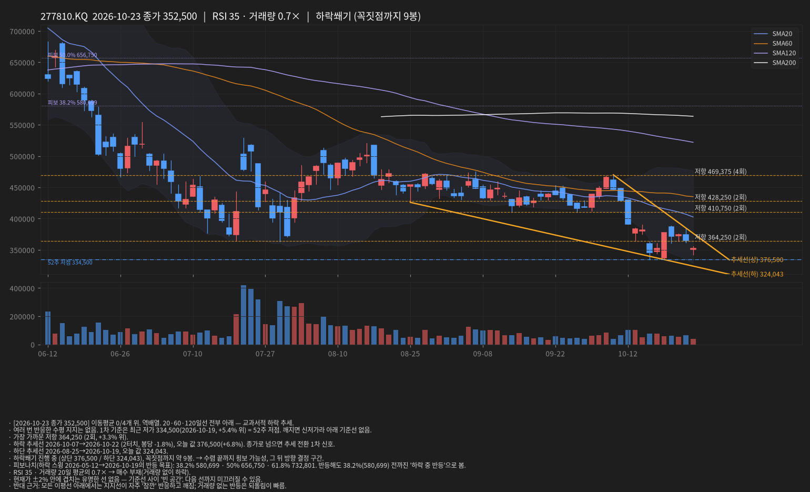
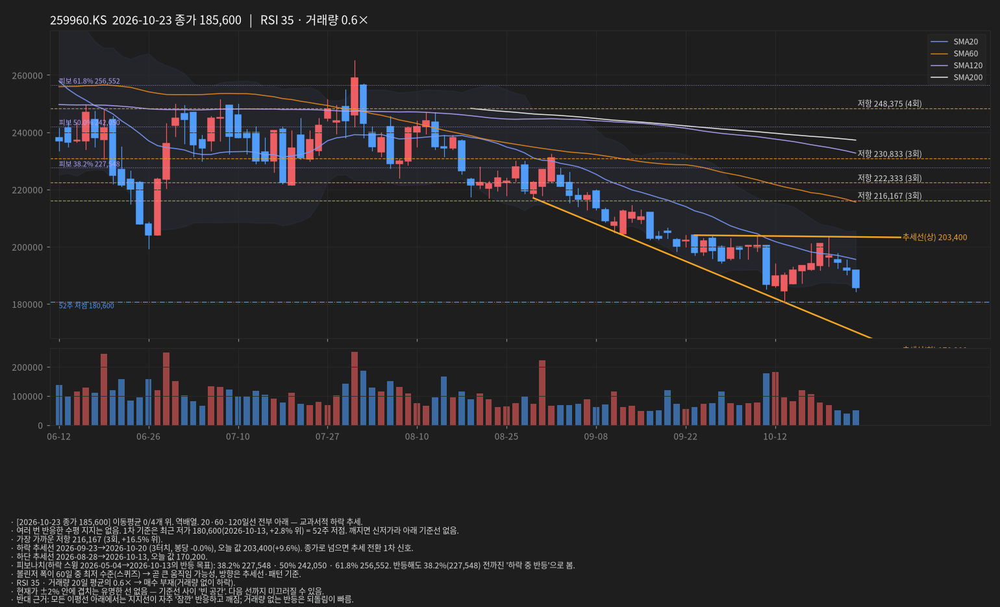
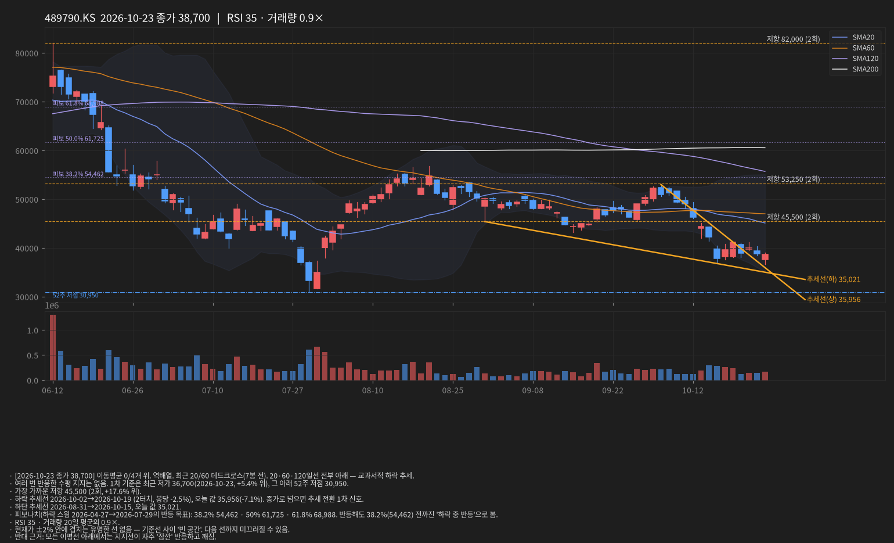
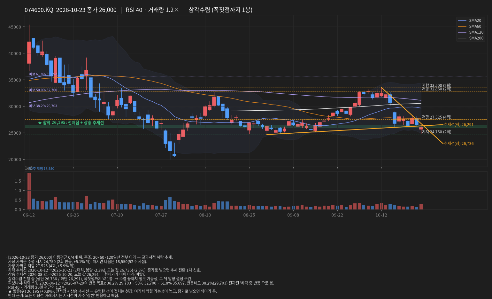
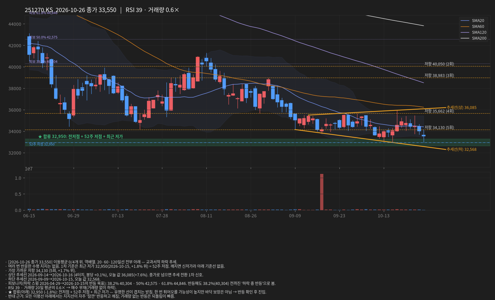
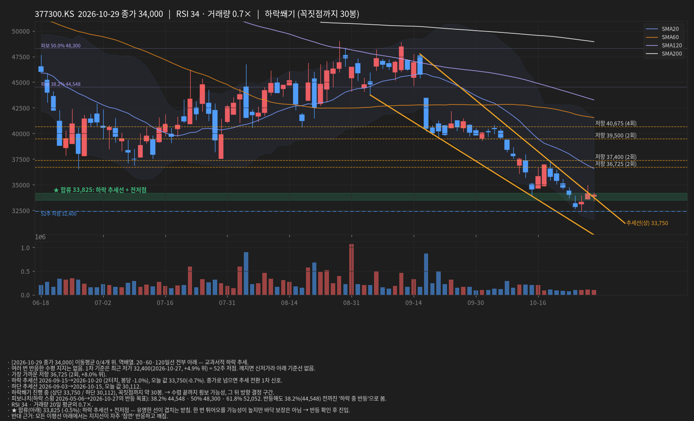
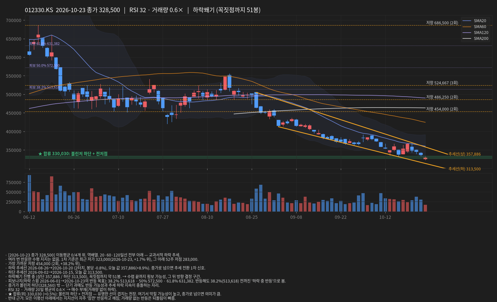

# 선 긋기 리포트 · 2026-10-27 01:21 KST

데이터: 야후 파이낸스 일봉(15분 지연) · 문장은 가능성 표현, 확률 아님

## INFQ · 2026-10-23 종가 8.75

- [2026-10-23 종가 8.75] 이동평균 0/3개 위. 역배열. 최근 20/120 데드크로스(7봉 전). 20·60·120일선 전부 아래 — 교과서적 하락 추세.
- 여러 번 반응한 수평 지지는 없음. 1차 기준은 최근 저가 8.38(2026-10-20, +4.4% 위) = 52주 저점. 깨지면 신저가라 아래 기준선 없음.
- 가장 가까운 저항 8.77 (2회, +0.2% 위).
- 하락 추세선 2026-09-23→2026-10-21 (2터치, 봉당 -1.9%), 오늘 값 8.77(+0.2%). 종가로 넘으면 추세 전환 1차 신호.
- 하단 추세선 2026-09-02→2026-10-20, 오늘 값 8.03.
- 하락쐐기 진행 중 (상단 8.77 / 하단 8.03), 꼭짓점까지 약 4봉. → 수렴 끝까지 횡보 가능성, 그 뒤 방향 결정 구간.
- 피보나치(하락 스윙 2026-06-02→2026-10-20의 반등 목표): 38.2% 13.11 · 50% 14.57 · 61.8% 16.02. 반등해도 38.2%(13.11) 전까진 '하락 중 반등'으로 봄.
- RSI 30 · 거래량 20일 평균의 0.6× → 매수 부재(거래량 없이 하락).
- ★ 합류(위) 8.77 (+0.2%): 하락 추세선 + 수평 저항(2회) — 유명한 선이 겹치는 천장. 여기서 막힐 가능성이 높고, 종가로 넘으면 의미가 큼.
- 반대 근거: 모든 이평선 아래에서는 지지선이 자주 '잠깐' 반응하고 깨짐; 거래량 없는 반등은 되돌림이 빠름.

## 005930.KS · 2026-10-23 종가 215,500

- [2026-10-23 종가 215,500] 이동평균 0/4개 위. 역배열. 최근 20/60 데드크로스(2봉 전). 20·60·120일선 전부 아래 — 교과서적 하락 추세.
- 여러 번 반응한 수평 지지는 없음. 1차 기준은 최근 저가 203,500(2026-10-23, +5.9% 위). 그 아래는 1년 내 기준선이 멀어 올해 상승분 되돌림 구간(피보나치 참고).
- 가장 가까운 저항 245,125 (4회, +13.7% 위).
- 하락 추세선 2026-10-13→2026-10-22 (4터치, 봉당 -1.1%), 오늘 값 223,429(+3.7%). 종가로 넘으면 추세 전환 1차 신호.
- 하단 추세선 2026-08-31→2026-10-15, 오늘 값 195,914.
- 하락쐐기 진행 중 (상단 223,429 / 하단 195,914), 꼭짓점까지 약 24봉. → 수렴 끝까지 횡보 가능성, 그 뒤 방향 결정 구간.
- 피보나치(하락 스윙 2026-06-19→2026-07-29의 반등 목표): 38.2% 259,985 · 50% 281,850 · 61.8% 303,715. 반등해도 38.2%(259,985) 전까진 '하락 중 반등'으로 봄.
- RSI 36 · 거래량 20일 평균의 0.9×.
- 현재가 ±2% 안에 겹치는 유명한 선 없음 — 기준선 사이 '빈 공간'. 다음 선까지 미끄러질 수 있음.
- 반대 근거: 모든 이평선 아래에서는 지지선이 자주 '잠깐' 반응하고 깨짐.

## 000660.KS · 2026-10-23 종가 1,277,000

- [2026-10-23 종가 1,277,000] 이동평균 0/4개 위. 역배열. 최근 20/60 데드크로스(3봉 전). 20·60·120일선 전부 아래 — 교과서적 하락 추세.
- 여러 번 반응한 수평 지지는 없음. 1차 기준은 최근 저가 1,171,000(2026-10-23, +9.1% 위). 그 아래는 1년 내 기준선이 멀어 올해 상승분 되돌림 구간(피보나치 참고).
- 가장 가까운 저항 1,557,500 (2회, +22.0% 위).
- 하락 추세선 2026-10-02→2026-10-21 (2터치, 봉당 -2.6%), 오늘 값 1,233,364(-3.4%). 종가로 넘으면 추세 전환 1차 신호.
- 하단 추세선 2026-08-25→2026-10-20, 오늘 값 1,151,833.
- 피보나치(하락 스윙 2026-06-25→2026-10-23의 반등 목표): 38.2% 1,864,712 · 50% 2,079,000 · 61.8% 2,293,288. 반등해도 38.2%(1,864,712) 전까진 '하락 중 반등'으로 봄.
- RSI 33 · 거래량 20일 평균의 1.2×.
- 현재가 ±2% 안에 겹치는 유명한 선 없음 — 기준선 사이 '빈 공간'. 다음 선까지 미끄러질 수 있음.
- 반대 근거: 모든 이평선 아래에서는 지지선이 자주 '잠깐' 반응하고 깨짐.

## 277810.KQ · 2026-10-23 종가 352,500

- [2026-10-23 종가 352,500] 이동평균 0/4개 위. 역배열. 20·60·120일선 전부 아래 — 교과서적 하락 추세.
- 여러 번 반응한 수평 지지는 없음. 1차 기준은 최근 저가 334,500(2026-10-19, +5.4% 위) = 52주 저점. 깨지면 신저가라 아래 기준선 없음.
- 가장 가까운 저항 364,250 (2회, +3.3% 위).
- 하락 추세선 2026-10-07→2026-10-22 (2터치, 봉당 -1.8%), 오늘 값 376,500(+6.8%). 종가로 넘으면 추세 전환 1차 신호.
- 하단 추세선 2026-08-25→2026-10-19, 오늘 값 324,043.
- 하락쐐기 진행 중 (상단 376,500 / 하단 324,043), 꼭짓점까지 약 9봉. → 수렴 끝까지 횡보 가능성, 그 뒤 방향 결정 구간.
- 피보나치(하락 스윙 2026-05-12→2026-10-19의 반등 목표): 38.2% 580,699 · 50% 656,750 · 61.8% 732,801. 반등해도 38.2%(580,699) 전까진 '하락 중 반등'으로 봄.
- RSI 35 · 거래량 20일 평균의 0.7× → 매수 부재(거래량 없이 하락).
- 현재가 ±2% 안에 겹치는 유명한 선 없음 — 기준선 사이 '빈 공간'. 다음 선까지 미끄러질 수 있음.
- 반대 근거: 모든 이평선 아래에서는 지지선이 자주 '잠깐' 반응하고 깨짐; 거래량 없는 반등은 되돌림이 빠름.

## 259960.KS · 2026-10-23 종가 185,600

- [2026-10-23 종가 185,600] 이동평균 0/4개 위. 역배열. 20·60·120일선 전부 아래 — 교과서적 하락 추세.
- 여러 번 반응한 수평 지지는 없음. 1차 기준은 최근 저가 180,600(2026-10-13, +2.8% 위) = 52주 저점. 깨지면 신저가라 아래 기준선 없음.
- 가장 가까운 저항 216,167 (3회, +16.5% 위).
- 하락 추세선 2026-09-23→2026-10-20 (3터치, 봉당 -0.0%), 오늘 값 203,400(+9.6%). 종가로 넘으면 추세 전환 1차 신호.
- 하단 추세선 2026-08-28→2026-10-13, 오늘 값 170,200.
- 피보나치(하락 스윙 2026-05-04→2026-10-13의 반등 목표): 38.2% 227,548 · 50% 242,050 · 61.8% 256,552. 반등해도 38.2%(227,548) 전까진 '하락 중 반등'으로 봄.
- 볼린저 폭이 60일 중 최저 수준(스퀴즈) → 곧 큰 움직임 가능성, 방향은 추세선·패턴 기준.
- RSI 35 · 거래량 20일 평균의 0.6× → 매수 부재(거래량 없이 하락).
- 현재가 ±2% 안에 겹치는 유명한 선 없음 — 기준선 사이 '빈 공간'. 다음 선까지 미끄러질 수 있음.
- 반대 근거: 모든 이평선 아래에서는 지지선이 자주 '잠깐' 반응하고 깨짐; 거래량 없는 반등은 되돌림이 빠름.

## 489790.KS · 2026-10-23 종가 38,700

- [2026-10-23 종가 38,700] 이동평균 0/4개 위. 역배열. 최근 20/60 데드크로스(7봉 전). 20·60·120일선 전부 아래 — 교과서적 하락 추세.
- 여러 번 반응한 수평 지지는 없음. 1차 기준은 최근 저가 36,700(2026-10-23, +5.4% 위), 그 아래 52주 저점 30,950.
- 가장 가까운 저항 45,500 (2회, +17.6% 위).
- 하락 추세선 2026-10-02→2026-10-19 (2터치, 봉당 -2.5%), 오늘 값 35,956(-7.1%). 종가로 넘으면 추세 전환 1차 신호.
- 하단 추세선 2026-08-31→2026-10-15, 오늘 값 35,021.
- 피보나치(하락 스윙 2026-04-27→2026-07-29의 반등 목표): 38.2% 54,462 · 50% 61,725 · 61.8% 68,988. 반등해도 38.2%(54,462) 전까진 '하락 중 반등'으로 봄.
- RSI 35 · 거래량 20일 평균의 0.9×.
- 현재가 ±2% 안에 겹치는 유명한 선 없음 — 기준선 사이 '빈 공간'. 다음 선까지 미끄러질 수 있음.
- 반대 근거: 모든 이평선 아래에서는 지지선이 자주 '잠깐' 반응하고 깨짐.

## 074600.KQ · 2026-10-23 종가 26,000

- [2026-10-23 종가 26,000] 이동평균 0/4개 위. 혼조. 20·60·120일선 전부 아래 — 교과서적 하락 추세.
- 가장 가까운 수평 지지 24,750 (2회 반응, +5.1% 위). 깨지면 다음은 18,550(52주 저점).
- 가장 가까운 저항 27,525 (4회, +5.9% 위).
- 하락 추세선 2026-10-12→2026-10-21 (2터치, 봉당 -2.3%), 오늘 값 26,736(+2.8%). 종가로 넘으면 추세 전환 1차 신호.
- 상승 추세선 2026-08-31→2026-10-20, 오늘 값 26,291 — 현재가가 이미 아래(이탈).
- 삼각수렴 진행 중 (상단 26,736 / 하단 26,291), 꼭짓점까지 약 1봉. → 수렴 끝까지 횡보 가능성, 그 뒤 방향 결정 구간.
- 피보나치(하락 스윙 2026-06-12→2026-07-29의 반등 목표): 38.2% 29,703 · 50% 32,700 · 61.8% 35,697. 반등해도 38.2%(29,703) 전까진 '하락 중 반등'으로 봄.
- RSI 40 · 거래량 20일 평균의 1.2×.
- ★ 합류(위) 26,195 (+0.8%): 전저점 + 상승 추세선 — 유명한 선이 겹치는 천장. 여기서 막힐 가능성이 높고, 종가로 넘으면 의미가 큼.
- 반대 근거: 모든 이평선 아래에서는 지지선이 자주 '잠깐' 반응하고 깨짐.

## 001120.KS · 2026-10-23 종가 42,800

- [2026-10-23 종가 42,800] 이동평균 3/4개 위. 혼조. 
- 가장 가까운 수평 지지 42,730 (5회 반응, +0.2% 위). 깨지면 다음은 29,000(52주 저점).
- 상단 추세선 2026-08-20→2026-10-14 (4터치, 봉당 +0.5%), 오늘 값 46,540(+8.7%). 종가로 넘으면 추세 전환 1차 신호.
- 상승 추세선 2026-08-24→2026-09-29, 오늘 값 41,450.
- 피보나치(하락 스윙 2026-04-29→2026-06-23의 반등 목표): 38.2% 42,466 · 50% 45,375 · 61.8% 48,284. 반등해도 38.2%(42,466) 전까진 '하락 중 반등'으로 봄.
- RSI 51 · 거래량 20일 평균의 0.6× → 매수 부재(거래량 없이 하락).
- ★ 합류(아래) 42,666 (-0.3%): 최근 저가 + 피보 38.2% + 수평 지지(5회) + 전저점 — 유명한 선이 겹치는 받침. 한 번 튀어오를 가능성이 높지만 바닥 보장은 아님 → 반등 확인 후 진입.
- ★ 합류(위) 43,192 (+0.9%): SMA20 + 볼린저 중심 — 유명한 선이 겹치는 천장. 여기서 막힐 가능성이 높고, 종가로 넘으면 의미가 큼.
- 반대 근거: 거래량 없는 반등은 되돌림이 빠름.

## 011200.KS · 2026-10-23 종가 22,650

- [2026-10-23 종가 22,650] 이동평균 4/4개 위. 정배열. 최근 20/60 골든크로스(7봉 전). 
- 가장 가까운 수평 지지 21,990 (5회 반응, +3.0% 위). 깨지면 다음은 17,910(52주 저점).
- 상단 추세선 2026-09-14→2026-10-16 (3터치, 봉당 +0.7%), 오늘 값 24,975(+10.3%). 종가로 넘으면 추세 전환 1차 신호.
- 상승 추세선 2026-09-23→2026-10-12, 오늘 값 20,900.
- 피보나치(상승 스윙 2026-06-26→2026-10-16의 되돌림): 38.2% 21,828 · 50% 21,080 · 61.8% 20,332. 
- RSI 55 · 거래량 20일 평균의 0.6×.
- 현재가 ±2% 안에 겹치는 유명한 선 없음 — 기준선 사이 '빈 공간'. 다음 선까지 미끄러질 수 있음.
- 반대 근거: 거래량 없는 반등은 되돌림이 빠름.

## 251270.KS · 2026-10-23 종가 34,000

- [2026-10-23 종가 34,000] 이동평균 0/4개 위. 역배열. 20·60·120일선 전부 아래 — 교과서적 하락 추세.
- 여러 번 반응한 수평 지지는 없음. 1차 기준은 최근 저가 32,950(2026-10-15, +3.2% 위) = 52주 저점. 깨지면 신저가라 아래 기준선 없음.
- 가장 가까운 저항 34,130 (5회, +0.4% 위).
- 상단 추세선 2026-09-14→2026-10-16 (4터치, 봉당 +0.1%), 오늘 값 36,062(+6.1%). 종가로 넘으면 추세 전환 1차 신호.
- 하단 추세선 2026-09-09→2026-10-15, 오늘 값 32,623.
- 박스권 34,130~35,662 15봉째. 박스 안에서는 횡보 가능성 높고, 상·하단 종가 이탈이 신호.
- 피보나치(하락 스윙 2026-04-29→2026-10-15의 반등 목표): 38.2% 40,304 · 50% 42,575 · 61.8% 44,846. 반등해도 38.2%(40,304) 전까진 '하락 중 반등'으로 봄.
- 볼린저 폭이 60일 중 최저 수준(스퀴즈) → 곧 큰 움직임 가능성, 방향은 추세선·패턴 기준.
- RSI 42 · 거래량 20일 평균의 0.7× → 매수 부재(거래량 없이 하락).
- ★ 합류(위) 34,378 (+1.1%): 수평 저항(5회) + SMA20 + 볼린저 중심 — 유명한 선이 겹치는 천장. 여기서 막힐 가능성이 높고, 종가로 넘으면 의미가 큼.
- 반대 근거: 모든 이평선 아래에서는 지지선이 자주 '잠깐' 반응하고 깨짐; 거래량 없는 반등은 되돌림이 빠름.

## 377300.KS · 2026-10-23 종가 34,050

- [2026-10-23 종가 34,050] 이동평균 0/4개 위. 역배열. 20·60·120일선 전부 아래 — 교과서적 하락 추세.
- 여러 번 반응한 수평 지지는 없음. 1차 기준은 최근 저가 33,700(2026-10-23, +1.0% 위) = 52주 저점. 깨지면 신저가라 아래 기준선 없음.
- 가장 가까운 저항 36,725 (2회, +7.9% 위).
- 하락 추세선 2026-09-15→2026-10-20 (2터치, 봉당 -1.0%), 오늘 값 35,750(+5.0%). 종가로 넘으면 추세 전환 1차 신호.
- 하단 추세선 2026-09-03→2026-10-15, 오늘 값 31,627.
- 하락쐐기 진행 중 (상단 35,750 / 하단 31,627), 꼭짓점까지 약 34봉. → 수렴 끝까지 횡보 가능성, 그 뒤 방향 결정 구간.
- 피보나치(하락 스윙 2026-05-06→2026-10-23의 반등 목표): 38.2% 45,351 · 50% 48,950 · 61.8% 52,549. 반등해도 38.2%(45,351) 전까진 '하락 중 반등'으로 봄.
- RSI 30 · 거래량 20일 평균의 0.5× → 매수 부재(거래량 없이 하락).
- ★ 합류(아래) 33,800 (-0.7%): 52주 저점 + 최근 저가 + 전저점 — 유명한 선이 겹치는 받침. 한 번 튀어오를 가능성이 높지만 바닥 보장은 아님 → 반등 확인 후 진입.
- 반대 근거: 모든 이평선 아래에서는 지지선이 자주 '잠깐' 반응하고 깨짐; 거래량 없는 반등은 되돌림이 빠름.

## 012330.KS · 2026-10-23 종가 328,500

- [2026-10-23 종가 328,500] 이동평균 0/4개 위. 역배열. 20·60·120일선 전부 아래 — 교과서적 하락 추세.
- 여러 번 반응한 수평 지지는 없음. 1차 기준은 최근 저가 323,000(2026-10-23, +1.7% 위), 그 아래 52주 저점 283,000.
- 가장 가까운 저항 454,000 (2회, +38.2% 위).
- 하락 추세선 2026-08-26→2026-10-20 (2터치, 봉당 -0.8%), 오늘 값 357,886(+8.9%). 종가로 넘으면 추세 전환 1차 신호.
- 하단 추세선 2026-09-02→2026-10-15, 오늘 값 313,500.
- 하락쐐기 진행 중 (상단 357,886 / 하단 313,500), 꼭짓점까지 약 51봉. → 수렴 끝까지 횡보 가능성, 그 뒤 방향 결정 구간.
- 피보나치(하락 스윙 2026-06-01→2026-10-23의 반등 목표): 38.2% 513,618 · 50% 572,500 · 61.8% 631,382. 반등해도 38.2%(513,618) 전까진 '하락 중 반등'으로 봄.
- 종가가 볼린저 하단(328,560) 밖 — 단기 과매도 반등 가능성과 추세 하락 지속이 충돌하는 자리.
- RSI 32 · 거래량 20일 평균의 0.6× → 매수 부재(거래량 없이 하락).
- ★ 합류(위) 330,030 (+0.5%): 볼린저 하단 + 전저점 — 유명한 선이 겹치는 천장. 여기서 막힐 가능성이 높고, 종가로 넘으면 의미가 큼.
- 반대 근거: 모든 이평선 아래에서는 지지선이 자주 '잠깐' 반응하고 깨짐; 거래량 없는 반등은 되돌림이 빠름.

## 알림
- [warn] **INFQ** 합류 천장: 8.77까지 +0.2%. 넘어서 마감하면 의미가 커요.
- [up] **000660.KS** 추세선 돌파: 1,277,000으로 마감해 흐름선(1,233,364) 위로 올라섰어요. 내일도 위면 1/3 매수 검토.
- [dn] **074600.KQ** 하단선 이탈: 26,000으로 마감해 아래 흐름선(26,291) 밑으로 내려갔어요. 다음 바닥까지 밀릴 수 있어요.
- [warn] **074600.KQ** 합류 천장: 26,195까지 +0.8%. 넘어서 마감하면 의미가 커요.
- [ok] **001120.KS** 합류 받침: 42,666까지 −0.3%. 여러 기준이 겹친 자리예요 — 반등을 확인하고 판단하세요.
- [warn] **001120.KS** 합류 천장: 43,192까지 +0.9%. 넘어서 마감하면 의미가 커요.
- [warn] **251270.KS** 합류 천장: 34,378까지 +1.1%. 넘어서 마감하면 의미가 커요.
- [ok] **377300.KS** 합류 받침: 33,800까지 −0.7%. 기준 두세 개가 겹친 자리예요 — 반등을 확인하고 판단하세요.
- [warn] **012330.KS** 합류 천장: 330,030까지 +0.5%. 넘어서 마감하면 의미가 커요.

## 급락/급등 원인 분해
- [2026-10-23] INFQ -0.6% = 지수 -1.6%(β3.0×^GSPC -0.5%) + 업종 +0.8%(양자 피어 +0.3%) + 종목 고유 +0.1%. 주원인: 지수 · 거래량 0.6× → 매수 부재(거래량 없이 하락). 시장 전체 움직임 — 종목 판단과 분리.
- [2026-10-23] 005930.KS +0.5% = 지수 +0.4%(β1.4×^KS11 +0.3%) + 업종 +2.2%(반도체 피어 +2.5%) + 종목 고유 -2.1%. 주원인: 업종 · 거래량 0.9× → 보통. 섹터 FUD 성격 — 펀더멘털 변화 없으면 플레이북 유지.
- [2026-10-23] 000660.KS +4.4% = 지수 +0.5%(β1.6×^KS11 +0.3%) + 업종 +0.2%(반도체 피어 +0.5%) + 종목 고유 +3.7%. 주원인: 종목 고유 · 거래량 1.2× → 보통. 종목 고유 뉴스/공시를 먼저 확인.
- [2026-10-19] 013030.KQ -0.5% = 지수 +0.9%(β0.5×^KQ11 +1.8%) + 업종 +0.0% + 종목 고유 -1.4%. 주원인: 종목 고유 · 거래량 0.5× → 매수 부재(거래량 없이 하락).
- [2026-10-19] 054950.KQ -0.2% = 지수 +0.3%(β0.2×^KQ11 +1.8%) + 업종 +0.0% + 종목 고유 -0.6%. 주원인: 종목 고유 · 거래량 0.9× → 보통.
- [2026-10-19] 236200.KQ +1.2% = 지수 +1.2%(β0.7×^KQ11 +1.8%) + 업종 +0.0% + 종목 고유 +0.0%. 주원인: 지수 · 거래량 0.5× → 보통. 시장 전체 움직임 — 종목 판단과 분리.
- [2026-10-19] 036800.KQ -1.4% = 지수 +0.1%(β0.1×^KQ11 +1.8%) + 업종 +0.0% + 종목 고유 -1.5%. 주원인: 종목 고유 · 거래량 0.3× → 매수 부재(거래량 없이 하락).
- [2026-10-19] 200670.KQ +2.2% = 지수 +1.1%(β0.6×^KQ11 +1.8%) + 업종 +0.0% + 종목 고유 +1.1%. 주원인: 지수 · 거래량 0.4× → 보통. 시장 전체 움직임 — 종목 판단과 분리.
- [2026-10-19] 015230.KS +1.1% = 지수 +0.3%(β0.2×^KS11 +1.8%) + 업종 +0.0% + 종목 고유 +0.8%. 주원인: 종목 고유 · 거래량 1.0× → 보통.
- [2026-10-19] 044960.KQ +0.3% = 지수 +0.3%(β0.2×^KQ11 +1.8%) + 업종 +0.0% + 종목 고유 +0.0%. 주원인: 지수 · 거래량 0.4× → 보통. 시장 전체 움직임 — 종목 판단과 분리.

## 판단 보드
- **INFQ** [hold] 보유 유지 — 손절까지 현재가에서 -2.1%
- **005930.KS** [wait] 기다림 — 매수 조건까지 +6.7%
- **000660.KS** [enter] 하락 흐름 끊김 — 종가 1,277,000 ≥ 흐름선 1,233,364
- **277810.KQ** [wait] 기다림 — 흐름선까지 +6.8%
- **259960.KS** [wait] 기다림 — 흐름선까지 +9.6%
- **489790.KS** [enter] 하락 흐름 끊김 — 종가 38,700 ≥ 흐름선 35,956 · 3일째
- **074600.KQ** [wait] 기다림 — 막힐 자리 26,195 (+0.8%) 아래. 넘어서 마감하면 다시 판단
- **001120.KS** [wait] 기다림 — 바닥 후보 42,666 (-0.3%) 위. 반등 확인 전엔 사지 않기
- **011200.KS** [wait] 기다림 — 흐름선까지 +10.3%
- **251270.KS** [wait] 기다림 — 막힐 자리 34,378 (+1.1%) 아래. 넘어서 마감하면 다시 판단
- **377300.KS** [wait] 기다림 — 바닥 후보 33,800 (-0.7%) 위. 반등 확인 전엔 사지 않기
- **012330.KS** [wait] 기다림 — 막힐 자리 330,030 (+0.5%) 아래. 넘어서 마감하면 다시 판단
