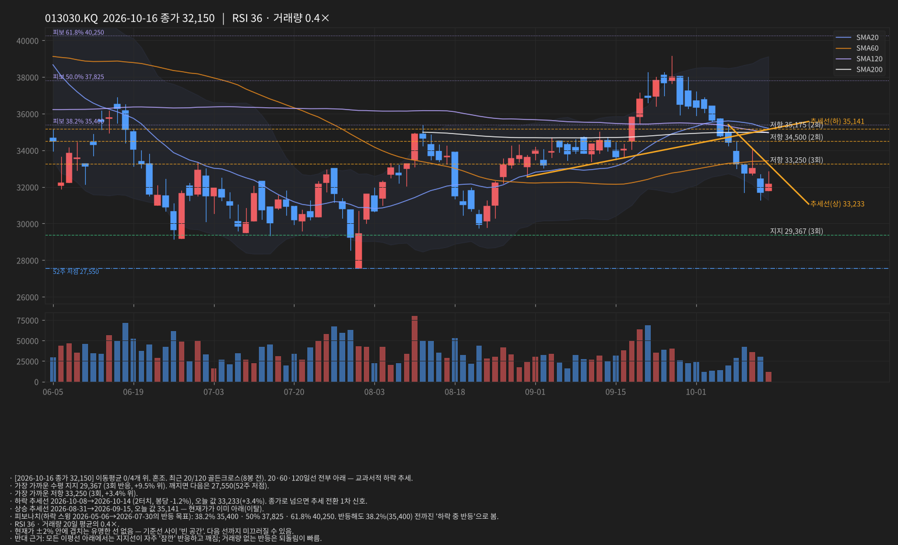
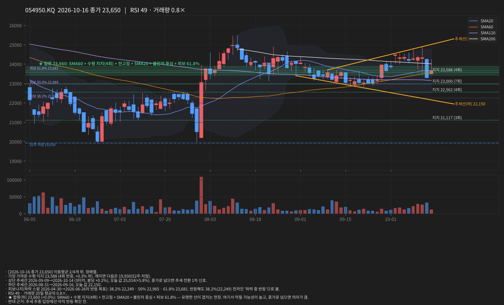
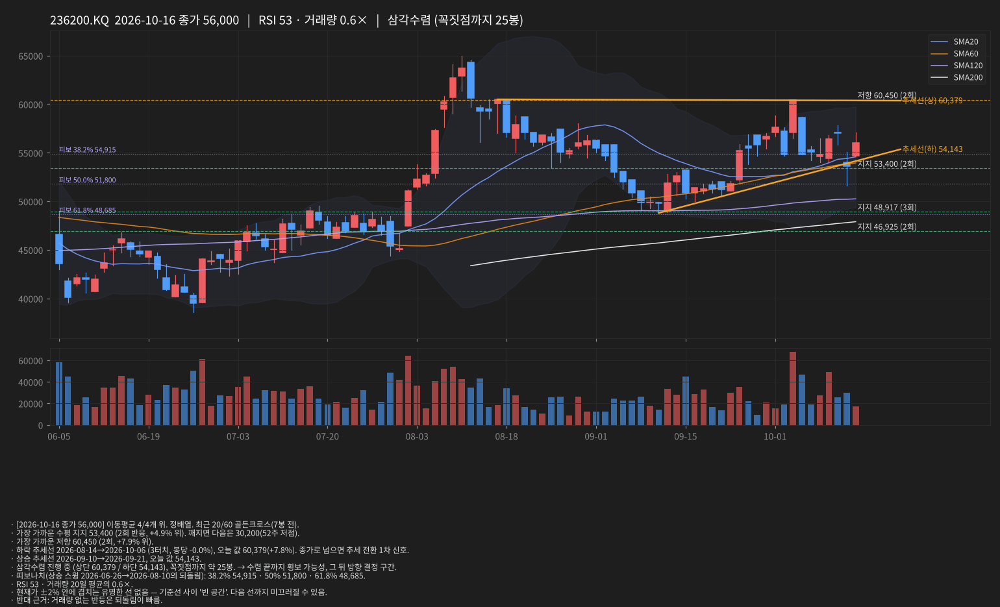
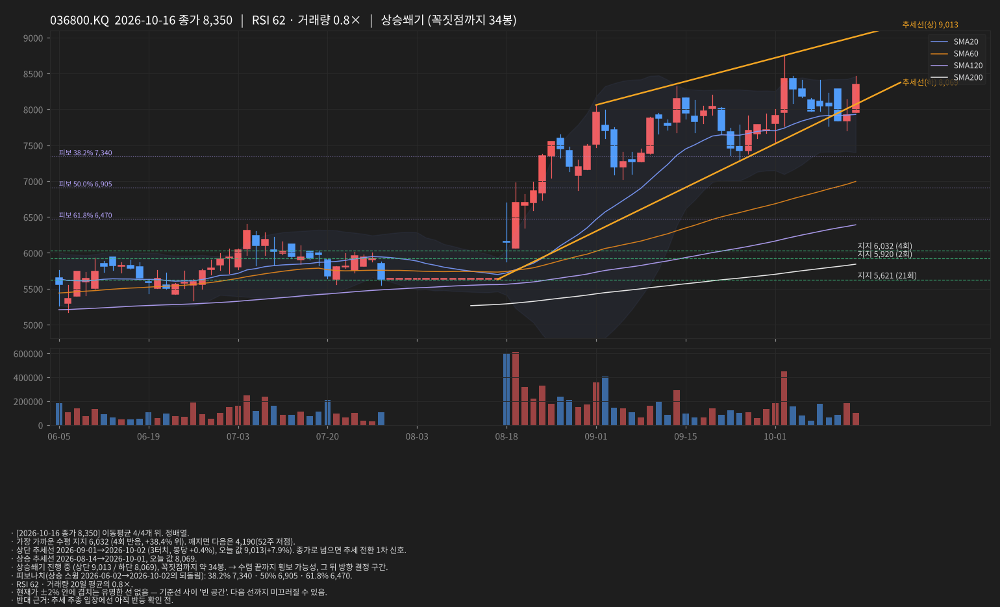
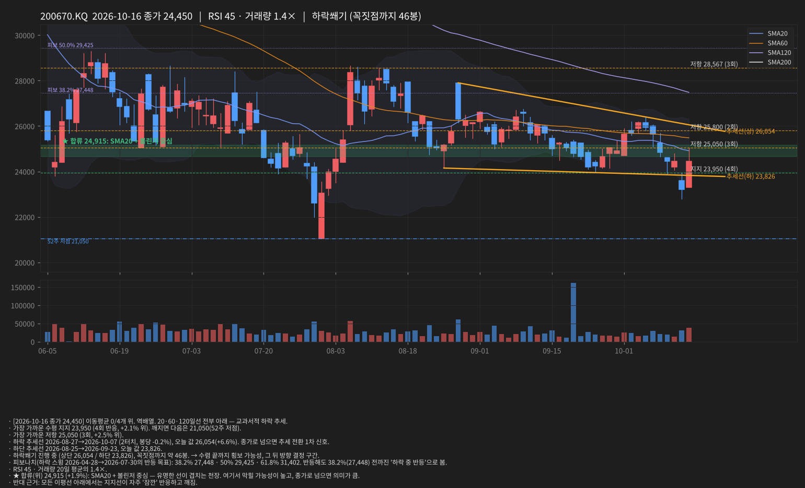
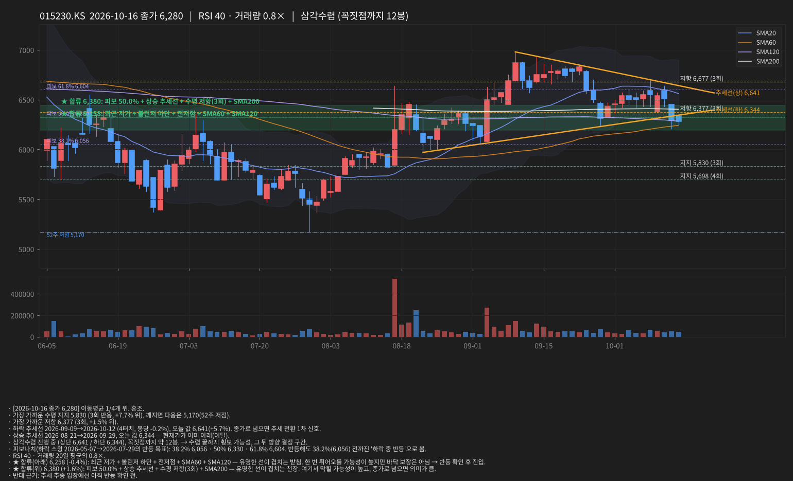
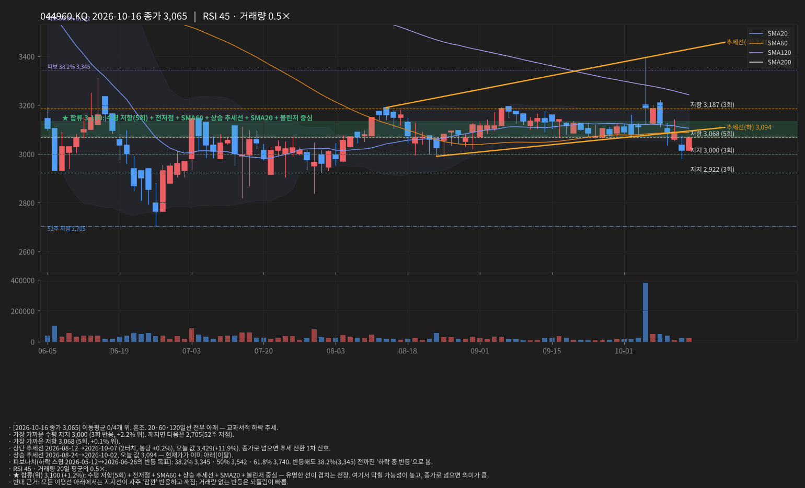

# 선 긋기 리포트 · 2026-10-20 02:47 KST

데이터: 야후 파이낸스 일봉(15분 지연) · 문장은 가능성 표현, 확률 아님

## INFQ · 2026-10-16 종가 8.55

- [2026-10-16 종가 8.55] 이동평균 0/3개 위. 혼조. 최근 20/120 데드크로스(2봉 전). 20·60·120일선 전부 아래 — 교과서적 하락 추세.
- 여러 번 반응한 수평 지지는 없음. 1차 기준은 최근 저가 8.42(2026-10-16, +1.5% 위) = 52주 저점. 깨지면 신저가라 아래 기준선 없음.
- 가장 가까운 저항 8.77 (2회, +2.6% 위).
- 하락 추세선 2026-10-09→2026-10-16 (3터치, 봉당 -3.7%), 오늘 값 9.29(+8.7%). 종가로 넘으면 추세 전환 1차 신호.
- 하단 추세선 2026-09-24→2026-10-15, 오늘 값 8.22.
- 하락쐐기 진행 중 (상단 9.29 / 하단 8.22), 꼭짓점까지 약 16봉. → 수렴 끝까지 횡보 가능성, 그 뒤 방향 결정 구간.
- 피보나치(하락 스윙 2026-06-02→2026-10-16의 반등 목표): 38.2% 13.13 · 50% 14.59 · 61.8% 16.04. 반등해도 38.2%(13.13) 전까진 '하락 중 반등'으로 봄.
- RSI 24 과매도 · 거래량 20일 평균의 1.4×.
- ★ 합류(아래) 8.42 (-1.5%): 볼린저 하단 + 52주 저점 + 최근 저가 — 유명한 선이 겹치는 받침. 한 번 튀어오를 가능성이 높지만 바닥 보장은 아님 → 반등 확인 후 진입.
- 반대 근거: RSI 과매도는 하락 추세에서 며칠씩 유지될 수 있음; 모든 이평선 아래에서는 지지선이 자주 '잠깐' 반응하고 깨짐.

## 005930.KS · 2026-10-16 종가 215,500

- [2026-10-16 종가 215,500] 이동평균 0/4개 위. 혼조. 20·60·120일선 전부 아래 — 교과서적 하락 추세.
- 여러 번 반응한 수평 지지는 없음. 1차 기준은 최근 저가 204,500(2026-10-15, +5.4% 위). 그 아래는 1년 내 기준선이 멀어 올해 상승분 되돌림 구간(피보나치 참고).
- 가장 가까운 저항 228,500 (2회, +6.0% 위).
- 하락 추세선 2026-10-07→2026-10-12 (3터치, 봉당 -3.0%), 오늘 값 228,500(+6.0%). 종가로 넘으면 추세 전환 1차 신호.
- 하단 추세선 2026-10-01→2026-10-15, 오늘 값 197,000.
- 하락쐐기 진행 중 (상단 228,500 / 하단 197,000), 꼭짓점까지 약 32봉. → 수렴 끝까지 횡보 가능성, 그 뒤 방향 결정 구간.
- 피보나치(하락 스윙 2026-06-19→2026-07-29의 반등 목표): 38.2% 259,985 · 50% 281,850 · 61.8% 303,715. 반등해도 38.2%(259,985) 전까진 '하락 중 반등'으로 봄.
- 종가가 볼린저 하단(215,655) 밖 — 단기 과매도 반등 가능성과 추세 하락 지속이 충돌하는 자리.
- RSI 31 · 거래량 20일 평균의 1.0×.
- 현재가 ±2% 안에 겹치는 유명한 선 없음 — 기준선 사이 '빈 공간'. 다음 선까지 미끄러질 수 있음.
- 반대 근거: 모든 이평선 아래에서는 지지선이 자주 '잠깐' 반응하고 깨짐.

## 000660.KS · 2026-10-16 종가 1,272,000

- [2026-10-16 종가 1,272,000] 이동평균 0/4개 위. 혼조. 20·60·120일선 전부 아래 — 교과서적 하락 추세.
- 여러 번 반응한 수평 지지는 없음. 1차 기준은 최근 저가 1,238,000(2026-10-15, +2.7% 위). 그 아래는 1년 내 기준선이 멀어 올해 상승분 되돌림 구간(피보나치 참고).
- 가장 가까운 저항 1,557,500 (2회, +22.4% 위).
- 하락 추세선 2026-10-08→2026-10-16 (3터치, 봉당 -4.9%), 오늘 값 1,325,000(+4.2%). 종가로 넘으면 추세 전환 1차 신호.
- 하단 추세선 2026-10-01→2026-10-15, 오늘 값 1,174,125.
- 하락쐐기 진행 중 (상단 1,325,000 / 하단 1,174,125), 꼭짓점까지 약 7봉. → 수렴 끝까지 횡보 가능성, 그 뒤 방향 결정 구간.
- 피보나치(상승 스윙 2026-04-20→2026-06-25의 되돌림): 38.2% 2,281,828 · 50% 2,064,000 · 61.8% 1,846,172. 61.8% 아래 — 되돌림이 깊어 상승 추세 자체가 의심되는 구간.
- 종가가 볼린저 하단(1,308,125) 밖 — 단기 과매도 반등 가능성과 추세 하락 지속이 충돌하는 자리.
- RSI 26 과매도 · 거래량 20일 평균의 1.4×.
- 현재가 ±2% 안에 겹치는 유명한 선 없음 — 기준선 사이 '빈 공간'. 다음 선까지 미끄러질 수 있음.
- 반대 근거: RSI 과매도는 하락 추세에서 며칠씩 유지될 수 있음; 모든 이평선 아래에서는 지지선이 자주 '잠깐' 반응하고 깨짐.

## 013030.KQ · 2026-10-16 종가 32,150

- [2026-10-16 종가 32,150] 이동평균 0/4개 위. 혼조. 최근 20/120 골든크로스(8봉 전). 20·60·120일선 전부 아래 — 교과서적 하락 추세.
- 가장 가까운 수평 지지 29,367 (3회 반응, +9.5% 위). 깨지면 다음은 27,550(52주 저점).
- 가장 가까운 저항 33,250 (3회, +3.4% 위).
- 하락 추세선 2026-10-08→2026-10-14 (2터치, 봉당 -1.2%), 오늘 값 33,233(+3.4%). 종가로 넘으면 추세 전환 1차 신호.
- 상승 추세선 2026-08-31→2026-09-15, 오늘 값 35,141 — 현재가가 이미 아래(이탈).
- 피보나치(하락 스윙 2026-05-06→2026-07-30의 반등 목표): 38.2% 35,400 · 50% 37,825 · 61.8% 40,250. 반등해도 38.2%(35,400) 전까진 '하락 중 반등'으로 봄.
- RSI 36 · 거래량 20일 평균의 0.4×.
- 현재가 ±2% 안에 겹치는 유명한 선 없음 — 기준선 사이 '빈 공간'. 다음 선까지 미끄러질 수 있음.
- 반대 근거: 모든 이평선 아래에서는 지지선이 자주 '잠깐' 반응하고 깨짐; 거래량 없는 반등은 되돌림이 빠름.

## 054950.KQ · 2026-10-16 종가 23,650

- [2026-10-16 종가 23,650] 이동평균 2/4개 위. 정배열. 
- 가장 가까운 수평 지지 23,588 (4회 반응, +0.3% 위). 깨지면 다음은 19,930(52주 저점).
- 상단 추세선 2026-09-09→2026-10-14 (3터치, 봉당 +0.2%), 오늘 값 25,014(+5.8%). 종가로 넘으면 추세 전환 1차 신호.
- 하단 추세선 2026-08-31→2026-09-16, 오늘 값 22,150.
- 피보나치(하락 스윙 2026-04-30→2026-06-26의 반등 목표): 38.2% 22,249 · 50% 22,965 · 61.8% 23,681. 반등해도 38.2%(22,249) 전까진 '하락 중 반등'으로 봄.
- RSI 49 · 거래량 20일 평균의 0.8×.
- ★ 합류(위) 23,660 (+0.0%): SMA60 + 수평 지지(4회) + 전고점 + SMA20 + 볼린저 중심 + 피보 61.8% — 유명한 선이 겹치는 천장. 여기서 막힐 가능성이 높고, 종가로 넘으면 의미가 큼.
- 반대 근거: 추세 추종 입장에선 아직 반등 확인 전.

## 236200.KQ · 2026-10-16 종가 56,000

- [2026-10-16 종가 56,000] 이동평균 4/4개 위. 정배열. 최근 20/60 골든크로스(7봉 전). 
- 가장 가까운 수평 지지 53,400 (2회 반응, +4.9% 위). 깨지면 다음은 30,200(52주 저점).
- 가장 가까운 저항 60,450 (2회, +7.9% 위).
- 하락 추세선 2026-08-14→2026-10-06 (3터치, 봉당 -0.0%), 오늘 값 60,379(+7.8%). 종가로 넘으면 추세 전환 1차 신호.
- 상승 추세선 2026-09-10→2026-09-21, 오늘 값 54,143.
- 삼각수렴 진행 중 (상단 60,379 / 하단 54,143), 꼭짓점까지 약 25봉. → 수렴 끝까지 횡보 가능성, 그 뒤 방향 결정 구간.
- 피보나치(상승 스윙 2026-06-26→2026-08-10의 되돌림): 38.2% 54,915 · 50% 51,800 · 61.8% 48,685. 
- RSI 53 · 거래량 20일 평균의 0.6×.
- 현재가 ±2% 안에 겹치는 유명한 선 없음 — 기준선 사이 '빈 공간'. 다음 선까지 미끄러질 수 있음.
- 반대 근거: 거래량 없는 반등은 되돌림이 빠름.

## 036800.KQ · 2026-10-16 종가 8,350

- [2026-10-16 종가 8,350] 이동평균 4/4개 위. 정배열. 
- 가장 가까운 수평 지지 6,032 (4회 반응, +38.4% 위). 깨지면 다음은 4,190(52주 저점).
- 상단 추세선 2026-09-01→2026-10-02 (3터치, 봉당 +0.4%), 오늘 값 9,013(+7.9%). 종가로 넘으면 추세 전환 1차 신호.
- 상승 추세선 2026-08-14→2026-10-01, 오늘 값 8,069.
- 상승쐐기 진행 중 (상단 9,013 / 하단 8,069), 꼭짓점까지 약 34봉. → 수렴 끝까지 횡보 가능성, 그 뒤 방향 결정 구간.
- 피보나치(상승 스윙 2026-06-02→2026-10-02의 되돌림): 38.2% 7,340 · 50% 6,905 · 61.8% 6,470. 
- RSI 62 · 거래량 20일 평균의 0.8×.
- 현재가 ±2% 안에 겹치는 유명한 선 없음 — 기준선 사이 '빈 공간'. 다음 선까지 미끄러질 수 있음.
- 반대 근거: 추세 추종 입장에선 아직 반등 확인 전.

## 200670.KQ · 2026-10-16 종가 24,450

- [2026-10-16 종가 24,450] 이동평균 0/4개 위. 역배열. 20·60·120일선 전부 아래 — 교과서적 하락 추세.
- 가장 가까운 수평 지지 23,950 (4회 반응, +2.1% 위). 깨지면 다음은 21,050(52주 저점).
- 가장 가까운 저항 25,050 (3회, +2.5% 위).
- 하락 추세선 2026-08-27→2026-10-07 (2터치, 봉당 -0.2%), 오늘 값 26,054(+6.6%). 종가로 넘으면 추세 전환 1차 신호.
- 하단 추세선 2026-08-25→2026-09-23, 오늘 값 23,826.
- 하락쐐기 진행 중 (상단 26,054 / 하단 23,826), 꼭짓점까지 약 46봉. → 수렴 끝까지 횡보 가능성, 그 뒤 방향 결정 구간.
- 피보나치(하락 스윙 2026-04-28→2026-07-30의 반등 목표): 38.2% 27,448 · 50% 29,425 · 61.8% 31,402. 반등해도 38.2%(27,448) 전까진 '하락 중 반등'으로 봄.
- RSI 45 · 거래량 20일 평균의 1.4×.
- ★ 합류(위) 24,915 (+1.9%): SMA20 + 볼린저 중심 — 유명한 선이 겹치는 천장. 여기서 막힐 가능성이 높고, 종가로 넘으면 의미가 큼.
- 반대 근거: 모든 이평선 아래에서는 지지선이 자주 '잠깐' 반응하고 깨짐.

## 015230.KS · 2026-10-16 종가 6,280

- [2026-10-16 종가 6,280] 이동평균 1/4개 위. 혼조. 
- 가장 가까운 수평 지지 5,830 (3회 반응, +7.7% 위). 깨지면 다음은 5,170(52주 저점).
- 가장 가까운 저항 6,377 (3회, +1.5% 위).
- 하락 추세선 2026-09-09→2026-10-12 (4터치, 봉당 -0.2%), 오늘 값 6,641(+5.7%). 종가로 넘으면 추세 전환 1차 신호.
- 상승 추세선 2026-08-21→2026-09-29, 오늘 값 6,344 — 현재가가 이미 아래(이탈).
- 삼각수렴 진행 중 (상단 6,641 / 하단 6,344), 꼭짓점까지 약 12봉. → 수렴 끝까지 횡보 가능성, 그 뒤 방향 결정 구간.
- 피보나치(하락 스윙 2026-05-07→2026-07-29의 반등 목표): 38.2% 6,056 · 50% 6,330 · 61.8% 6,604. 반등해도 38.2%(6,056) 전까진 '하락 중 반등'으로 봄.
- RSI 40 · 거래량 20일 평균의 0.8×.
- ★ 합류(아래) 6,258 (-0.4%): 최근 저가 + 볼린저 하단 + 전저점 + SMA60 + SMA120 — 유명한 선이 겹치는 받침. 한 번 튀어오를 가능성이 높지만 바닥 보장은 아님 → 반등 확인 후 진입.
- ★ 합류(위) 6,380 (+1.6%): 피보 50.0% + 상승 추세선 + 수평 저항(3회) + SMA200 — 유명한 선이 겹치는 천장. 여기서 막힐 가능성이 높고, 종가로 넘으면 의미가 큼.
- 반대 근거: 추세 추종 입장에선 아직 반등 확인 전.

## 044960.KQ · 2026-10-16 종가 3,065

- [2026-10-16 종가 3,065] 이동평균 0/4개 위. 혼조. 20·60·120일선 전부 아래 — 교과서적 하락 추세.
- 가장 가까운 수평 지지 3,000 (3회 반응, +2.2% 위). 깨지면 다음은 2,705(52주 저점).
- 가장 가까운 저항 3,068 (5회, +0.1% 위).
- 상단 추세선 2026-08-12→2026-10-07 (2터치, 봉당 +0.2%), 오늘 값 3,429(+11.9%). 종가로 넘으면 추세 전환 1차 신호.
- 상승 추세선 2026-08-24→2026-10-02, 오늘 값 3,094 — 현재가가 이미 아래(이탈).
- 피보나치(하락 스윙 2026-05-12→2026-06-26의 반등 목표): 38.2% 3,345 · 50% 3,542 · 61.8% 3,740. 반등해도 38.2%(3,345) 전까진 '하락 중 반등'으로 봄.
- RSI 45 · 거래량 20일 평균의 0.5×.
- ★ 합류(위) 3,100 (+1.2%): 수평 저항(5회) + 전저점 + SMA60 + 상승 추세선 + SMA20 + 볼린저 중심 — 유명한 선이 겹치는 천장. 여기서 막힐 가능성이 높고, 종가로 넘으면 의미가 큼.
- 반대 근거: 모든 이평선 아래에서는 지지선이 자주 '잠깐' 반응하고 깨짐; 거래량 없는 반등은 되돌림이 빠름.

## 알림
- [dn] **INFQ** 손절 이탈: 종가 8.55 < 손절 8.57 — 규칙상 단기분 정리. 장중 반응 말고 다음 장 시작가 확인.
- [ok] **INFQ** 합류 받침: ★8.42 (-1.5%) = 볼린저 하단 + 52주 저점 + 최근 저가 — 튀어오를 수 있는 자리. 반등 확인 후 판단(바닥 보장 아님).
- [warn] **054950.KQ** 합류 천장: ★23,660 (+0.0%) = SMA60 + 수평 지지(4회) + 전고점 + SMA20 + 볼린저 중심 + 피보 61.8% — 막힐 수 있는 자리. 종가로 넘으면 의미 큼.
- [warn] **200670.KQ** 합류 천장: ★24,915 (+1.9%) = SMA20 + 볼린저 중심 — 막힐 수 있는 자리. 종가로 넘으면 의미 큼.
- [ok] **015230.KS** 합류 받침: ★6,258 (-0.4%) = 최근 저가 + 볼린저 하단 + 전저점 + SMA60 + SMA120 — 튀어오를 수 있는 자리. 반등 확인 후 판단(바닥 보장 아님).
- [warn] **015230.KS** 합류 천장: ★6,380 (+1.6%) = 피보 50.0% + 상승 추세선 + 수평 저항(3회) + SMA200 — 막힐 수 있는 자리. 종가로 넘으면 의미 큼.
- [warn] **044960.KQ** 합류 천장: ★3,100 (+1.2%) = 수평 저항(5회) + 전저점 + SMA60 + 상승 추세선 + SMA20 + 볼린저 중심 — 막힐 수 있는 자리. 종가로 넘으면 의미 큼.

## 급락/급등 원인 분해
- [2026-10-16] INFQ -9.8% = 지수 -3.3%(β3.0×^GSPC -1.1%) + 업종 -6.8%(양자 피어 -7.8%) + 종목 고유 +0.2%. 주원인: 업종 · 거래량 1.4× → 보통. 섹터 FUD 성격 — 펀더멘털 변화 없으면 플레이북 유지.
- [2026-10-16] 005930.KS +2.6% = 지수 +2.9%(β1.4×^KS11 +2.0%) + 업종 -3.7%(반도체 피어 -1.7%) + 종목 고유 +3.5%. 주원인: 업종 · 거래량 1.0× → 보통. 섹터 FUD 성격 — 펀더멘털 변화 없으면 플레이북 유지.
- [2026-10-16] 000660.KS +0.8% = 지수 +3.3%(β1.6×^KS11 +2.0%) + 업종 -2.8%(반도체 피어 -0.8%) + 종목 고유 +0.3%. 주원인: 지수 · 거래량 1.4× → 보통. 시장 전체 움직임 — 종목 판단과 분리.
- [2026-10-16] 013030.KQ +1.4% = 지수 +2.3%(β0.5×^KQ11 +4.5%) + 업종 +0.0% + 종목 고유 -0.9%. 주원인: 지수 · 거래량 0.4× → 보통. 시장 전체 움직임 — 종목 판단과 분리.
- [2026-10-16] 054950.KQ +1.5% = 지수 +0.9%(β0.2×^KQ11 +4.5%) + 업종 +0.0% + 종목 고유 +0.6%. 주원인: 지수 · 거래량 0.8× → 보통. 시장 전체 움직임 — 종목 판단과 분리.
- [2026-10-16] 236200.KQ +4.5% = 지수 +3.1%(β0.7×^KQ11 +4.5%) + 업종 +0.0% + 종목 고유 +1.4%. 주원인: 지수 · 거래량 0.6× → 보통. 시장 전체 움직임 — 종목 판단과 분리.
- [2026-10-16] 036800.KQ +5.4% = 지수 +0.3%(β0.1×^KQ11 +4.5%) + 업종 +0.0% + 종목 고유 +5.1%. 주원인: 종목 고유 · 거래량 0.8× → 보통. 종목 고유 뉴스/공시를 먼저 확인.
- [2026-10-16] 200670.KQ +5.4% = 지수 +2.8%(β0.6×^KQ11 +4.5%) + 업종 +0.0% + 종목 고유 +2.5%. 주원인: 지수 · 거래량 1.4× → 보통. 시장 전체 움직임 — 종목 판단과 분리.
- [2026-10-16] 015230.KS -0.2% = 지수 +0.4%(β0.2×^KS11 +2.0%) + 업종 +0.0% + 종목 고유 -0.5%. 주원인: 종목 고유 · 거래량 0.8× → 보통.
- [2026-10-16] 044960.KQ +1.7% = 지수 +0.8%(β0.2×^KQ11 +4.5%) + 업종 +0.0% + 종목 고유 +0.9%. 주원인: 종목 고유 · 거래량 0.5× → 보통.

## 판단 보드
- **INFQ** [exit] 종가 손절 이탈 (8.55 < 8.57) — 규칙상 단기분 정리
  - ! 손절선 바로 아래 ★합류 8.42가 있음 — '합류 이탈'을 최종 기준으로 쓸지는 규칙 선택(장기분 버퍼와 같은 논리). 결정은 아침에.
- **005930.KS** [wait] 조건 대기 — 진입선까지 +6.7%
- **000660.KS** [wait] 조건 대기 — 추세선까지 +4.2%
