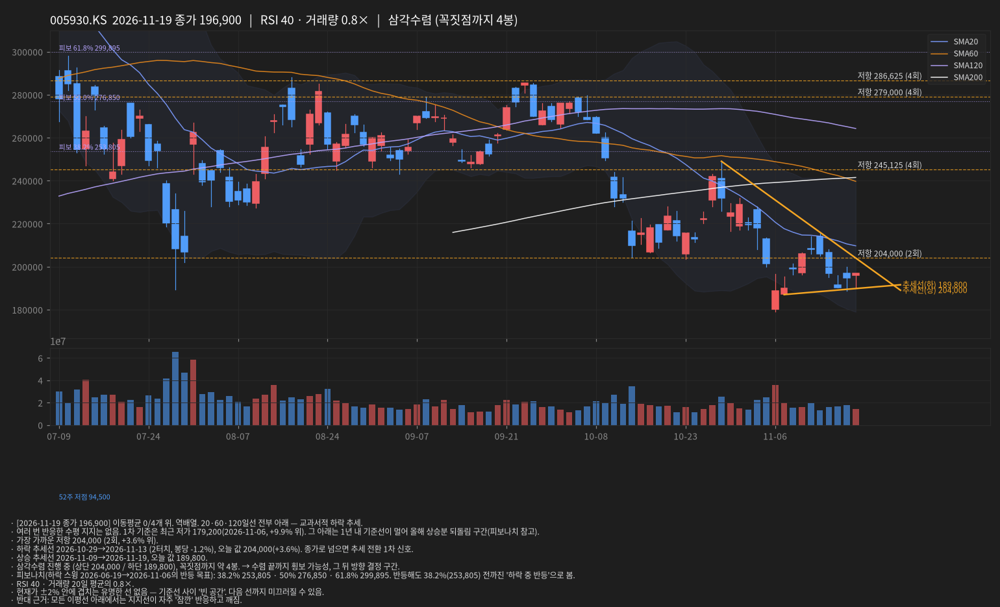
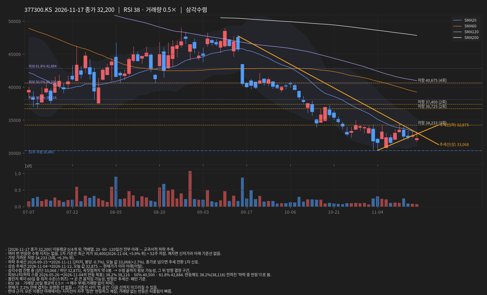

# 선 긋기 리포트 · 2026-11-20 13:21 KST

데이터: 야후 파이낸스 일봉(15분 지연) · 문장은 가능성 표현, 확률 아님

## INFQ · 2026-11-18 종가 7.61

- [2026-11-18 종가 7.61] 이동평균 0/3개 위. 역배열. 20·60·120일선 전부 아래 — 교과서적 하락 추세.
- 여러 번 반응한 수평 지지는 없음. 1차 기준은 최근 저가 7.01(2026-11-05, +8.6% 위) = 52주 저점. 깨지면 신저가라 아래 기준선 없음.
- 가장 가까운 저항 8.41 (2회, +10.6% 위).
- 하락 추세선 2026-09-23→2026-11-09 (2터치, 봉당 -1.1%), 오늘 값 8.72(+14.6%). 종가로 넘으면 추세 전환 1차 신호.
- 상승 추세선 2026-11-05→2026-11-18, 오늘 값 7.38.
- 삼각수렴 진행 중 (상단 8.72 / 하단 7.38), 꼭짓점까지 약 7봉. → 수렴 끝까지 횡보 가능성, 그 뒤 방향 결정 구간.
- 피보나치(하락 스윙 2026-06-02→2026-11-05의 반등 목표): 38.2% 12.26 · 50% 13.88 · 61.8% 15.50. 반등해도 38.2%(12.26) 전까진 '하락 중 반등'으로 봄.
- RSI 37 · 거래량 20일 평균의 0.8×.
- 현재가 ±2% 안에 겹치는 유명한 선 없음 — 기준선 사이 '빈 공간'. 다음 선까지 미끄러질 수 있음.
- 반대 근거: 모든 이평선 아래에서는 지지선이 자주 '잠깐' 반응하고 깨짐.

## 005930.KS · 2026-11-19 종가 196,900

- [2026-11-19 종가 196,900] 이동평균 0/4개 위. 역배열. 20·60·120일선 전부 아래 — 교과서적 하락 추세.
- 여러 번 반응한 수평 지지는 없음. 1차 기준은 최근 저가 179,200(2026-11-06, +9.9% 위). 그 아래는 1년 내 기준선이 멀어 올해 상승분 되돌림 구간(피보나치 참고).
- 가장 가까운 저항 204,000 (2회, +3.6% 위).
- 하락 추세선 2026-10-29→2026-11-13 (2터치, 봉당 -1.2%), 오늘 값 204,000(+3.6%). 종가로 넘으면 추세 전환 1차 신호.
- 상승 추세선 2026-11-09→2026-11-19, 오늘 값 189,800.
- 삼각수렴 진행 중 (상단 204,000 / 하단 189,800), 꼭짓점까지 약 4봉. → 수렴 끝까지 횡보 가능성, 그 뒤 방향 결정 구간.
- 피보나치(하락 스윙 2026-06-19→2026-11-06의 반등 목표): 38.2% 253,805 · 50% 276,850 · 61.8% 299,895. 반등해도 38.2%(253,805) 전까진 '하락 중 반등'으로 봄.
- RSI 40 · 거래량 20일 평균의 0.7×.
- 현재가 ±2% 안에 겹치는 유명한 선 없음 — 기준선 사이 '빈 공간'. 다음 선까지 미끄러질 수 있음.
- 반대 근거: 모든 이평선 아래에서는 지지선이 자주 '잠깐' 반응하고 깨짐.

## 000660.KS · 2026-11-19 종가 1,183,000

- [2026-11-19 종가 1,183,000] 이동평균 0/4개 위. 역배열. 20·60·120일선 전부 아래 — 교과서적 하락 추세.
- 여러 번 반응한 수평 지지는 없음. 1차 기준은 최근 저가 1,089,000(2026-11-06, +8.6% 위). 그 아래는 1년 내 기준선이 멀어 올해 상승분 되돌림 구간(피보나치 참고).
- 가장 가까운 저항 1,323,000 (2회, +11.8% 위).
- 하락 추세선 2026-10-29→2026-11-13 (2터치, 봉당 -1.5%), 오늘 값 1,218,818(+3.0%). 종가로 넘으면 추세 전환 1차 신호.
- 상승 추세선 2026-11-06→2026-11-17, 오늘 값 1,092,857.
- 삼각수렴 진행 중 (상단 1,218,818 / 하단 1,092,857), 꼭짓점까지 약 5봉. → 수렴 끝까지 횡보 가능성, 그 뒤 방향 결정 구간.
- 피보나치(하락 스윙 2026-06-25→2026-11-06의 반등 목표): 38.2% 1,814,036 · 50% 2,038,000 · 61.8% 2,261,964. 반등해도 38.2%(1,814,036) 전까진 '하락 중 반등'으로 봄.
- RSI 41 · 거래량 20일 평균의 0.7×.
- 현재가 ±2% 안에 겹치는 유명한 선 없음 — 기준선 사이 '빈 공간'. 다음 선까지 미끄러질 수 있음.
- 반대 근거: 모든 이평선 아래에서는 지지선이 자주 '잠깐' 반응하고 깨짐.

## 277810.KQ · 2026-11-19 종가 425,500

- [2026-11-19 종가 425,500] 이동평균 2/4개 위. 역배열. 
- 가장 가까운 수평 지지 410,167 (3회 반응, +3.7% 위). 깨지면 다음은 300,500(52주 저점).
- 가장 가까운 저항 469,375 (4회, +10.3% 위).
- 하락 추세선 2026-10-07→2026-11-13 (2터치, 봉당 -0.6%), 오늘 값 391,538(-8.0%). 종가로 넘으면 추세 전환 1차 신호.
- 상승 추세선 2026-11-06→2026-11-17, 오늘 값 344,214.
- 피보나치(하락 스윙 2026-06-02→2026-11-06의 반등 목표): 38.2% 508,499 · 50% 572,750 · 61.8% 637,001. 반등해도 38.2%(508,499) 전까진 '하락 중 반등'으로 봄.
- RSI 62 · 거래량 20일 평균의 2.4×.
- 현재가 ±2% 안에 겹치는 유명한 선 없음 — 기준선 사이 '빈 공간'. 다음 선까지 미끄러질 수 있음.
- 반대 근거: 추세 추종 입장에선 아직 반등 확인 전.

## 259960.KS · 2026-11-19 종가 197,100

- [2026-11-19 종가 197,100] 이동평균 1/4개 위. 역배열. 
- 여러 번 반응한 수평 지지는 없음. 1차 기준은 최근 저가 190,100(2026-11-11, +3.7% 위), 그 아래 52주 저점 178,500.
- 가장 가까운 저항 216,167 (3회, +9.7% 위).
- 하락 추세선 2026-11-09→2026-11-19 (2터치, 봉당 -1.2%), 오늘 값 205,000(+4.0%). 종가로 넘으면 추세 전환 1차 신호.
- 상승 추세선 2026-10-30→2026-11-17, 오늘 값 193,083.
- 삼각수렴 진행 중 (상단 205,000 / 하단 193,083), 꼭짓점까지 약 3봉. → 수렴 끝까지 횡보 가능성, 그 뒤 방향 결정 구간.
- 피보나치(하락 스윙 2026-06-04→2026-10-30의 반등 목표): 38.2% 212,689 · 50% 223,250 · 61.8% 233,811. 반등해도 38.2%(212,689) 전까진 '하락 중 반등'으로 봄.
- RSI 48 · 거래량 20일 평균의 1.1×.
- ★ 합류(아래) 196,400 (-0.4%): SMA20 + 볼린저 중심 — 유명한 선이 겹치는 받침. 한 번 튀어오를 가능성이 높지만 바닥 보장은 아님 → 반등 확인 후 진입.
- 반대 근거: 추세 추종 입장에선 아직 반등 확인 전.

## 103140.KS · 2026-11-19 종가 50,300

- [2026-11-19 종가 50,300] 이동평균 0/4개 위. 역배열. 최근 60/120 데드크로스(6봉 전). 20·60·120일선 전부 아래 — 교과서적 하락 추세.
- 여러 번 반응한 수평 지지는 없음. 1차 기준은 최근 저가 49,200(2026-11-19, +2.2% 위) = 52주 저점. 깨지면 신저가라 아래 기준선 없음.
- 가장 가까운 저항 60,050 (2회, +19.4% 위).
- 하락 추세선 2026-10-06→2026-11-13 (3터치, 봉당 -1.2%), 오늘 값 50,033(-0.5%). 종가로 넘으면 추세 전환 1차 신호.
- 하단 추세선 2026-10-13→2026-11-09, 오늘 값 46,505.
- 하락쐐기 진행 중 (상단 50,033 / 하단 46,505), 꼭짓점까지 약 8봉. → 수렴 끝까지 횡보 가능성, 그 뒤 방향 결정 구간.
- 피보나치(하락 스윙 2026-08-25→2026-11-19의 반등 목표): 38.2% 65,168 · 50% 70,100 · 61.8% 75,032. 반등해도 38.2%(65,168) 전까진 '하락 중 반등'으로 봄.
- RSI 29 과매도 · 거래량 20일 평균의 0.7×.
- 현재가 ±2% 안에 겹치는 유명한 선 없음 — 기준선 사이 '빈 공간'. 다음 선까지 미끄러질 수 있음.
- 반대 근거: RSI 과매도는 하락 추세에서 며칠씩 유지될 수 있음; 모든 이평선 아래에서는 지지선이 자주 '잠깐' 반응하고 깨짐.

## 120110.KS · 2026-11-19 종가 37,200

- [2026-11-19 종가 37,200] 이동평균 0/4개 위. 역배열. 20·60·120일선 전부 아래 — 교과서적 하락 추세.
- 여러 번 반응한 수평 지지는 없음. 1차 기준은 최근 저가 34,000(2026-11-12, +9.4% 위) = 52주 저점. 깨지면 신저가라 아래 기준선 없음.
- 가장 가까운 저항 37,700 (2회, +1.3% 위).
- 하락 추세선 2026-10-06→2026-11-16 (2터치, 봉당 -1.3%), 오늘 값 35,766(-3.9%). 종가로 넘으면 추세 전환 1차 신호.
- 하단 추세선 2026-10-30→2026-11-12, 오늘 값 31,944.
- 피보나치(하락 스윙 2026-06-12→2026-11-12의 반등 목표): 38.2% 51,419 · 50% 56,800 · 61.8% 62,181. 반등해도 38.2%(51,419) 전까진 '하락 중 반등'으로 봄.
- RSI 37 · 거래량 20일 평균의 0.4×.
- 현재가 ±2% 안에 겹치는 유명한 선 없음 — 기준선 사이 '빈 공간'. 다음 선까지 미끄러질 수 있음.
- 반대 근거: 모든 이평선 아래에서는 지지선이 자주 '잠깐' 반응하고 깨짐; 거래량 없는 반등은 되돌림이 빠름.

## 010140.KS · 2026-11-19 종가 16,150

- [2026-11-19 종가 16,150] 이동평균 0/4개 위. 역배열. 20·60·120일선 전부 아래 — 교과서적 하락 추세.
- 가장 가까운 수평 지지 15,290 (2회 반응, +5.6% 위). 깨지면 다음은 15,260(52주 저점).
- 가장 가까운 저항 17,245 (2회, +6.8% 위).
- 하락 추세선 2026-10-06→2026-11-13 (4터치, 봉당 -0.5%), 오늘 값 16,855(+4.4%). 종가로 넘으면 추세 전환 1차 신호.
- 하단 추세선 2026-10-30→2026-11-09, 오늘 값 15,180.
- 하락쐐기 진행 중 (상단 16,855 / 하단 15,180), 꼭짓점까지 약 17봉. → 수렴 끝까지 횡보 가능성, 그 뒤 방향 결정 구간.
- 피보나치(하락 스윙 2026-05-27→2026-11-09의 반등 목표): 38.2% 20,986 · 50% 22,755 · 61.8% 24,524. 반등해도 38.2%(20,986) 전까진 '하락 중 반등'으로 봄.
- RSI 42 · 거래량 20일 평균의 0.5×.
- ★ 합류(위) 16,434 (+1.8%): SMA20 + 볼린저 중심 — 유명한 선이 겹치는 천장. 여기서 막힐 가능성이 높고, 종가로 넘으면 의미가 큼.
- 반대 근거: 모든 이평선 아래에서는 지지선이 자주 '잠깐' 반응하고 깨짐; 거래량 없는 반등은 되돌림이 빠름.

## 294870.KS · 2026-11-19 종가 24,900

- [2026-11-19 종가 24,900] 이동평균 4/4개 위. 정배열. 최근 20/60 골든크로스(7봉 전). 
- 가장 가까운 수평 지지 22,988 (4회 반응, +8.3% 위). 깨지면 다음은 16,900(52주 저점).
- 가장 가까운 저항 25,025 (2회, +0.5% 위).
- 하락 추세선 2026-11-05→2026-11-11 (2터치, 봉당 -0.8%), 오늘 값 23,825(-4.3%). 종가로 넘으면 추세 전환 1차 신호.
- 상승 추세선 2026-10-20→2026-11-17, 오늘 값 24,095.
- 박스권 22,988~25,025 15봉째. 박스 안에서는 횡보 가능성 높고, 상·하단 종가 이탈이 신호.
- 피보나치(상승 스윙 2026-07-14→2026-11-05의 되돌림): 38.2% 22,493 · 50% 21,425 · 61.8% 20,357. 
- RSI 59 · 거래량 20일 평균의 0.4×.
- ★ 합류(위) 25,062 (+0.7%): 수평 저항(2회) + 전고점 — 유명한 선이 겹치는 천장. 여기서 막힐 가능성이 높고, 종가로 넘으면 의미가 큼.
- 반대 근거: 거래량 없는 반등은 되돌림이 빠름.

## 036460.KS · 2026-11-19 종가 38,150

- [2026-11-19 종가 38,150] 이동평균 4/4개 위. 정배열. 
- 가장 가까운 수평 지지 37,950 (3회 반응, +0.5% 위). 깨지면 다음은 31,150(52주 저점).
- 상단 추세선 2026-10-22→2026-11-13 (3터치, 봉당 +0.4%), 오늘 값 39,525(+3.6%). 종가로 넘으면 추세 전환 1차 신호.
- 상승 추세선 2026-09-29→2026-11-10, 오늘 값 36,362.
- 피보나치(상승 스윙 2026-06-26→2026-11-13의 되돌림): 38.2% 36,001 · 50% 35,075 · 61.8% 34,149. 
- RSI 59 · 거래량 20일 평균의 0.5× → 매수 부재(거래량 없이 하락).
- 현재가 ±2% 안에 겹치는 유명한 선 없음 — 기준선 사이 '빈 공간'. 다음 선까지 미끄러질 수 있음.
- 반대 근거: 거래량 없는 반등은 되돌림이 빠름.

## 241560.KS · 2026-11-19 종가 51,800

- [2026-11-19 종가 51,800] 이동평균 1/4개 위. 역배열. 
- 여러 번 반응한 수평 지지는 없음. 1차 기준은 최근 저가 48,850(2026-11-06, +6.0% 위), 그 아래 52주 저점 47,400.
- 가장 가까운 저항 58,150 (2회, +12.3% 위).
- 상단 추세선 2026-10-28→2026-11-10 (3터치, 봉당 +1.1%), 오늘 값 58,572(+13.1%). 종가로 넘으면 추세 전환 1차 신호.
- 상승 추세선 2026-10-30→2026-11-17, 오늘 값 51,250.
- 피보나치(하락 스윙 2026-05-27→2026-10-30의 반등 목표): 38.2% 56,453 · 50% 59,250 · 61.8% 62,047. 반등해도 38.2%(56,453) 전까진 '하락 중 반등'으로 봄.
- RSI 49 · 거래량 20일 평균의 0.9×.
- 현재가 ±2% 안에 겹치는 유명한 선 없음 — 기준선 사이 '빈 공간'. 다음 선까지 미끄러질 수 있음.
- 반대 근거: 추세 추종 입장에선 아직 반등 확인 전.

## 377300.KS · 2026-11-19 종가 34,300

- [2026-11-19 종가 34,300] 이동평균 1/4개 위. 역배열. 
- 가장 가까운 수평 지지 34,233 (3회 반응, +0.2% 위). 깨지면 다음은 30,400(52주 저점).
- 가장 가까운 저항 36,725 (2회, +7.1% 위).
- 하락 추세선 2026-10-06→2026-11-11 (2터치, 봉당 -0.6%), 오늘 값 32,988(-3.8%). 종가로 넘으면 추세 전환 1차 신호.
- 상승 추세선 2026-11-04→2026-11-17, 오늘 값 32,050.
- 피보나치(하락 스윙 2026-06-01→2026-11-04의 반등 목표): 38.2% 37,754 · 50% 40,025 · 61.8% 42,296. 반등해도 38.2%(37,754) 전까진 '하락 중 반등'으로 봄.
- 볼린저 폭이 60일 중 최저 수준(스퀴즈) → 곧 큰 움직임 가능성, 방향은 추세선·패턴 기준.
- RSI 50 · 거래량 20일 평균의 1.1×.
- ★ 합류(위) 34,367 (+0.2%): 수평 지지(3회) + 전고점 — 유명한 선이 겹치는 천장. 여기서 막힐 가능성이 높고, 종가로 넘으면 의미가 큼.
- 반대 근거: 추세 추종 입장에선 아직 반등 확인 전.

## 알림
- [dn] **INFQ** 손절 이탈: 7.61으로 마감해 손절선(8.57) 아래예요. 규칙대로면 단기분 정리 — 다음 장 시작가 확인.
- [ok] **259960.KS** 합류 받침: 196,400까지 −0.4%. 기준 두세 개가 겹친 자리예요 — 반등을 확인하고 판단하세요.
- [up] **103140.KS** 추세선 돌파: 50,300으로 마감해 흐름선(50,033) 위로 올라섰어요. 내일도 위면 1/3 매수 검토.
- [up] **120110.KS** 추세선 돌파: 37,200으로 마감해 흐름선(35,766) 위로 올라섰어요. 내일도 위면 1/3 매수 검토.
- [warn] **010140.KS** 합류 천장: 16,434까지 +1.8%. 넘어서 마감하면 의미가 커요.
- [warn] **294870.KS** 합류 천장: 25,062까지 +0.7%. 넘어서 마감하면 의미가 커요.
- [up] **377300.KS** 추세선 돌파: 34,300으로 마감해 흐름선(32,988) 위로 올라섰어요. 내일도 위면 1/3 매수 검토.
- [warn] **377300.KS** 합류 천장: 34,367까지 +0.2%. 넘어서 마감하면 의미가 커요.

## 급락/급등 원인 분해
- [2026-11-18] INFQ +0.9% = 지수 -0.7%(β3.0×^GSPC -0.2%) + 업종 -3.7%(양자 피어 -3.9%) + 종목 고유 +5.3%. 주원인: 종목 고유 · 거래량 0.8× → 보통. 종목 고유 뉴스/공시를 먼저 확인.
- [2026-11-19] 005930.KS +1.1% = 지수 +1.8%(β1.3×^KS11 +1.4%) + 업종 -1.1%(반도체 피어 +0.3%) + 종목 고유 +0.4%. 주원인: 지수 · 거래량 0.7× → 보통. 시장 전체 움직임 — 종목 판단과 분리.
- [2026-11-19] 000660.KS +3.4% = 지수 +2.3%(β1.6×^KS11 +1.4%) + 업종 -2.2%(반도체 피어 -0.8%) + 종목 고유 +3.3%. 주원인: 종목 고유 · 거래량 0.7× → 보통. 종목 고유 뉴스/공시를 먼저 확인.
- [2026-10-19] 013030.KQ -0.5% = 지수 +0.9%(β0.5×^KQ11 +1.8%) + 업종 +0.0% + 종목 고유 -1.4%. 주원인: 종목 고유 · 거래량 0.5× → 매수 부재(거래량 없이 하락).
- [2026-10-19] 054950.KQ -0.2% = 지수 +0.3%(β0.2×^KQ11 +1.8%) + 업종 +0.0% + 종목 고유 -0.6%. 주원인: 종목 고유 · 거래량 0.9× → 보통.
- [2026-10-19] 236200.KQ +1.2% = 지수 +1.2%(β0.7×^KQ11 +1.8%) + 업종 +0.0% + 종목 고유 +0.0%. 주원인: 지수 · 거래량 0.5× → 보통. 시장 전체 움직임 — 종목 판단과 분리.
- [2026-10-19] 036800.KQ -1.4% = 지수 +0.1%(β0.1×^KQ11 +1.8%) + 업종 +0.0% + 종목 고유 -1.5%. 주원인: 종목 고유 · 거래량 0.3× → 매수 부재(거래량 없이 하락).
- [2026-10-19] 200670.KQ +2.2% = 지수 +1.1%(β0.6×^KQ11 +1.8%) + 업종 +0.0% + 종목 고유 +1.1%. 주원인: 지수 · 거래량 0.4× → 보통. 시장 전체 움직임 — 종목 판단과 분리.
- [2026-10-19] 015230.KS +1.1% = 지수 +0.3%(β0.2×^KS11 +1.8%) + 업종 +0.0% + 종목 고유 +0.8%. 주원인: 종목 고유 · 거래량 1.0× → 보통.
- [2026-10-19] 044960.KQ +0.3% = 지수 +0.3%(β0.2×^KQ11 +1.8%) + 업종 +0.0% + 종목 고유 +0.0%. 주원인: 지수 · 거래량 0.4× → 보통. 시장 전체 움직임 — 종목 판단과 분리.

## 판단 보드
- **INFQ** [exit] 손절선 8.57 아래 마감 — 규칙대로면 단기분 정리
- **005930.KS** [exit] 무효선 204,500 아래 — 관심 해제 검토
- **000660.KS** [wait] 기다림 — 흐름선까지 +3.0%
- **277810.KQ** [enter] 하락 흐름 끊김 — 종가 425,500 ≥ 흐름선 391,538 · 2일째
- **259960.KS** [wait] 기다림 — 바닥 후보 196,400 (-0.4%) 위. 반등 확인 전엔 사지 않기
- **103140.KS** [enter] 하락 흐름 끊김 — 종가 50,300 ≥ 흐름선 50,033 · 내일도 위면 1/3 검토
- **120110.KS** [enter] 하락 흐름 끊김 — 종가 37,200 ≥ 흐름선 35,766 · 내일도 위면 1/3 검토
- **010140.KS** [wait] 기다림 — 막힐 자리 16,434 (+1.8%) 아래. 넘어서 마감하면 다시 판단
- **294870.KS** [enter] 하락 흐름 끊김 — 종가 24,900 ≥ 흐름선 23,825 · 2일째 · 바로 위 막힐 자리 25,062 (+0.7%)
- **036460.KS** [wait] 기다림 — 흐름선까지 +3.6%
- **241560.KS** [wait] 기다림 — 흐름선까지 +13.1%
- **377300.KS** [enter] 하락 흐름 끊김 — 종가 34,300 ≥ 흐름선 32,988 · 내일도 위면 1/3 검토 · 바로 위 막힐 자리 34,367 (+0.2%)
