# 선 긋기 리포트 · 2026-11-11 00:32 KST

데이터: 야후 파이낸스 일봉(15분 지연) · 문장은 가능성 표현, 확률 아님

## INFQ · 2026-11-09 종가 9.66
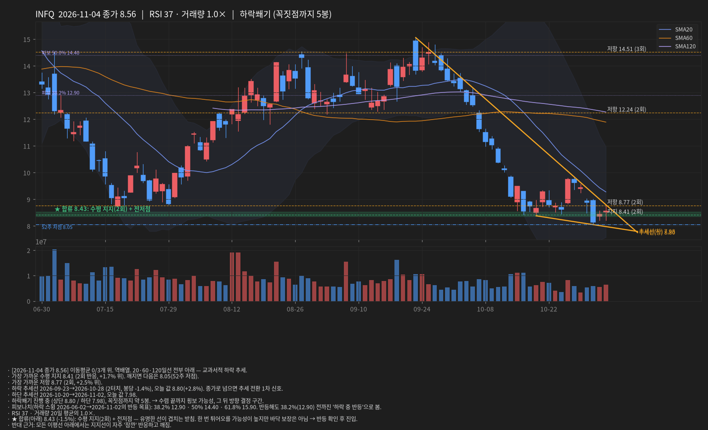
- [2026-11-09 종가 9.66] 이동평균 1/3개 위. 역배열. 
- 가장 가까운 수평 지지 8.77 (2회 반응, +10.1% 위). 깨지면 다음은 7.01(52주 저점).
- 가장 가까운 저항 12.24 (2회, +26.8% 위).
- 하락 추세선 2026-10-28→2026-11-09 (2터치, 봉당 -0.0%), 오늘 값 9.83(+1.8%). 종가로 넘으면 추세 전환 1차 신호.
- 하단 추세선 2026-10-20→2026-11-05, 오늘 값 6.78.
- 피보나치(하락 스윙 2026-06-02→2026-11-05의 반등 목표): 38.2% 12.26 · 50% 13.88 · 61.8% 15.50. 반등해도 38.2%(12.26) 전까진 '하락 중 반등'으로 봄.
- RSI 49 · 거래량 20일 평균의 1.1×.
- ★ 합류(위) 9.84 (+1.8%): 하락 추세선 + 전고점 — 유명한 선이 겹치는 천장. 여기서 막힐 가능성이 높고, 종가로 넘으면 의미가 큼.
- 반대 근거: 추세 추종 입장에선 아직 반등 확인 전.

## 005930.KS · 2026-11-10 종가 198,900
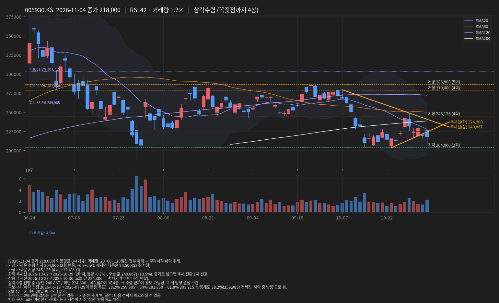
- [2026-11-10 종가 198,900] 이동평균 0/4개 위. 역배열. 20·60·120일선 전부 아래 — 교과서적 하락 추세.
- 여러 번 반응한 수평 지지는 없음. 1차 기준은 최근 저가 179,200(2026-11-06, +11.0% 위). 그 아래는 1년 내 기준선이 멀어 올해 상승분 되돌림 구간(피보나치 참고).
- 가장 가까운 저항 204,000 (2회, +2.6% 위).
- 하락 추세선 2026-10-29→2026-11-04 (2터치, 봉당 -2.1%), 오늘 값 207,000(+4.1%). 종가로 넘으면 추세 전환 1차 신호.
- 하단 추세선 2026-10-15→2026-11-06, 오늘 값 176,038.
- 하락쐐기 진행 중 (상단 207,000 / 하단 176,038), 꼭짓점까지 약 8봉. → 수렴 끝까지 횡보 가능성, 그 뒤 방향 결정 구간.
- 피보나치(하락 스윙 2026-06-19→2026-11-06의 반등 목표): 38.2% 253,805 · 50% 276,850 · 61.8% 299,895. 반등해도 38.2%(253,805) 전까진 '하락 중 반등'으로 봄.
- RSI 38 · 거래량 20일 평균의 0.8×.
- 현재가 ±2% 안에 겹치는 유명한 선 없음 — 기준선 사이 '빈 공간'. 다음 선까지 미끄러질 수 있음.
- 반대 근거: 모든 이평선 아래에서는 지지선이 자주 '잠깐' 반응하고 깨짐.

## 000660.KS · 2026-11-10 종가 1,212,000
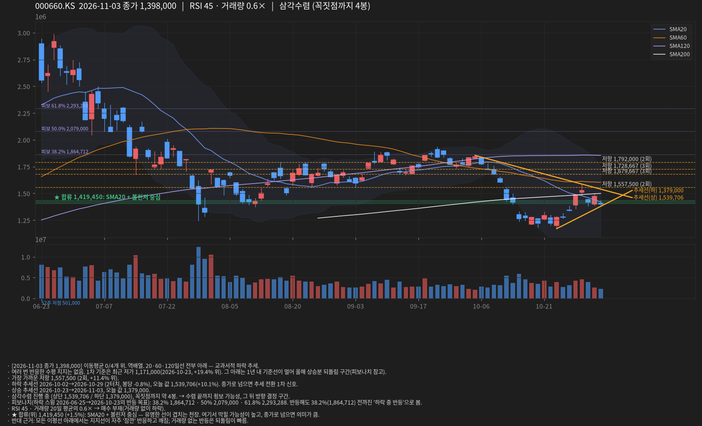
- [2026-11-10 종가 1,212,000] 이동평균 0/4개 위. 역배열. 20·60·120일선 전부 아래 — 교과서적 하락 추세.
- 여러 번 반응한 수평 지지는 없음. 1차 기준은 최근 저가 1,089,000(2026-11-06, +11.3% 위). 그 아래는 1년 내 기준선이 멀어 올해 상승분 되돌림 구간(피보나치 참고).
- 가장 가까운 저항 1,557,500 (2회, +28.5% 위).
- 하락 추세선 2026-10-29→2026-11-04 (2터치, 봉당 -1.7%), 오늘 값 1,365,000(+12.6%). 종가로 넘으면 추세 전환 1차 신호.
- 하단 추세선 2026-10-20→2026-11-06, 오늘 값 1,074,538.
- 하락쐐기 진행 중 (상단 1,365,000 / 하단 1,074,538), 꼭짓점까지 약 14봉. → 수렴 끝까지 횡보 가능성, 그 뒤 방향 결정 구간.
- 피보나치(하락 스윙 2026-06-25→2026-11-06의 반등 목표): 38.2% 1,814,036 · 50% 2,038,000 · 61.8% 2,261,964. 반등해도 38.2%(1,814,036) 전까진 '하락 중 반등'으로 봄.
- RSI 39 · 거래량 20일 평균의 0.8×.
- 현재가 ±2% 안에 겹치는 유명한 선 없음 — 기준선 사이 '빈 공간'. 다음 선까지 미끄러질 수 있음.
- 반대 근거: 모든 이평선 아래에서는 지지선이 자주 '잠깐' 반응하고 깨짐.

## 277810.KQ · 2026-11-10 종가 325,000
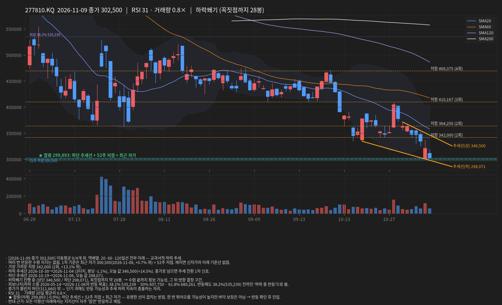
- [2026-11-10 종가 325,000] 이동평균 0/4개 위. 역배열. 20·60·120일선 전부 아래 — 교과서적 하락 추세.
- 여러 번 반응한 수평 지지는 없음. 1차 기준은 최근 저가 300,500(2026-11-06, +8.2% 위) = 52주 저점. 깨지면 신저가라 아래 기준선 없음.
- 가장 가까운 저항 342,000 (2회, +5.2% 위).
- 하락 추세선 2026-10-07→2026-10-28 (2터치, 봉당 -0.9%), 오늘 값 369,786(+13.8%). 종가로 넘으면 추세 전환 1차 신호.
- 하단 추세선 2026-10-19→2026-11-06, 오늘 값 295,643.
- 하락쐐기 진행 중 (상단 369,786 / 하단 295,643), 꼭짓점까지 약 38봉. → 수렴 끝까지 횡보 가능성, 그 뒤 방향 결정 구간.
- 피보나치(하락 스윙 2026-05-15→2026-11-06의 반등 목표): 38.2% 535,239 · 50% 607,750 · 61.8% 680,261. 반등해도 38.2%(535,239) 전까진 '하락 중 반등'으로 봄.
- RSI 38 · 거래량 20일 평균의 0.8×.
- 현재가 ±2% 안에 겹치는 유명한 선 없음 — 기준선 사이 '빈 공간'. 다음 선까지 미끄러질 수 있음.
- 반대 근거: 모든 이평선 아래에서는 지지선이 자주 '잠깐' 반응하고 깨짐.

## 259960.KS · 2026-11-10 종가 216,500
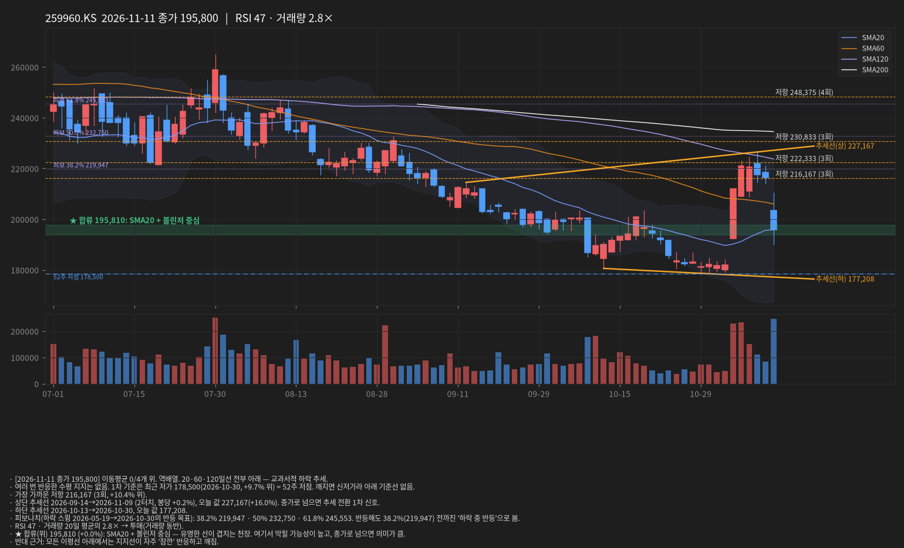
- [2026-11-10 종가 216,500] 이동평균 2/4개 위. 역배열. 
- 가장 가까운 수평 지지 216,167 (3회 반응, +0.2% 위). 깨지면 다음은 178,500(52주 저점).
- 가장 가까운 저항 222,333 (3회, +2.7% 위).
- 하락 추세선 2026-09-23→2026-10-20 (3터치, 봉당 -0.0%), 오늘 값 203,000(-6.2%). 종가로 넘으면 추세 전환 1차 신호.
- 상승 추세선 2026-11-03→2026-11-10, 오늘 값 214,000.
- 피보나치(하락 스윙 2026-05-15→2026-10-30의 반등 목표): 38.2% 223,576 · 50% 237,500 · 61.8% 251,424. 반등해도 38.2%(223,576) 전까진 '하락 중 반등'으로 봄.
- RSI 65 · 거래량 20일 평균의 0.9×.
- 현재가 ±2% 안에 겹치는 유명한 선 없음 — 기준선 사이 '빈 공간'. 다음 선까지 미끄러질 수 있음.
- 반대 근거: 추세 추종 입장에선 아직 반등 확인 전.

## 083650.KQ · 2026-11-10 종가 36,800
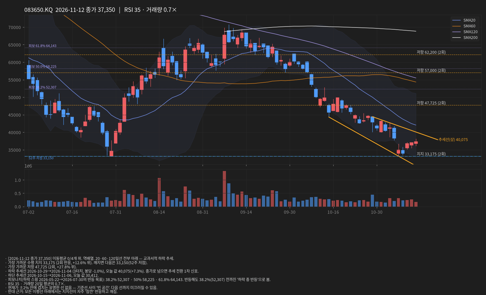
- [2026-11-10 종가 36,800] 이동평균 0/4개 위. 역배열. 20·60·120일선 전부 아래 — 교과서적 하락 추세.
- 여러 번 반응한 수평 지지는 없음. 1차 기준은 최근 저가 33,200(2026-11-06, +10.8% 위) = 52주 저점. 깨지면 신저가라 아래 기준선 없음.
- 가장 가까운 저항 47,725 (2회, +29.7% 위).
- 하락 추세선 2026-10-07→2026-10-27 (2터치, 봉당 -1.9%), 오늘 값 33,938(-7.8%). 종가로 넘으면 추세 전환 1차 신호.
- 하단 추세선 2026-10-15→2026-11-06, 오늘 값 31,806.
- 피보나치(하락 스윙 2026-05-15→2026-07-30의 반등 목표): 38.2% 53,492 · 50% 59,775 · 61.8% 66,058. 반등해도 38.2%(53,492) 전까진 '하락 중 반등'으로 봄.
- RSI 33 · 거래량 20일 평균의 1.0×.
- 현재가 ±2% 안에 겹치는 유명한 선 없음 — 기준선 사이 '빈 공간'. 다음 선까지 미끄러질 수 있음.
- 반대 근거: 모든 이평선 아래에서는 지지선이 자주 '잠깐' 반응하고 깨짐.

## 017960.KS · 2026-11-10 종가 14,270
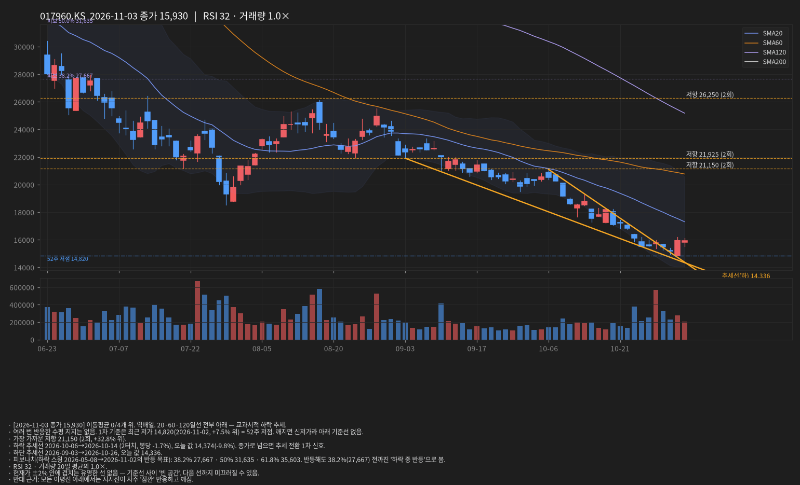
- [2026-11-10 종가 14,270] 이동평균 0/4개 위. 역배열. 20·60·120일선 전부 아래 — 교과서적 하락 추세.
- 여러 번 반응한 수평 지지는 없음. 1차 기준은 최근 저가 13,720(2026-11-09, +4.0% 위) = 52주 저점. 깨지면 신저가라 아래 기준선 없음.
- 가장 가까운 저항 21,150 (2회, +48.2% 위).
- 하락 추세선 2026-10-06→2026-11-04 (2터치, 봉당 -1.1%), 오늘 값 15,448(+8.3%). 종가로 넘으면 추세 전환 1차 신호.
- 하단 추세선 2026-09-10→2026-11-02, 오늘 값 13,687.
- 하락쐐기 진행 중 (상단 15,448 / 하단 13,687), 꼭짓점까지 약 38봉. → 수렴 끝까지 횡보 가능성, 그 뒤 방향 결정 구간.
- 피보나치(하락 스윙 2026-05-15→2026-11-09의 반등 목표): 38.2% 24,160 · 50% 27,385 · 61.8% 30,610. 반등해도 38.2%(24,160) 전까진 '하락 중 반등'으로 봄.
- RSI 29 과매도 · 거래량 20일 평균의 0.9×.
- 현재가 ±2% 안에 겹치는 유명한 선 없음 — 기준선 사이 '빈 공간'. 다음 선까지 미끄러질 수 있음.
- 반대 근거: RSI 과매도는 하락 추세에서 며칠씩 유지될 수 있음; 모든 이평선 아래에서는 지지선이 자주 '잠깐' 반응하고 깨짐.

## 102710.KQ · 2026-11-10 종가 39,000
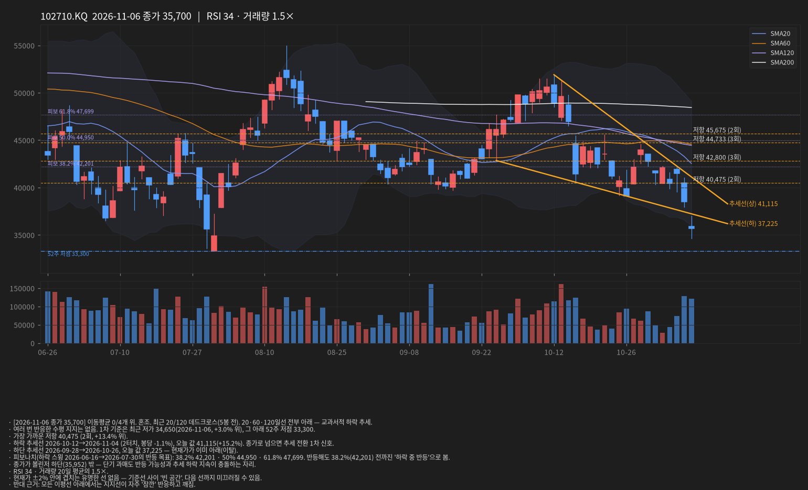
- [2026-11-10 종가 39,000] 이동평균 0/4개 위. 역배열. 최근 20/120 데드크로스(7봉 전). 20·60·120일선 전부 아래 — 교과서적 하락 추세.
- 여러 번 반응한 수평 지지는 없음. 1차 기준은 최근 저가 34,600(2026-11-09, +12.7% 위), 그 아래 52주 저점 33,300.
- 가장 가까운 저항 40,475 (2회, +3.8% 위).
- 하락 추세선 2026-10-12→2026-11-04 (2터치, 봉당 -1.1%), 오늘 값 39,979(+2.5%). 종가로 넘으면 추세 전환 1차 신호.
- 하단 추세선 2026-09-28→2026-10-26, 오늘 값 36,808.
- 하락쐐기 진행 중 (상단 39,979 / 하단 36,808), 꼭짓점까지 약 9봉. → 수렴 끝까지 횡보 가능성, 그 뒤 방향 결정 구간.
- 피보나치(하락 스윙 2026-06-16→2026-07-30의 반등 목표): 38.2% 42,201 · 50% 44,950 · 61.8% 47,699. 반등해도 38.2%(42,201) 전까진 '하락 중 반등'으로 봄.
- RSI 43 · 거래량 20일 평균의 0.7×.
- 현재가 ±2% 안에 겹치는 유명한 선 없음 — 기준선 사이 '빈 공간'. 다음 선까지 미끄러질 수 있음.
- 반대 근거: 모든 이평선 아래에서는 지지선이 자주 '잠깐' 반응하고 깨짐; 거래량 없는 반등은 되돌림이 빠름.

## 120110.KS · 2026-11-10 종가 38,500
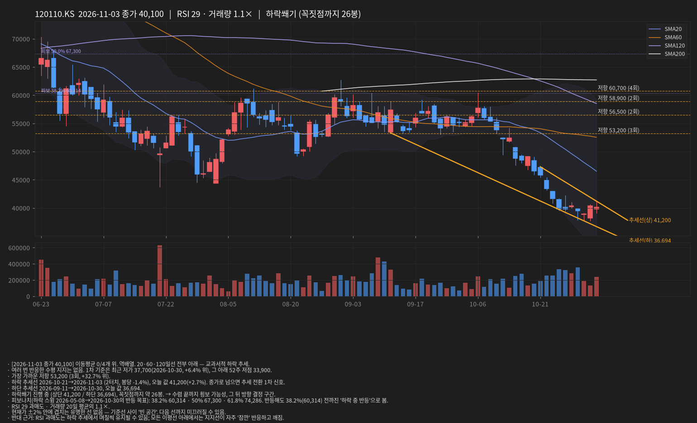
- [2026-11-10 종가 38,500] 이동평균 0/4개 위. 역배열. 20·60·120일선 전부 아래 — 교과서적 하락 추세.
- 가장 가까운 수평 지지 37,700 (2회 반응, +2.1% 위). 깨지면 다음은 34,600(52주 저점).
- 가장 가까운 저항 53,200 (3회, +38.2% 위).
- 하락 추세선 2026-10-06→2026-11-05 (2터치, 봉당 -1.4%), 오늘 값 40,229(+4.5%). 종가로 넘으면 추세 전환 1차 신호.
- 하단 추세선 2026-09-11→2026-10-30, 오늘 값 34,177.
- 하락쐐기 진행 중 (상단 40,229 / 하단 34,177), 꼭짓점까지 약 18봉. → 수렴 끝까지 횡보 가능성, 그 뒤 방향 결정 구간.
- 피보나치(하락 스윙 2026-05-15→2026-11-09의 반등 목표): 38.2% 56,459 · 50% 62,825 · 61.8% 69,191. 반등해도 38.2%(56,459) 전까진 '하락 중 반등'으로 봄.
- RSI 34 · 거래량 20일 평균의 0.7×.
- 현재가 ±2% 안에 겹치는 유명한 선 없음 — 기준선 사이 '빈 공간'. 다음 선까지 미끄러질 수 있음.
- 반대 근거: 모든 이평선 아래에서는 지지선이 자주 '잠깐' 반응하고 깨짐.

## 489790.KS · 2026-11-10 종가 43,900
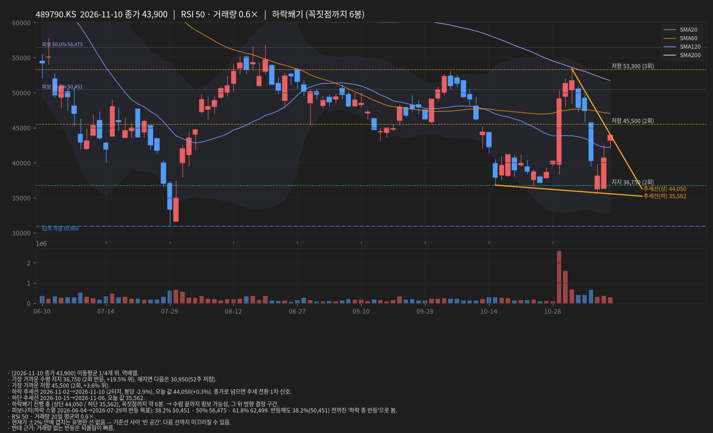
- [2026-11-10 종가 43,900] 이동평균 1/4개 위. 역배열. 
- 가장 가까운 수평 지지 36,750 (2회 반응, +19.5% 위). 깨지면 다음은 30,950(52주 저점).
- 가장 가까운 저항 45,500 (2회, +3.6% 위).
- 하락 추세선 2026-11-02→2026-11-10 (2터치, 봉당 -2.9%), 오늘 값 44,050(+0.3%). 종가로 넘으면 추세 전환 1차 신호.
- 하단 추세선 2026-10-15→2026-11-06, 오늘 값 35,562.
- 하락쐐기 진행 중 (상단 44,050 / 하단 35,562), 꼭짓점까지 약 6봉. → 수렴 끝까지 횡보 가능성, 그 뒤 방향 결정 구간.
- 피보나치(하락 스윙 2026-06-04→2026-07-29의 반등 목표): 38.2% 50,451 · 50% 56,475 · 61.8% 62,499. 반등해도 38.2%(50,451) 전까진 '하락 중 반등'으로 봄.
- RSI 50 · 거래량 20일 평균의 0.6×.
- 현재가 ±2% 안에 겹치는 유명한 선 없음 — 기준선 사이 '빈 공간'. 다음 선까지 미끄러질 수 있음.
- 반대 근거: 거래량 없는 반등은 되돌림이 빠름.

## 010140.KS · 2026-11-10 종가 16,450
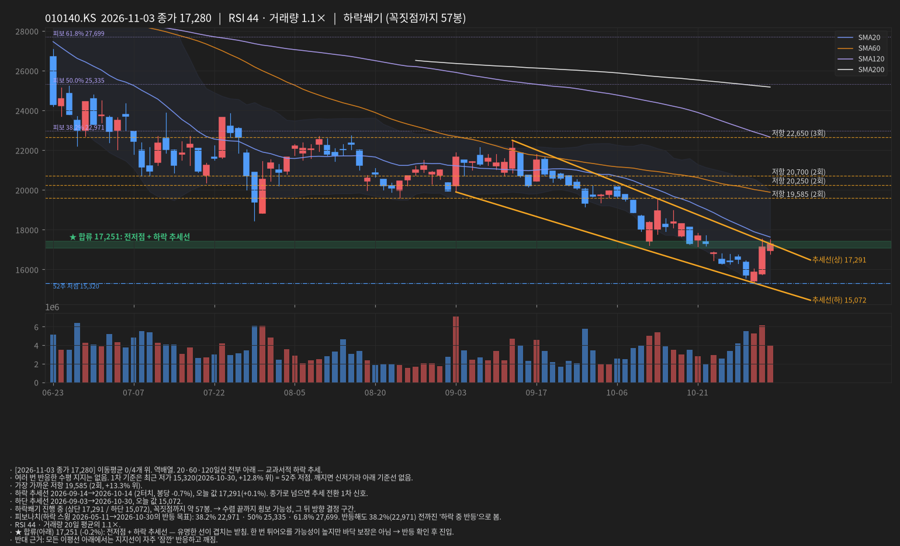
- [2026-11-10 종가 16,450] 이동평균 0/4개 위. 역배열. 20·60·120일선 전부 아래 — 교과서적 하락 추세.
- 여러 번 반응한 수평 지지는 없음. 1차 기준은 최근 저가 15,260(2026-11-09, +7.8% 위) = 52주 저점. 깨지면 신저가라 아래 기준선 없음.
- 가장 가까운 저항 19,585 (2회, +19.1% 위).
- 하락 추세선 2026-10-06→2026-11-04 (3터치, 봉당 -0.5%), 오늘 값 17,630(+7.2%). 종가로 넘으면 추세 전환 1차 신호.
- 하단 추세선 2026-10-13→2026-10-30, 오늘 값 14,302.
- 피보나치(하락 스윙 2026-05-26→2026-11-09의 반등 목표): 38.2% 21,254 · 50% 23,105 · 61.8% 24,956. 반등해도 38.2%(21,254) 전까진 '하락 중 반등'으로 봄.
- RSI 42 · 거래량 20일 평균의 1.2×.
- 현재가 ±2% 안에 겹치는 유명한 선 없음 — 기준선 사이 '빈 공간'. 다음 선까지 미끄러질 수 있음.
- 반대 근거: 모든 이평선 아래에서는 지지선이 자주 '잠깐' 반응하고 깨짐.

## 257720.KQ · 2026-11-10 종가 26,650
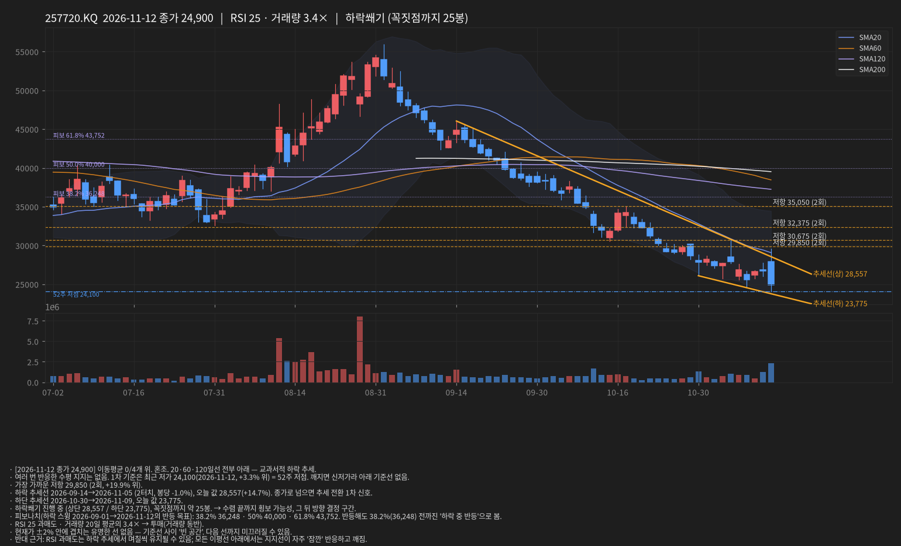
- [2026-11-10 종가 26,650] 이동평균 0/4개 위. 혼조. 20·60·120일선 전부 아래 — 교과서적 하락 추세.
- 여러 번 반응한 수평 지지는 없음. 1차 기준은 최근 저가 24,550(2026-11-09, +8.6% 위) = 52주 저점. 깨지면 신저가라 아래 기준선 없음.
- 가장 가까운 저항 29,850 (2회, +12.0% 위).
- 하락 추세선 2026-09-14→2026-11-05 (2터치, 봉당 -1.0%), 오늘 값 29,454(+10.5%). 종가로 넘으면 추세 전환 1차 신호.
- 하단 추세선 2026-10-15→2026-10-30, 오늘 값 23,268.
- 하락쐐기 모양이지만 꼭짓점이 멀어(60봉 넘게) 아직 신호로 보기 어려움.
- 피보나치(하락 스윙 2026-09-01→2026-11-09의 반등 목표): 38.2% 36,526 · 50% 40,225 · 61.8% 43,924. 반등해도 38.2%(36,526) 전까진 '하락 중 반등'으로 봄.
- RSI 29 과매도 · 거래량 20일 평균의 0.6×.
- 현재가 ±2% 안에 겹치는 유명한 선 없음 — 기준선 사이 '빈 공간'. 다음 선까지 미끄러질 수 있음.
- 반대 근거: RSI 과매도는 하락 추세에서 며칠씩 유지될 수 있음; 모든 이평선 아래에서는 지지선이 자주 '잠깐' 반응하고 깨짐; 거래량 없는 반등은 되돌림이 빠름.

## 알림
- [warn] **INFQ** 합류 천장: 9.84까지 +1.8%. 넘어서 마감하면 의미가 커요.
- [up] **INFQ** 진입 조건: 9.66으로 마감해 9.33 위예요. 계획대로 다음 차수를 검토하세요.
- [up] **083650.KQ** 추세선 돌파: 36,800으로 마감해 흐름선(33,938) 위로 올라섰어요. 내일도 위면 1/3 매수 검토.

## 급락/급등 원인 분해
- [2026-11-09] INFQ +8.7% = 지수 +7.0%(β3.0×^GSPC +2.3%) + 업종 +6.4%(양자 피어 +8.7%) + 종목 고유 -4.8%. 주원인: 지수 · 거래량 1.1× → 보통. 시장 전체 움직임 — 종목 판단과 분리.
- [2026-11-10] 005930.KS +4.7% = 지수 +5.9%(β1.3×^KS11 +4.4%) + 업종 +2.7%(반도체 피어 +7.1%) + 종목 고유 -3.8%. 주원인: 지수 · 거래량 0.8× → 보통. 시장 전체 움직임 — 종목 판단과 분리.
- [2026-11-10] 000660.KS +6.7% = 지수 +7.2%(β1.6×^KS11 +4.4%) + 업종 +1.7%(반도체 피어 +6.1%) + 종목 고유 -2.3%. 주원인: 지수 · 거래량 0.8× → 보통. 시장 전체 움직임 — 종목 판단과 분리.
- [2026-10-19] 013030.KQ -0.5% = 지수 +0.9%(β0.5×^KQ11 +1.8%) + 업종 +0.0% + 종목 고유 -1.4%. 주원인: 종목 고유 · 거래량 0.5× → 매수 부재(거래량 없이 하락).
- [2026-10-19] 054950.KQ -0.2% = 지수 +0.3%(β0.2×^KQ11 +1.8%) + 업종 +0.0% + 종목 고유 -0.6%. 주원인: 종목 고유 · 거래량 0.9× → 보통.
- [2026-10-19] 236200.KQ +1.2% = 지수 +1.2%(β0.7×^KQ11 +1.8%) + 업종 +0.0% + 종목 고유 +0.0%. 주원인: 지수 · 거래량 0.5× → 보통. 시장 전체 움직임 — 종목 판단과 분리.
- [2026-10-19] 036800.KQ -1.4% = 지수 +0.1%(β0.1×^KQ11 +1.8%) + 업종 +0.0% + 종목 고유 -1.5%. 주원인: 종목 고유 · 거래량 0.3× → 매수 부재(거래량 없이 하락).
- [2026-10-19] 200670.KQ +2.2% = 지수 +1.1%(β0.6×^KQ11 +1.8%) + 업종 +0.0% + 종목 고유 +1.1%. 주원인: 지수 · 거래량 0.4× → 보통. 시장 전체 움직임 — 종목 판단과 분리.
- [2026-10-19] 015230.KS +1.1% = 지수 +0.3%(β0.2×^KS11 +1.8%) + 업종 +0.0% + 종목 고유 +0.8%. 주원인: 종목 고유 · 거래량 1.0× → 보통.
- [2026-10-19] 044960.KQ +0.3% = 지수 +0.3%(β0.2×^KQ11 +1.8%) + 업종 +0.0% + 종목 고유 +0.0%. 주원인: 지수 · 거래량 0.4× → 보통. 시장 전체 움직임 — 종목 판단과 분리.

## 판단 보드
- **INFQ** [target] 9.33 위 마감 — 다음 차수 검토
- **005930.KS** [exit] 무효선 204,500 아래 — 관심 해제 검토
- **000660.KS** [wait] 기다림 — 흐름선까지 +12.6%
- **277810.KQ** [wait] 기다림 — 흐름선까지 +13.8%
- **259960.KS** [enter] 하락 흐름 끊김 — 종가 216,500 ≥ 흐름선 203,000 · 5일째
- **083650.KQ** [enter] 하락 흐름 끊김 — 종가 36,800 ≥ 흐름선 33,938 · 내일도 위면 1/3 검토
- **017960.KS** [wait] 기다림 — 많이 팔린 상태(RSI 29), 바닥 후보는 없음. 거래량 늘며 오르는지 보기
- **102710.KQ** [wait] 기다림 — 흐름선까지 +2.5%
- **120110.KS** [wait] 기다림 — 흐름선까지 +4.5%
- **489790.KS** [wait] 기다림 — 흐름선까지 +0.3%
- **010140.KS** [wait] 기다림 — 흐름선까지 +7.2%
- **257720.KQ** [wait] 기다림 — 많이 팔린 상태(RSI 29), 바닥 후보는 없음. 거래량 늘며 오르는지 보기
